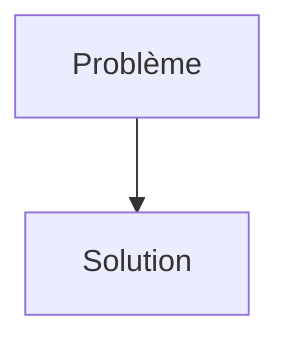
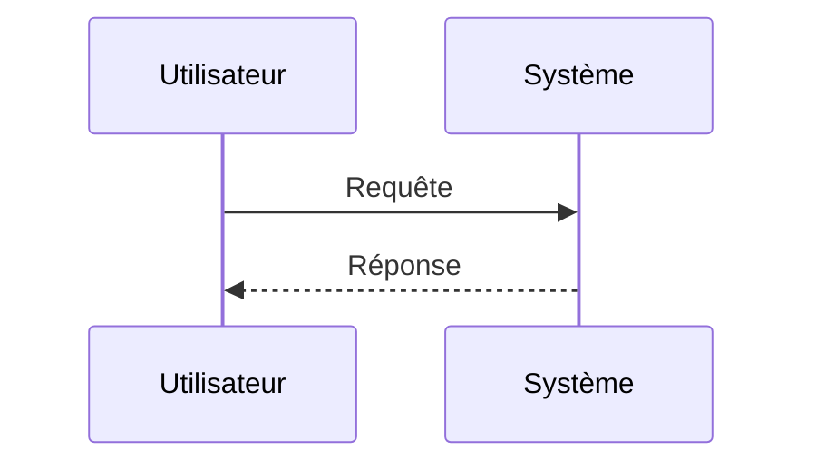

<!-- markdownlint-disable MD009 MD010 MD013 MD022 MD028 MD032 MD033 MD034 MD036 MD037 MD039 MD041 MD058 MD060 -->
<!-- markdownlint-disable MD033 MD041 -->

[🇬🇧 English Version](./README.md)

# AgentWall

> **Résumé exécutif :** Firewall pour Agents Autonomes via API

---

## 1. Aperçu visuel & Effet Wahou

## 2. La thèse contrariante (Peter Thiel Style)

- **La croyance populaire :** [Ce que la majorité pense sur ce marché]
- **La vérité cachée :** [La réalité non intuitive exploitée par cette startup]

## 3. Le problème & La cible

- **Modèle économique :** B2B / M2M
- **Cible précise :** Entreprises déployant des flottes d'agents IA autonomes, fournisseurs de plateformes LLM (OpenAI, Anthropic) et équipes DevSecOps.
- **La douleur urgente :** Les agents IA autonomes interagissent de plus en plus avec des API d'entreprise, exécutant des actions en chaîne (RPA 2.0). Les firewalls traditionnels (WAF) ou les gestions d'API (API Gateways) ne savent pas distinguer une requête d'un agent malveillant ou halluciné d'une requête légitime. Un agent compromis (Prompt Injection) peut exfiltrer des données ou déclencher des transactions destructrices sans être détecté par les règles de sécurité statiques.

## 4. Architecture technique & Plomberie

## 5. Modèle économique & Viabilité financière

| Métrique                        | Valeur                                                          |
| ------------------------------- | --------------------------------------------------------------- |
| **Structure de prix**           | [Prix / Modèle d'abonnement / Commission]                       |
| **Objectif 12 mois**            | [Nombre exact de clients/utilisateurs/transactions nécessaires] |
| **Calcul du CA (Target 100k€)** | [Formule mathématique exacte]                                   |
| **Marge brute estimée**         | [Marge en %]                                                    |

## 6. Moteur de distribution & Fossé défensif (Moat)

- **Stratégie d'acquisition :** [Viralité B2C, réseau C2C, acquisition B2B directe, adhésion dev M2M]
- **Moat (Barrière à l'entrée) :** Les WAF actuels cherchent des signatures (SQLi, XSS) ou des anomalies de volume. Une attaque par agent IA ressemble à du trafic parfaitement légitime au niveau syntaxique (JSON, headers valides), seule l'intention logique et le contexte sémantique sont altérés. Il faut un moteur d'inférence sémantique ultra-rapide (faible latence) directement au niveau de l'API Gateway.

## 7. Grille d'évaluation détaillée

| Critère                               | Score VC (/100) | Score Terrain (/100) |
| ------------------------------------- | --------------- | -------------------- |
| **Thèse & Monopole / Urgence**        | -- / 25         | -- / 25              |
| **Moat / Résistance aux LLM natifs**  | -- / 25         | -- / 25              |
| **Scalabilité / Friction d'adoption** | -- / 25         | -- / 25              |
| **Unit Economics / ROI direct**       | -- / 25         | -- / 25              |
| **TOTAL**                             | **-- / 100**    | **-- / 100**         |

> **Verdict VC :** En attente d'évaluation.
>
> **Verdict Terrain :** En attente d'évaluation.
