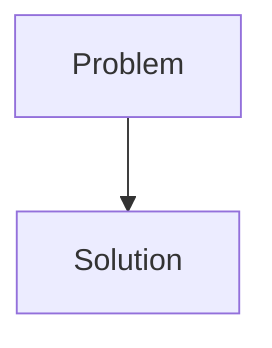
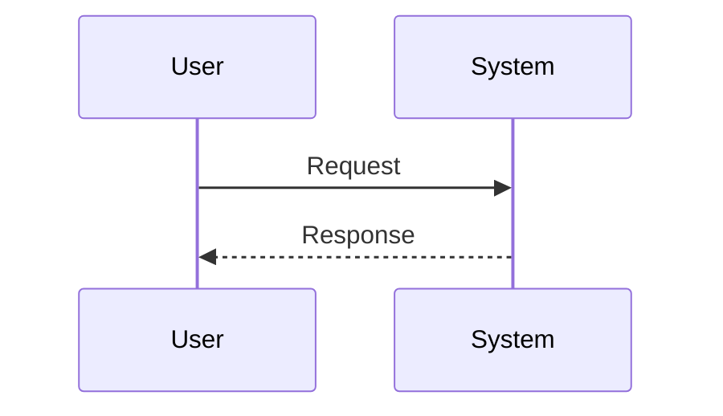

<!-- markdownlint-disable MD009 MD010 MD013 MD022 MD028 MD032 MD033 MD034 MD036 MD037 MD039 MD041 MD058 MD060 -->
<!-- markdownlint-disable MD033 MD041 -->

[🇫🇷 Version Française](./README.fr.md)

# AgentWall

> **Executive Summary:** Firewall for Autonomous Agents via API

---

## 1. Visual Overview & Wow Effect

## 2. Contrarian Thesis (Peter Thiel Style)

- **Popular Belief:** [What the consensus thinks about this market]
- **Hidden Truth:** [The non-intuitive reality leveraged by this startup]

## 3. Problem & Target Market

- **Business Model:** B2B / M2M
- **Target Audience:** Companies deploying autonomous AI agent fleets, LLM platform providers (OpenAI, Anthropic) and DevSecOps teams.
- **Urgent Pain Point:** Autonomous AI agents are increasingly interacting with enterprise APIs, performing chain actions (RPA 2.0). Traditional firewalls (WAF) or API management (API Gateways) do not know how to distinguish a request from a malicious or hallucinated agent from a legitimate request. A compromised agent (Prompt Injection) can exfiltrate data or trigger destructive transactions without being detected by static security rules.

## 4. Technical Architecture & Infrastructure

## 5. Business Model & Financial Viability

| Metric                     | Value                                     |
| -------------------------- | ----------------------------------------- |
| **Pricing Structure**      | [Price / Subscription Model / Commission] |
| **12-Month Target**        | [Exact volume required for 100k ARR]      |
| **Revenue Formula**        | [Mathematical calculation]                |
| **Estimated Gross Margin** | [Margin %]                                |

## 6. Distribution Engine & Moat

- **Acquisition Strategy:** [Virality, network effect, direct sales, developer adoption]
- **Moat (Defensibility):** Current WAFs are looking for signatures (SQLi, XSS) or volume anomalies. An AI agent attack looks like perfectly legitimate traffic at the syntactic level (JSON, valid headers), only the logical intent and the semantic context are altered. You need an ultra-fast semantic inference engine (low latency) directly at the Gateway API.

## 7. Detailed Evaluation Grid

| Criterion                       | VC Score (/100) | Market Score (/100) |
| ------------------------------- | --------------- | ------------------- |
| **Thesis & Monopoly / Urgency** | -- / 25         | -- / 25             |
| **Moat / LLM Immunity**         | -- / 25         | -- / 25             |
| **Scalability / UX Friction**   | -- / 25         | -- / 25             |
| **Unit Economics / ROI**        | -- / 25         | -- / 25             |
| **TOTAL**                       | **-- / 100**    | **-- / 100**        |

> **VC Verdict:** Pending evaluation.
>
> **Market Verdict:** Pending evaluation.
