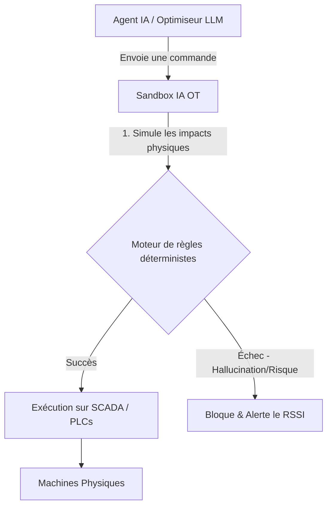
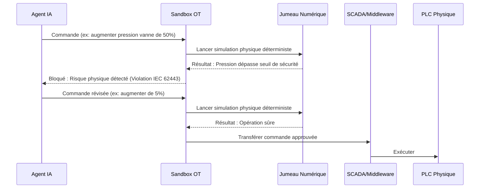

<!-- markdownlint-disable MD009 MD010 MD013 MD022 MD028 MD032 MD033 MD034 MD036 MD037 MD039 MD041 MD058 MD060 -->

[ 🇬🇧 English Version ](./README.md)

# AI Agent Sandbox OT

> **Résumé exécutif :** Un bac à sable (sandbox) middleware spécialisé qui intercepte, simule et valide les commandes des agents IA selon des règles physiques déterministes avant leur exécution dans les réseaux industriels (OT). Il prévient les dommages physiques et les temps d'arrêt coûteux causés par les actions imprévisibles de l'IA dans les infrastructures critiques.

---

## 1. Aperçu visuel & Effet Wahou

## 2. La thèse contrariante (Peter Thiel Style)

- **La croyance populaire :** La clé pour sécuriser l'IA industrielle est d'avoir de meilleurs pare-feu réseau, des limites d'API plus strictes, et de rendre les modèles d'IA plus intelligents pour qu'ils hallucinent moins.
- **La vérité cachée :** L'IA sera toujours probabiliste, mais la physique industrielle est déterministe. On ne peut pas sécuriser les réseaux OT en sécurisant uniquement la couche logicielle ; il faut simuler les conséquences physiques réelles de chaque commande d'IA avant qu'elle n'atteigne les automates programmables industriels (PLC).

## 3. Le problème & La cible

- **Modèle économique :** B2B
- **Cible précise :** RSSI (CISO) et directeurs d'infrastructures industrielles (énergie, manufacturier critique, transport).
- **La douleur urgente :** Alors que les entreprises se précipitent pour intégrer des agents IA autonomes afin d'optimiser l'énergie ou la production, une hallucination de l'IA ou une commande imprévue pourrait briser physiquement des machines, causant des millions de dommages, des arrêts de production très coûteux ou violant des normes de sécurité strictes comme l'IEC 62443.

## 4. Architecture technique & Plomberie

## 5. Modèle économique & Viabilité financière

| Métrique                        | Valeur                                      |
| :------------------------------ | :------------------------------------------ |
| **Structure de prix**           | Licence annuelle par site industriel / nœud |
| **Objectif 12 mois**            | 20 sites industriels                        |
| **Calcul du CA (Target 100k€)** | 20 sites \* 5 000 €/an = 100 000 €          |
| **Marge brute estimée**         | 80%                                         |

## 6. Moteur de distribution & Fossé défensif (Moat)

- **Stratégie d'acquisition :** Vente B2B directe ciblant les RSSI dans la fabrication et l'énergie, en utilisant les audits de conformité (IEC 62443) comme cheval de Troie. Partenariats avec des intégrateurs industriels.
- **Moat (Barrière à l'entrée) :** Les API LLM génériques et les pare-feu standards ne comprennent pas les protocoles industriels bas niveau (Modbus, OPC UA) ni la physique des automates. Construire cela nécessite une expertise pointue des systèmes SCADA vieillissants et de la simulation physique en temps réel, rendant la solution très difficile à copier par de purs acteurs logiciels ou des LLM natifs.

## 7. Grille d'évaluation détaillée

| Critère                               | Score VC (/100) | Score Terrain (/100) |
| :------------------------------------ | :-------------- | :------------------- |
| **Thèse & Monopole / Urgence**        | -- / 25         | -- / 25              |
| **Moat / Résistance aux LLM natifs**  | -- / 25         | -- / 25              |
| **Scalabilité / Friction d'adoption** | -- / 25         | -- / 25              |
| **Unit Economics / ROI direct**       | -- / 25         | -- / 25              |
| **TOTAL**                             | **-- / 100**    | **-- / 100**         |

> **Verdict VC :** En attente d'évaluation.

> **Verdict Terrain :** En attente d'évaluation.
