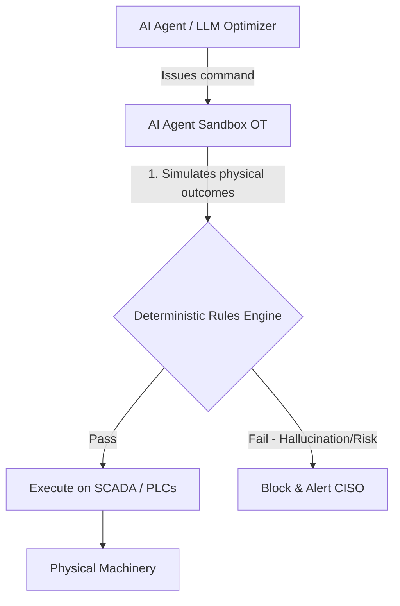
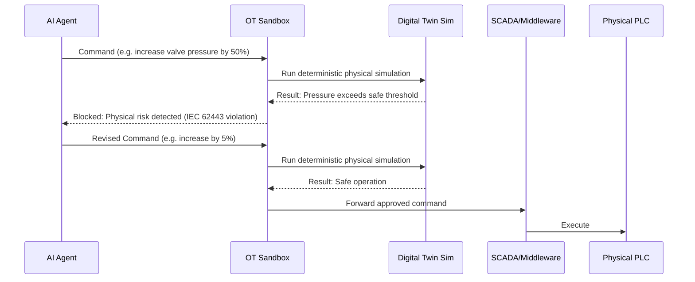

<!-- markdownlint-disable MD009 MD010 MD013 MD022 MD028 MD032 MD033 MD034 MD036 MD037 MD039 MD041 MD058 MD060 -->

[ 🇫🇷 Version Française ](./README.fr.md)

# AI Agent Sandbox OT

> **Executive Summary:** A specialized middleware sandbox that intercepts, simulates, and validates AI agent commands against physical deterministic rules before execution in Operational Technology (OT) networks. It prevents physical damage or costly downtime caused by unpredictable AI actions in critical infrastructure.

---

## 1. Visual Overview & Wow Effect

## 2. Contrarian Thesis (Peter Thiel Style)

- **Popular Belief:** The key to securing industrial AI is better network firewalls, stricter API limits, and making the AI models smarter so they hallucinate less.
- **Hidden Truth:** AI will always be probabilistic, but industrial physics are deterministic. You cannot secure OT networks by just securing the software layer; you must simulate the real-world physical consequences of every AI command before it hits the programmable logic controllers (PLCs).

## 3. Problem & Target Market

- **Business Model:** B2B
- **Target Audience:** CISOs and industrial infrastructure directors (energy, critical manufacturing, transport).
- **Urgent Pain Point:** As companies rush to integrate autonomous AI agents to optimize energy or production, an AI hallucination or unpredicted command could physically break machinery, causing millions in damages, costly production halts, or violating strict safety standards like IEC 62443.

## 4. Technical Architecture & Infrastructure

## 5. Business Model & Financial Viability

| Metric                     | Value                                     |
| :------------------------- | :---------------------------------------- |
| **Pricing Structure**      | Annual license per industrial site / node |
| **12-Month Target**        | 20 industrial sites                       |
| **Revenue Formula**        | 20 sites \* €5,000/year = €100,000        |
| **Estimated Gross Margin** | 80%                                       |

## 6. Distribution Engine & Moat

- **Acquisition Strategy:** Direct B2B sales targeting CISOs in manufacturing and energy sectors, leveraging compliance (IEC 62443) audits as a Trojan horse. Partnerships with industrial integrators.
- **Moat (Defensibility):** Generic LLM APIs and standard firewalls cannot understand low-level industrial protocols (Modbus, OPC UA) or PLC physics. Building this requires deep domain expertise in legacy SCADA systems and real-time physical simulation, making it highly defensible against pure software players or native LLMs.

## 7. Detailed Evaluation Grid

| Criterion                       | VC Score (/100) | Market Score (/100) |
| :------------------------------ | :-------------- | :------------------ |
| **Thesis & Monopoly / Urgency** | -- / 25         | -- / 25             |
| **Moat / LLM Immunity**         | -- / 25         | -- / 25             |
| **Scalability / UX Friction**   | -- / 25         | -- / 25             |
| **Unit Economics / ROI**        | -- / 25         | -- / 25             |
| **TOTAL**                       | **-- / 100**    | **-- / 100**        |

> **VC Verdict:** Pending evaluation.

> **Market Verdict:** Pending evaluation.
