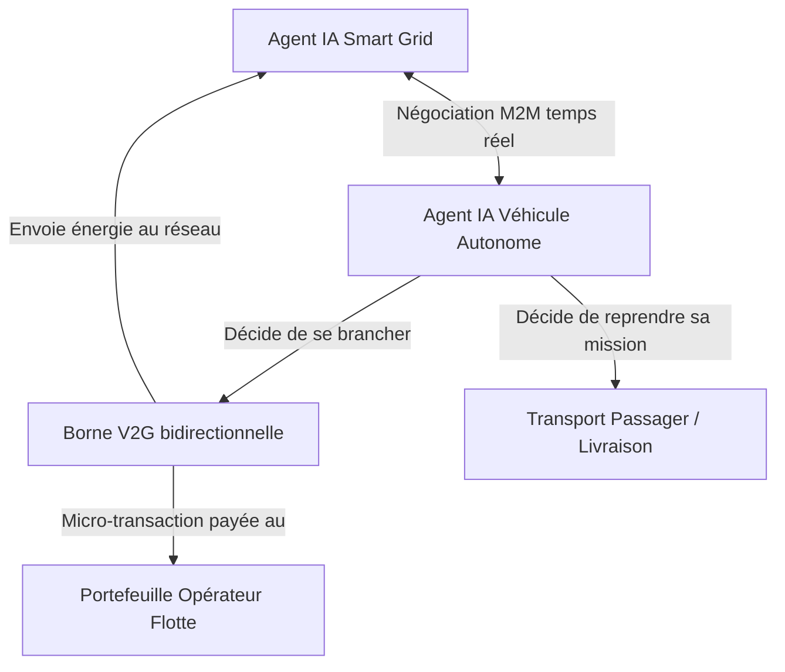
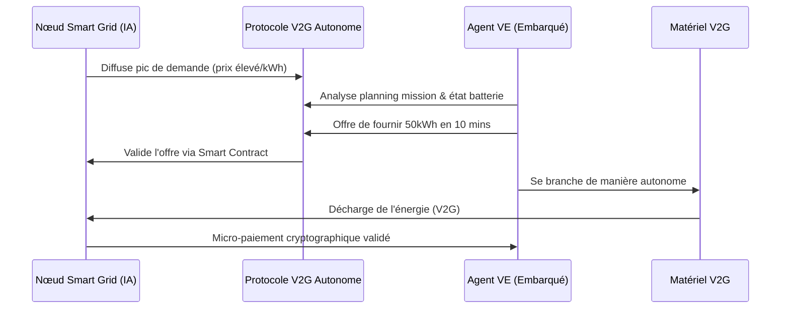

<!-- markdownlint-disable MD009 MD010 MD013 MD022 MD028 MD032 MD033 MD034 MD036 MD037 MD039 MD041 MD058 MD060 -->

[ 🇬🇧 English Version ](./README.md)

# Autonomous Fleet V2G

> **Résumé exécutif :** Un protocole M2M décentralisé permettant aux agents IA des flottes de véhicules électriques autonomes de négocier de manière autonome avec l'IA du réseau électrique (Smart Grid) pour fournir de l'énergie (Vehicle-to-Grid) lors des pics de demande, stabilisant le réseau tout en créant une nouvelle source de revenus.

---

## 1. Aperçu visuel & Effet Wahou

## 2. La thèse contrariante (Peter Thiel Style)

- **La croyance populaire :** Le problème de stabilité du réseau sera résolu par la construction de fermes de batteries centralisées géantes, et les flottes de VE ne seront que des consommateurs passifs gérés par des plannings de recharge centralisés.
- **La vérité cachée :** Les systèmes centralisés sont trop lents et rigides. Des millions de VE autonomes constituent des centrales électriques mobiles. En leur permettant de négocier la vente d'énergie de façon autonome (M2M) selon les contraintes du réseau local et leurs missions, nous débloquons instantanément un réseau de stockage distribué massif.

## 3. Le problème & La cible

- **Modèle économique :** B2B2C / M2M
- **Cible précise :** Opérateurs de réseaux électriques, gestionnaires de flottes de véhicules autonomes électriques (robotaxis), fournisseurs d'énergie.
- **La douleur urgente :** L'intermittence des énergies renouvelables déstabilise le réseau électrique. En parallèle, les flottes de véhicules autonomes électriques en croissance ont des besoins de recharge massifs. La synchronisation manuelle ou centralisée est inefficace pour les besoins d'équilibrage du réseau en temps réel (millisecondes).

## 4. Architecture technique & Plomberie

## 5. Modèle économique & Viabilité financière

| Métrique                        | Valeur                                                                |
| :------------------------------ | :-------------------------------------------------------------------- |
| **Structure de prix**           | Commission (%) sur l'énergie échangée + accès SaaS pour gestionnaires |
| **Objectif 12 mois**            | 1 000 VE actifs sur le protocole                                      |
| **Calcul du CA (Target 100k€)** | 1000 VE \* 100 € de frais/an = 100 000 €                              |
| **Marge brute estimée**         | 90%                                                                   |

## 6. Moteur de distribution & Fossé défensif (Moat)

- **Stratégie d'acquisition :** Adhésion développeurs (SDK M2M pour opérateurs de flotte) et partenariats directs avec les opérateurs de réseau régionaux via des programmes pilotes.
- **Moat (Barrière à l'entrée) :** Nécessite une infrastructure décentralisée ultra-basse latence, des IA embarquées (edge computing) dans les véhicules, et des contrats intelligents cryptographiques. Les plateformes SaaS génériques ne peuvent pas gérer les contraintes de temps réel et l'intégration matérielle requises pour les transactions énergétiques en millisecondes.

## 7. Grille d'évaluation détaillée

| Critère                               | Score VC (/100) | Score Terrain (/100) |
| :------------------------------------ | :-------------- | :------------------- |
| **Thèse & Monopole / Urgence**        | -- / 25         | -- / 25              |
| **Moat / Résistance aux LLM natifs**  | -- / 25         | -- / 25              |
| **Scalabilité / Friction d'adoption** | -- / 25         | -- / 25              |
| **Unit Economics / ROI direct**       | -- / 25         | -- / 25              |
| **TOTAL**                             | **-- / 100**    | **-- / 100**         |

> **Verdict VC :** En attente d'évaluation.

> **Verdict Terrain :** En attente d'évaluation.
