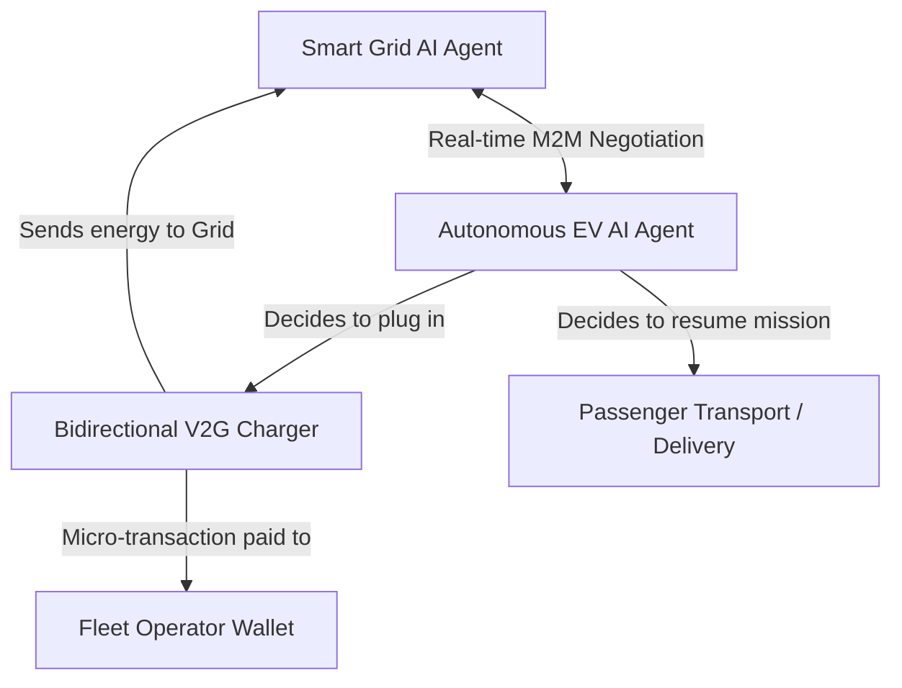
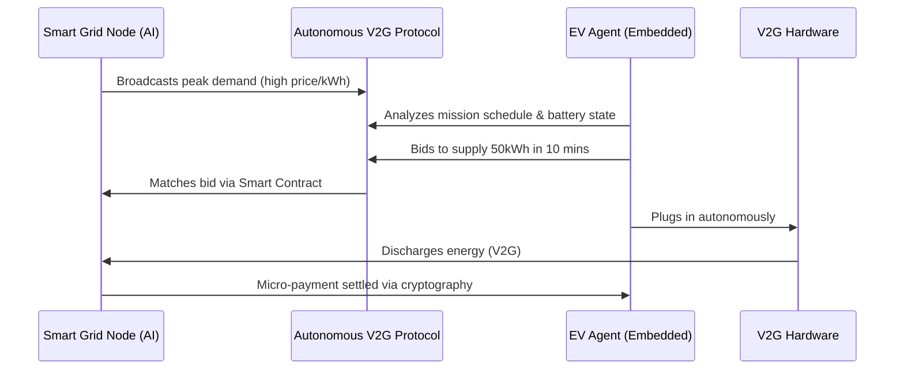

<!-- markdownlint-disable MD009 MD010 MD013 MD022 MD028 MD032 MD033 MD034 MD036 MD037 MD039 MD041 MD058 MD060 -->

[ 🇫🇷 Version Française ](./README.fr.md)

# Autonomous Fleet V2G

> **Executive Summary:** A decentralized M2M protocol enabling AI agents of autonomous electric vehicle fleets to negotiate autonomously with Smart Grid AI to supply power (Vehicle-to-Grid) during peak demand. This optimizes grid stability while creating a new revenue stream for fleet operators.

---

## 1. Visual Overview & Wow Effect

## 2. Contrarian Thesis (Peter Thiel Style)

- **Popular Belief:** The grid stability problem will be solved by building massive centralized battery farms, and EV fleets will just be passive energy consumers managed by centralized charging schedules.
- **Hidden Truth:** Centralized systems are too slow and rigid. Millions of autonomous EVs are effectively mobile power plants. By allowing them to autonomously negotiate energy trading (M2M) based on local grid constraints and their mission schedules, we unlock a massive, distributed energy storage network instantly.

## 3. Problem & Target Market

- **Business Model:** B2B2C / M2M
- **Target Audience:** Electrical grid operators, autonomous EV fleet managers (robotaxis), and energy providers.
- **Urgent Pain Point:** The intermittency of renewable energy destabilizes the electrical grid. Concurrently, growing autonomous EV fleets have massive charging needs. Manual or centralized synchronization between grid needs and vehicle charging schedules is inefficient and cannot handle real-time (millisecond) grid balancing requirements.

## 4. Technical Architecture & Infrastructure

## 5. Business Model & Financial Viability

| Metric                     | Value                                                                 |
| :------------------------- | :-------------------------------------------------------------------- |
| **Pricing Structure**      | Transaction fee (%) on traded energy + SaaS access for fleet managers |
| **12-Month Target**        | 1,000 EVs active on the protocol                                      |
| **Revenue Formula**        | 1000 EVs \* €100 transaction fees/year = €100,000                     |
| **Estimated Gross Margin** | 90%                                                                   |

## 6. Distribution Engine & Moat

- **Acquisition Strategy:** Developer adoption (M2M SDK for fleet operators) and direct partnerships with regional grid operators running localized pilot programs.
- **Moat (Defensibility):** Requires ultra-low latency, decentralized infrastructure, embedded AI on the edge (vehicles), and cryptographic micro-transactions. Standard SaaS platforms and generalized LLMs cannot handle the real-time constraints and hardware integration necessary for millisecond-level energy balancing.

## 7. Detailed Evaluation Grid

| Criterion                       | VC Score (/100) | Market Score (/100) |
| :------------------------------ | :-------------- | :------------------ |
| **Thesis & Monopoly / Urgency** | -- / 25         | -- / 25             |
| **Moat / LLM Immunity**         | -- / 25         | -- / 25             |
| **Scalability / UX Friction**   | -- / 25         | -- / 25             |
| **Unit Economics / ROI**        | -- / 25         | -- / 25             |
| **TOTAL**                       | **-- / 100**    | **-- / 100**        |

> **VC Verdict:** Pending evaluation.

> **Market Verdict:** Pending evaluation.
