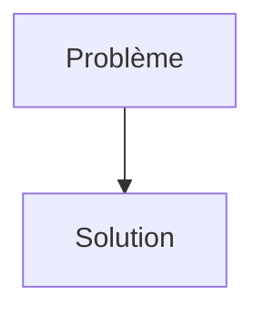
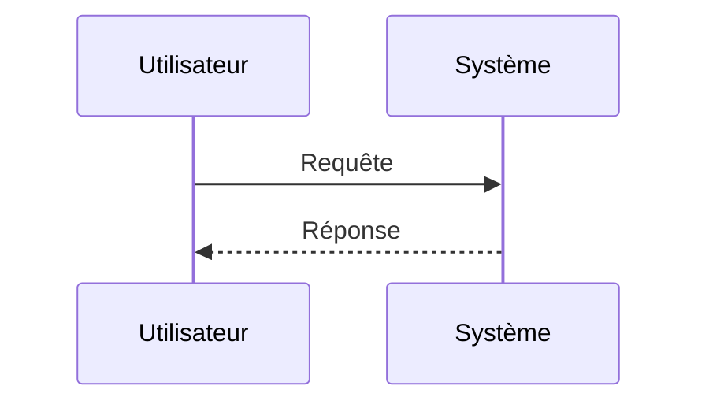

<!-- markdownlint-disable MD009 MD010 MD013 MD022 MD028 MD032 MD033 MD034 MD036 MD037 MD039 MD041 MD058 MD060 -->
<!-- markdownlint-disable MD033 MD041 -->

[🇬🇧 English Version](./README.md)

# EdgeCrash

> **Résumé exécutif :** Autonomous Vehicle Corner-Case Simulator

---

## 1. Aperçu visuel & Effet Wahou

## 2. La thèse contrariante (Peter Thiel Style)

- **La croyance populaire :** [Ce que la majorité pense sur ce marché]
- **La vérité cachée :** [La réalité non intuitive exploitée par cette startup]

## 3. Le problème & La cible

- **Modèle économique :** B2B
- **Cible précise :** Constructeurs de véhicules autonomes (Waymo, Cruise, Tesla), fabricants de capteurs LiDAR, régulateurs de sécurité automobile.
- **La douleur urgente :** Les systèmes de conduite autonome accumulent des milliards de kilomètres de données réelles "ennuyeuses" (conduite sur autoroute rectiligne), mais manquent cruellement de données sur les "Corner Cases" (situations rares, dangereuses et complexes : ex: enfant qui court derrière un camion dans la neige, capteur aveuglé par le soleil). Il est physiquement impossible de filmer tous ces scénarios dans le monde réel sans tuer des gens.

## 4. Architecture technique & Plomberie

## 5. Modèle économique & Viabilité financière

| Métrique                        | Valeur                                                          |
| ------------------------------- | --------------------------------------------------------------- |
| **Structure de prix**           | [Prix / Modèle d'abonnement / Commission]                       |
| **Objectif 12 mois**            | [Nombre exact de clients/utilisateurs/transactions nécessaires] |
| **Calcul du CA (Target 100k€)** | [Formule mathématique exacte]                                   |
| **Marge brute estimée**         | [Marge en %]                                                    |

## 6. Moteur de distribution & Fossé défensif (Moat)

- **Stratégie d'acquisition :** [Viralité B2C, réseau C2C, acquisition B2B directe, adhésion dev M2M]
- **Moat (Barrière à l'entrée) :** Les moteurs de jeu vidéo traditionnels (Unreal Engine, Unity) génèrent des images "propres" (Game Engines). Ils ne simulent pas le bruit microscopique des photons frappant un capteur CMOS ou les réflexions complexes d'un faisceau LiDAR sur du verre mouillé. L'IA autonome voit la différence et s'entraîne mal (Domain Gap).

## 7. Grille d'évaluation détaillée

| Critère                               | Score VC (/100) | Score Terrain (/100) |
| ------------------------------------- | --------------- | -------------------- |
| **Thèse & Monopole / Urgence**        | -- / 25         | -- / 25              |
| **Moat / Résistance aux LLM natifs**  | -- / 25         | -- / 25              |
| **Scalabilité / Friction d'adoption** | -- / 25         | -- / 25              |
| **Unit Economics / ROI direct**       | -- / 25         | -- / 25              |
| **TOTAL**                             | **-- / 100**    | **-- / 100**         |

> **Verdict VC :** En attente d'évaluation.
>
> **Verdict Terrain :** En attente d'évaluation.
