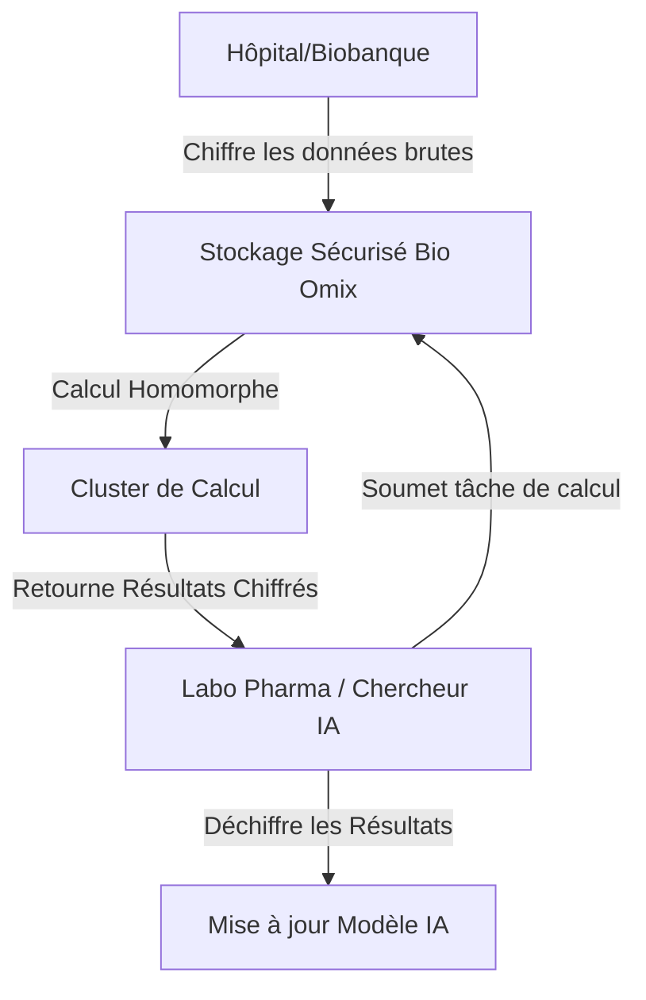
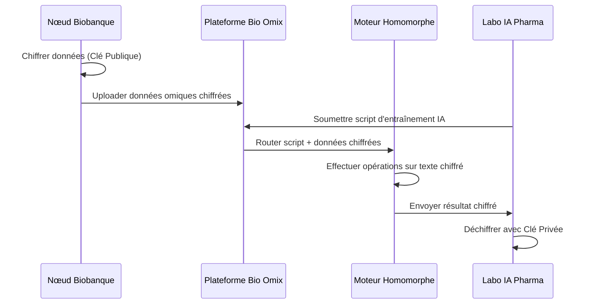

<!-- markdownlint-disable MD009 MD010 MD013 MD022 MD028 MD032 MD033 MD034 MD036 MD037 MD039 MD041 MD058 MD060 -->

[ 🇬🇧 English Version ](./README.md)

# Bio Omix Secure Storage

> **Résumé exécutif :** Une infrastructure de stockage distribuée Zero-Trust utilisant un chiffrement homomorphe spécifiquement optimisé pour les pipelines d'analyse multi-omiques. Elle permet aux institutions de recherche d'entraîner des modèles d'IA sur des données génomiques hautement sensibles sans jamais décrypter la donnée source.

---

## 1. Aperçu visuel & Effet Wahou

## 2. La thèse contrariante (Peter Thiel Style)

- **La croyance populaire :** Le principal obstacle à la médecine personnalisée est le manque de données génomiques de haute qualité, nous devons donc construire des lacs de données centralisés plus vastes et mieux sécurisés.
- **La vérité cachée :** Les données existent déjà dans des milliers de silos déconnectés, mais les institutions ne peuvent pas les partager à cause des lois strictes (HIPAA/RGPD) et des risques juridiques. La véritable révolution n'est pas de centraliser la donnée, mais de permettre le calcul sur des données chiffrées à grande échelle pour que la confiance ne soit plus un prérequis à la collaboration.

## 3. Le problème & La cible

- **Modèle économique :** B2B
- **Cible précise :** Hôpitaux de recherche, laboratoires pharmaceutiques, banques de données génomiques nationales.
- **La douleur urgente :** L'explosion des données multi-omiques (génomique, protéomique, transcriptomique) crée des goulets d'étranglement majeurs pour le stockage sécurisé, le partage inter-institutionnel et la conformité stricte (HIPAA, RGPD) face aux risques de fuites de données biomédicales hautement sensibles.

## 4. Architecture technique & Plomberie

## 5. Modèle économique & Viabilité financière

| Métrique                        | Valeur                                                         |
| :------------------------------ | :------------------------------------------------------------- |
| **Structure de prix**           | Abonnement pour volume de stockage + frais de calcul à l'usage |
| **Objectif 12 mois**            | 5 hôpitaux de recherche + 2 labos pharma de taille moyenne     |
| **Calcul du CA (Target 100k€)** | 7 clients \* ~15 000 €/an = 105 000 €                          |
| **Marge brute estimée**         | 70%                                                            |

## 6. Moteur de distribution & Fossé défensif (Moat)

- **Stratégie d'acquisition :** Vente B2B directe auprès des Délégués à la Protection des Données (DPO) et des Directeurs de Recherche, en utilisant la conformité réglementaire absolue comme argument de vente principal.
- **Moat (Barrière à l'entrée) :** Les fournisseurs cloud génériques (AWS, Box) ne gèrent pas le chiffrement homomorphe optimisé pour les algorithmes bio-informatiques complexes. Le surcoût computationnel de l'analyse sur des données chiffrées nécessite une infrastructure hautement spécialisée et des optimisations mathématiques propriétaires impossibles à répliquer facilement par un SaaS standard.

## 7. Grille d'évaluation détaillée

| Critère                               | Score VC (/100) | Score Terrain (/100) |
| :------------------------------------ | :-------------- | :------------------- |
| **Thèse & Monopole / Urgence**        | -- / 25         | -- / 25              |
| **Moat / Résistance aux LLM natifs**  | -- / 25         | -- / 25              |
| **Scalabilité / Friction d'adoption** | -- / 25         | -- / 25              |
| **Unit Economics / ROI direct**       | -- / 25         | -- / 25              |
| **TOTAL**                             | **-- / 100**    | **-- / 100**         |

> **Verdict VC :** En attente d'évaluation.

> **Verdict Terrain :** En attente d'évaluation.
