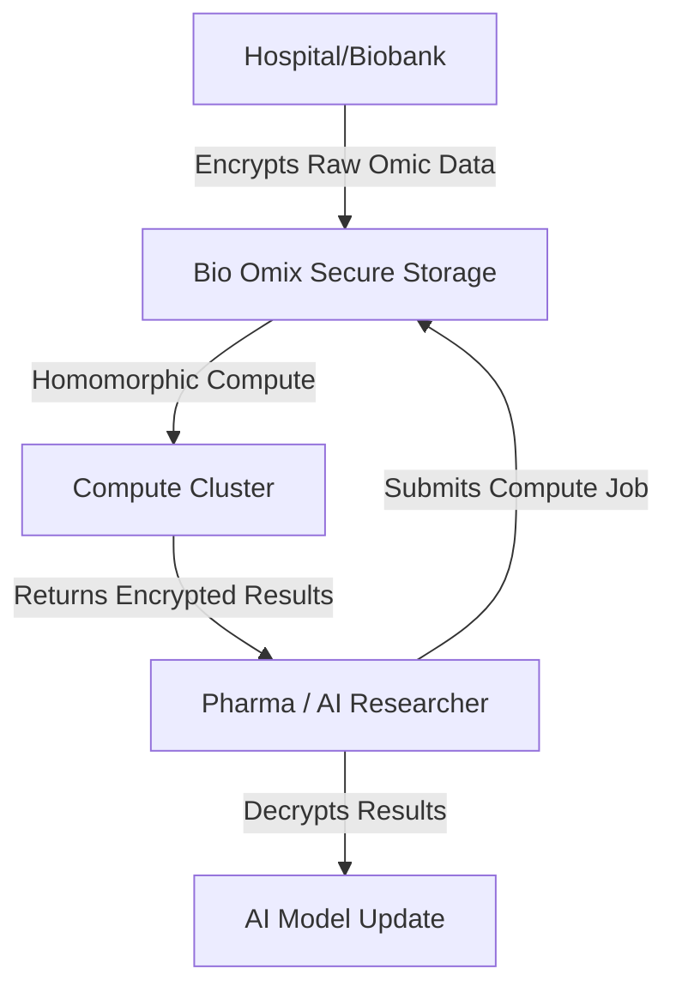
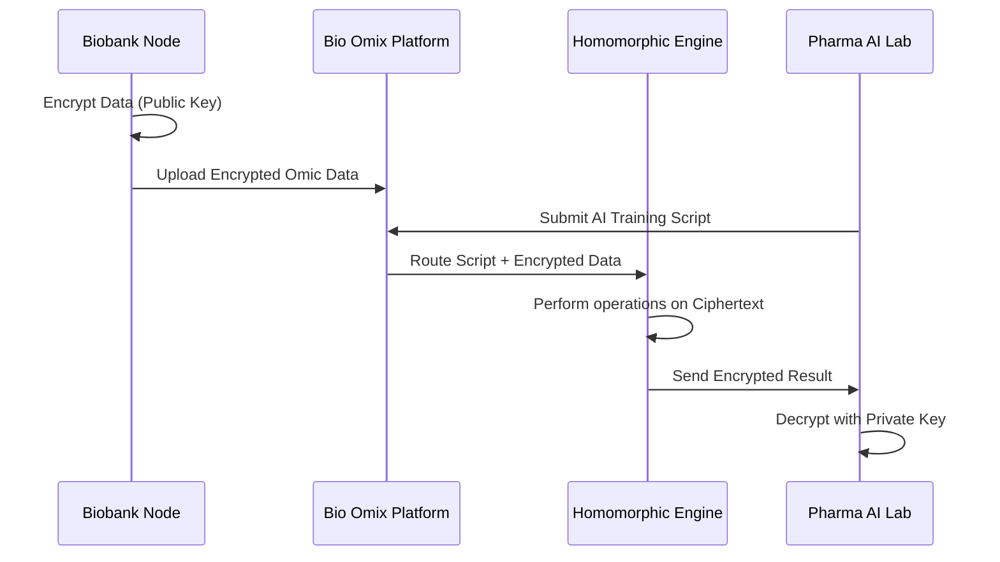

<!-- markdownlint-disable MD009 MD010 MD013 MD022 MD028 MD032 MD033 MD034 MD036 MD037 MD039 MD041 MD058 MD060 -->

[ 🇫🇷 Version Française ](./README.fr.md)

# Bio Omix Secure Storage

> **Executive Summary:** A Zero-Trust distributed storage infrastructure leveraging homomorphic encryption specifically optimized for multi-omic analysis pipelines. It allows research institutions to train predictive AI models on highly sensitive genomic data without ever decrypting the source material.

---

## 1. Visual Overview & Wow Effect

## 2. Contrarian Thesis (Peter Thiel Style)

- **Popular Belief:** The main barrier to personalized medicine is a lack of high-quality genomic data, so we must build larger, better-secured centralized data lakes.
- **Hidden Truth:** The data already exists across thousands of disconnected silos, but institutions cannot share it due to strict privacy laws (HIPAA/GDPR) and liability. The real unlock is not centralizing data, but enabling computation on encrypted data at scale so trust is no longer a prerequisite for collaboration.

## 3. Problem & Target Market

- **Business Model:** B2B
- **Target Audience:** Research hospitals, pharmaceutical laboratories, and national genomic biobanks.
- **Urgent Pain Point:** The explosion of multi-omic data (genomic, proteomic, transcriptomic) creates massive bottlenecks for secure storage and inter-institutional sharing. Traditional compliance (HIPAA, GDPR) blocks collaborative AI research due to the severe risks of leaking highly sensitive biomedical data.

## 4. Technical Architecture & Infrastructure

## 5. Business Model & Financial Viability

| Metric                     | Value                                                                 |
| :------------------------- | :-------------------------------------------------------------------- |
| **Pricing Structure**      | Subscription for storage volume + per-computation fee (compute hours) |
| **12-Month Target**        | 5 research hospitals + 2 mid-size pharma labs                         |
| **Revenue Formula**        | 7 clients \* ~€15,000/year = €105,000                                 |
| **Estimated Gross Margin** | 70%                                                                   |

## 6. Distribution Engine & Moat

- **Acquisition Strategy:** Direct B2B sales to institutional Data Protection Officers (DPOs) and Chief Research Officers, using regulatory compliance as the primary selling point.
- **Moat (Defensibility):** Generic cloud providers (AWS, Box) do not support homomorphic encryption optimized for complex bioinformatics algorithms. The computational overhead of analyzing encrypted data requires highly specialized infrastructure and proprietary mathematical optimizations that cannot be easily replicated by standard SaaS platforms.

## 7. Detailed Evaluation Grid

| Criterion                       | VC Score (/100) | Market Score (/100) |
| :------------------------------ | :-------------- | :------------------ |
| **Thesis & Monopoly / Urgency** | -- / 25         | -- / 25             |
| **Moat / LLM Immunity**         | -- / 25         | -- / 25             |
| **Scalability / UX Friction**   | -- / 25         | -- / 25             |
| **Unit Economics / ROI**        | -- / 25         | -- / 25             |
| **TOTAL**                       | **-- / 100**    | **-- / 100**        |

> **VC Verdict:** Pending evaluation.

> **Market Verdict:** Pending evaluation.
