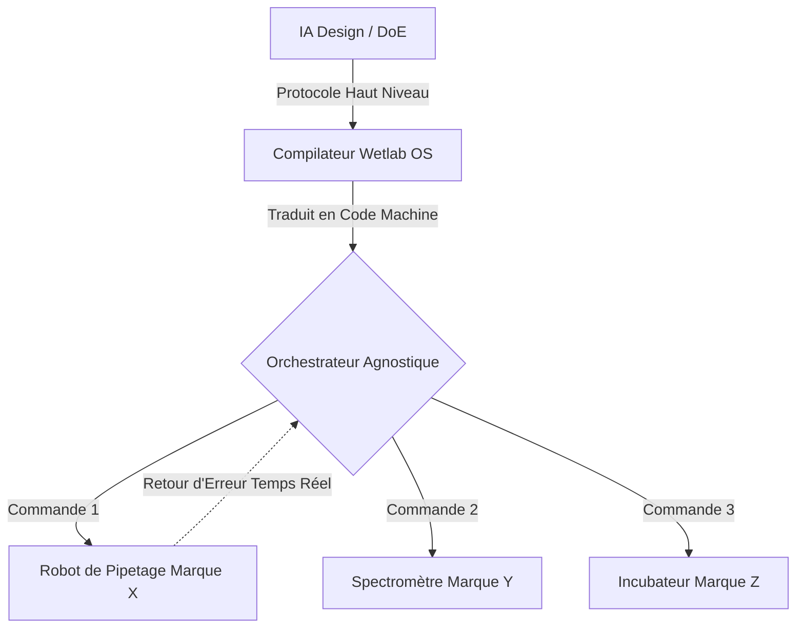
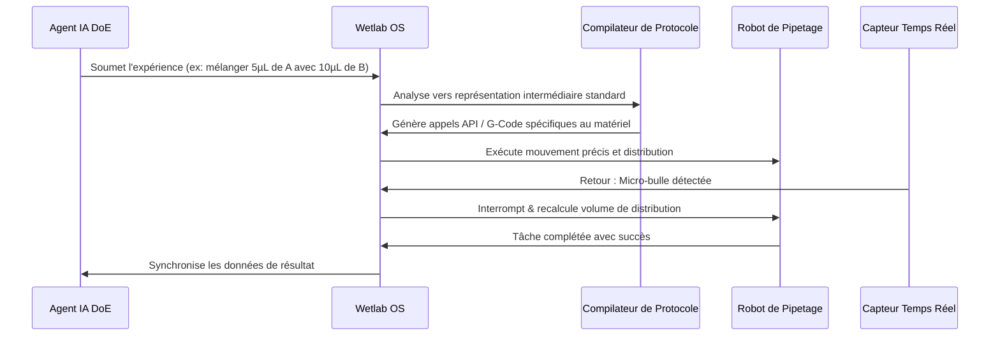

<!-- markdownlint-disable MD009 MD010 MD013 MD022 MD028 MD032 MD033 MD034 MD036 MD037 MD039 MD041 MD058 MD060 -->

[ 🇬🇧 English Version ](./README.md)

# Biotech Wetlab Orchestrator

> **Résumé exécutif :** Un système d'exploitation et compilateur agnostique au matériel qui traduit les expériences biologiques de haut niveau conçues par IA en instructions machine bas niveau et standardisées pour les robots de laboratoire (wet-lab). Il crée le pont manquant entre la conception assistée par IA et l'exécution physique.

---

## 1. Aperçu visuel & Effet Wahou

## 2. La thèse contrariante (Peter Thiel Style)

- **La croyance populaire :** L'avenir de la biologie est purement in silico ; nous avons juste besoin de meilleurs modèles d'IA (comme AlphaFold) pour prédire les structures moléculaires, et les techniciens de laboratoire se contenteront de suivre les recettes de l'IA.
- **La vérité cachée :** La biologie est chaotique et non déterministe. Le véritable goulot d'étranglement n'est pas la prédiction biologique, mais l'exécution physique des expériences à grande échelle. L'absence d'API standardisées entre les équipements de laboratoire empêche l'exécution fiable des protocoles générés par l'IA. La prochaine révolution nécessite un "système d'exploitation" de niveau industriel pour la biologie physique.

## 3. Le problème & La cible

- **Modèle économique :** B2B
- **Cible précise :** Startups de biologie de synthèse, CROs (Contract Research Organizations), départements R&D de grands groupes pharmaceutiques.
- **La douleur urgente :** L'automatisation des laboratoires humides (wet-labs) est bloquée par l'incompatibilité des API et des standards entre différents équipements (robots de pipetage, spectromètres, incubateurs). La conception expérimentale (Design of Experiments - DoE) par l'IA ne peut pas se traduire directement en commandes d'exécution physique fiables, créant un goulot d'étranglement majeur.

## 4. Architecture technique & Plomberie

## 5. Modèle économique & Viabilité financière

| Métrique                        | Valeur                                                               |
| :------------------------------ | :------------------------------------------------------------------- |
| **Structure de prix**           | Licence annuelle plateforme + frais d'intégration par nœud robotique |
| **Objectif 12 mois**            | 4 startups biotech / CROs                                            |
| **Calcul du CA (Target 100k€)** | 4 clients \* 25 000 €/an = 100 000 €                                 |
| **Marge brute estimée**         | 80%                                                                  |

## 6. Moteur de distribution & Fossé défensif (Moat)

- **Stratégie d'acquisition :** Cibler les startups de biologie de synthèse en phase de démarrage construisant des laboratoires hautement automatisés, afin de créer des cas d'usage (case studies) pour vendre ensuite aux massives CROs pharmaceutiques.
- **Moat (Barrière à l'entrée) :** Les LIMS actuels sont passifs (gestion documentaire). Une solution d'orchestration wet-lab nécessite le développement de drivers spécifiques bas niveau pour du matériel de laboratoire souvent fermé, la gestion des variables physiques (température, volumes microscopiques) et un feedback loop en temps réel pour l'IA. Cela s'apparente à un système d'exploitation industriel de pointe, immunisé contre les simples wrappers LLM.

## 7. Grille d'évaluation détaillée

| Critère                               | Score VC (/100) | Score Terrain (/100) |
| :------------------------------------ | :-------------- | :------------------- |
| **Thèse & Monopole / Urgence**        | -- / 25         | -- / 25              |
| **Moat / Résistance aux LLM natifs**  | -- / 25         | -- / 25              |
| **Scalabilité / Friction d'adoption** | -- / 25         | -- / 25              |
| **Unit Economics / ROI direct**       | -- / 25         | -- / 25              |
| **TOTAL**                             | **-- / 100**    | **-- / 100**         |

> **Verdict VC :** En attente d'évaluation.

> **Verdict Terrain :** En attente d'évaluation.
