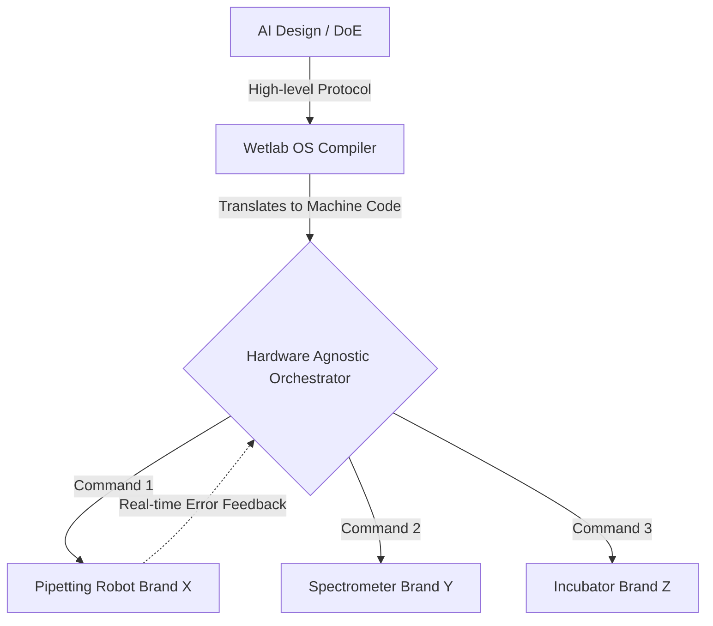
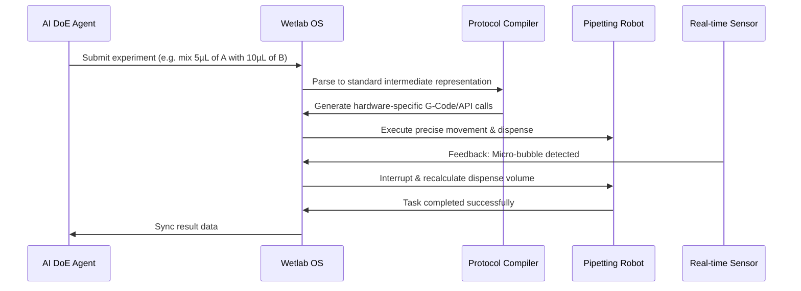

<!-- markdownlint-disable MD009 MD010 MD013 MD022 MD028 MD032 MD033 MD034 MD036 MD037 MD039 MD041 MD058 MD060 -->

[ 🇫🇷 Version Française ](./README.fr.md)

# Biotech Wetlab Orchestrator

> **Executive Summary:** A hardware-agnostic operating system and compiler that translates high-level biological experiments designed by AI into standardized, low-level machine instructions for wet-lab robotics. It bridges the gap between AI-driven design (DoE) and physical lab execution.

---

## 1. Visual Overview & Wow Effect

## 2. Contrarian Thesis (Peter Thiel Style)

- **Popular Belief:** The future of biology is purely in silico; we just need better AI models (like AlphaFold) to predict molecular structures, and standard lab technicians will simply follow the AI's recipes.
- **Hidden Truth:** Biology is messy and non-deterministic. The true bottleneck is not biological prediction, but the physical execution of experiments at scale. The lack of standard APIs across wet-lab hardware means AI-generated protocols cannot be executed reliably. The next revolution requires an industrial-grade "operating system" for physical biology.

## 3. Problem & Target Market

- **Business Model:** B2B
- **Target Audience:** Synthetic biology startups, Contract Research Organizations (CROs), and R&D departments of major pharmaceutical companies.
- **Urgent Pain Point:** Wet-lab automation is paralyzed by the incompatibility of APIs and standards across different equipment vendors. AI-driven Design of Experiments (DoE) cannot translate directly into reliable physical execution commands, creating a massive, error-prone bottleneck.

## 4. Technical Architecture & Infrastructure

## 5. Business Model & Financial Viability

| Metric                     | Value                                                    |
| :------------------------- | :------------------------------------------------------- |
| **Pricing Structure**      | Annual platform license + per-robot node integration fee |
| **12-Month Target**        | 4 biotech startups / CROs                                |
| **Revenue Formula**        | 4 clients \* €25,000/year = €100,000                     |
| **Estimated Gross Margin** | 80%                                                      |

## 6. Distribution Engine & Moat

- **Acquisition Strategy:** Target early-stage synthetic biology startups building highly automated labs, creating case studies to eventually sell into massive pharma CROs.
- **Moat (Defensibility):** Current LIMS (Laboratory Information Management Systems) are merely passive document management tools. Building an orchestration layer requires developing specific, low-level drivers for closed-source lab hardware, managing physical variables (temperature, microscopic volumes), and providing a real-time feedback loop. This is an advanced industrial operating system, completely immune to simple LLM wrappers.

## 7. Detailed Evaluation Grid

| Criterion                       | VC Score (/100) | Market Score (/100) |
| :------------------------------ | :-------------- | :------------------ |
| **Thesis & Monopoly / Urgency** | -- / 25         | -- / 25             |
| **Moat / LLM Immunity**         | -- / 25         | -- / 25             |
| **Scalability / UX Friction**   | -- / 25         | -- / 25             |
| **Unit Economics / ROI**        | -- / 25         | -- / 25             |
| **TOTAL**                       | **-- / 100**    | **-- / 100**        |

> **VC Verdict:** Pending evaluation.

> **Market Verdict:** Pending evaluation.
