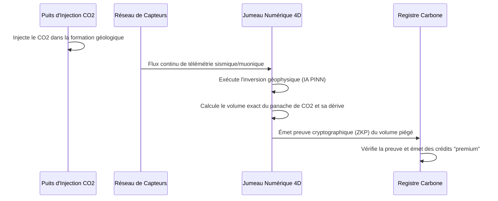

<!-- markdownlint-disable MD009 MD010 MD013 MD022 MD028 MD032 MD033 MD034 MD036 MD037 MD039 MD041 MD058 MD060 -->

[ 🇬🇧 English Version ](./README.md)

# Carbon Sequestration Auditor

> **Résumé exécutif :** Un jumeau numérique géophysique 4D qui ingère les données de capteurs sismiques et muoniques pour auditer en continu, vérifier mathématiquement et certifier cryptographiquement la séquestration souterraine du CO2. Il apporte une vérité physique irréfutable au marché volatil des crédits carbone.


---

## 1. Aperçu visuel & Effet Wahou

```mermaid
graph TD
    A[Capteurs Sismiques & Muons (Sous-sol)] -->|Données Physiques Brutes| B[Moteur d'Inversion Jumeau 4D]
    B -->|Réseau de Neurones Informé par la Physique| C{Validation Volumétrique}
    C -->|Fuite Détectée| D[Alerter Opérateur & Stopper Injection]
    C -->|Séquestration Stable| E[Entrée Registre Cryptographique]
    E --> F[Émettre Crédit Carbone Certifié]
```

## 2. La thèse contrariante (Peter Thiel Style)

- **La croyance populaire :** Le marché des crédits carbone sera réparé par de meilleurs logiciels comptables, des images satellites des forêts, et des règles de conformité plus strictes basées sur des audits Excel.
- **La vérité cachée :** La compensation basée sur la nature n'est fondamentalement pas scalable et est sujette à la fraude. L'avenir du "Net-Zero" exige la séquestration géologique permanente du CO2, mais les marchés financiers ne la financeront que si nous pouvons prouver définitivement que le CO2 est piégé sous terre pour toujours. Nous devons passer d'une comptabilité de feuille de calcul à une vérification géophysique déterministe.

## 3. Le problème & La cible

- **Modèle économique :** B2B
- **Cible précise :** Exploitants de puits d'injection de CO2 (CCS/CCUS), fonds d'investissement à impact, registres de crédits carbone (Verra, Gold Standard).
- **La douleur urgente :** L'absence de vérifiabilité granulaire et continue du stockage souterrain de CO2 entraîne un manque de confiance des investisseurs, une volatilité extrême des prix des crédits carbone et des risques réglementaires majeurs liés aux fuites non détectées de carbone séquestré.

## 4. Architecture technique & Plomberie



## 5. Modèle économique & Viabilité financière

| Métrique                        | Valeur                                                                      |
| :------------------------------ | :-------------------------------------------------------------------------- |
| **Structure de prix**           | Frais d'audit par tonne de CO2 vérifiée + SaaS de monitoring annuel du site |
| **Objectif 12 mois**            | 3 sites actifs de séquestration carbone                                     |
| **Calcul du CA (Target 100k€)** | 3 sites _ (10k€ SaaS + 50k tonnes _ 0,40€/tonne) = 90 000 €                 |
| **Marge brute estimée**         | 75%                                                                         |

## 6. Moteur de distribution & Fossé défensif (Moat)

- **Stratégie d'acquisition :** S'associer aux principaux registres de crédits carbone pour imposer le protocole de vérification de la plateforme comme le nouveau standard "Premium", forçant les opérateurs de puits à l'adopter pour obtenir un prix de crédit plus élevé.
- **Moat (Barrière à l'entrée) :** Construire un "World Model" du sous-sol en 4D exige une expertise pointue en géophysique, le traitement de pétaoctets de données issues de capteurs profonds et la résolution de problèmes d'inversion mathématique complexes. C'est infranchissable pour les startups SaaS génériques.

## 7. Grille d'évaluation détaillée

| Critère                               | Score VC (/100) | Score Terrain (/100) |
| :------------------------------------ | :-------------- | :------------------- |
| **Thèse & Monopole / Urgence**        | -- / 25         | -- / 25              |
| **Moat / Résistance aux LLM natifs**  | -- / 25         | -- / 25              |
| **Scalabilité / Friction d'adoption** | -- / 25         | -- / 25              |
| **Unit Economics / ROI direct**       | -- / 25         | -- / 25              |
| **TOTAL**                             | **-- / 100**    | **-- / 100**         |

> **Verdict VC :** En attente d'évaluation.

> **Verdict Terrain :** En attente d'évaluation.
