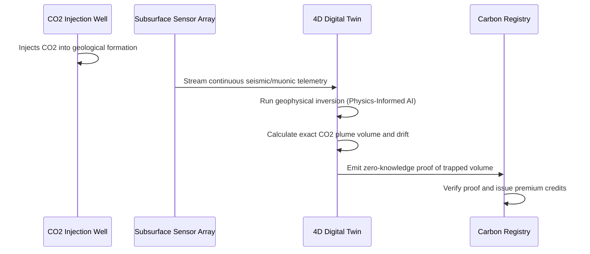

<!-- markdownlint-disable MD009 MD010 MD013 MD022 MD028 MD032 MD033 MD034 MD036 MD037 MD039 MD041 MD058 MD060 -->

[ 🇫🇷 Version Française ](./README.fr.md)

# Carbon Sequestration Auditor

> **Executive Summary:** A 4D geophysical digital twin that ingests seismic and muonic sensor data to continuously audit, mathematically verify, and cryptographically certify subsurface CO2 sequestration. It brings irrefutable physical truth to the volatile carbon credit market.


---

## 1. Visual Overview & Wow Effect

```mermaid
graph TD
    A[Seismic & Muon Sensors (Subsurface)] -->|Raw Physics Data| B[4D Digital Twin Inversion Engine]
    B -->|Physics-Informed Neural Network| C{Volumetric Validation}
    C -->|Leak Detected| D[Alert Operator & Halt Injection]
    C -->|Stable Sequestration| E[Cryptographic Ledger Entry]
    E --> F[Mint Certified Carbon Credit]
```

## 2. Contrarian Thesis (Peter Thiel Style)

- **Popular Belief:** The carbon credit market will be fixed by better accounting software, satellite imagery of forests, and stricter registry compliance rules based on spreadsheet audits.
- **Hidden Truth:** Nature-based offsets are fundamentally unscalable and prone to fraud. The future of net-zero requires permanent geological CO2 sequestration, but financial markets will only fund it if we can definitively prove the CO2 is trapped underground forever. We must transition from spreadsheet accounting to deterministic, subsurface geophysical verification.

## 3. Problem & Target Market

- **Business Model:** B2B
- **Target Audience:** Operators of carbon injection wells (CCS/CCUS), impact investment funds, and carbon credit registries (Verra, Gold Standard).
- **Urgent Pain Point:** The lack of granular, continuous verification of underground CO2 storage leads to investor distrust, immense volatility in carbon credit pricing, and severe regulatory risks if geological leaks occur undetected.

## 4. Technical Architecture & Infrastructure



## 5. Business Model & Financial Viability

| Metric                     | Value                                                           |
| :------------------------- | :-------------------------------------------------------------- |
| **Pricing Structure**      | Audit fee per ton of CO2 verified + annual site monitoring SaaS |
| **12-Month Target**        | 3 active carbon sequestration sites                             |
| **Revenue Formula**        | 3 sites _ (€10k SaaS + 50k tons _ €0.40/ton fee) = €90,000      |
| **Estimated Gross Margin** | 75%                                                             |

## 6. Distribution Engine & Moat

- **Acquisition Strategy:** Partner with major carbon credit registries to establish the platform's verification protocol as the new "premium" standard, forcing well operators to adopt it to achieve higher credit pricing.
- **Moat (Defensibility):** Building a 4D subsurface world model requires deep expertise in geophysics, handling petabytes of noisy sensor data, and solving complex inverse problems in heterogeneous geological formations. It is mathematically and computationally insurmountable for standard SaaS or LLM-wrapper startups.

## 7. Detailed Evaluation Grid

| Criterion                       | VC Score (/100) | Market Score (/100) |
| :------------------------------ | :-------------- | :------------------ |
| **Thesis & Monopoly / Urgency** | -- / 25         | -- / 25             |
| **Moat / LLM Immunity**         | -- / 25         | -- / 25             |
| **Scalability / UX Friction**   | -- / 25         | -- / 25             |
| **Unit Economics / ROI**        | -- / 25         | -- / 25             |
| **TOTAL**                       | **-- / 100**    | **-- / 100**        |

> **VC Verdict:** Pending evaluation.

> **Market Verdict:** Pending evaluation.
