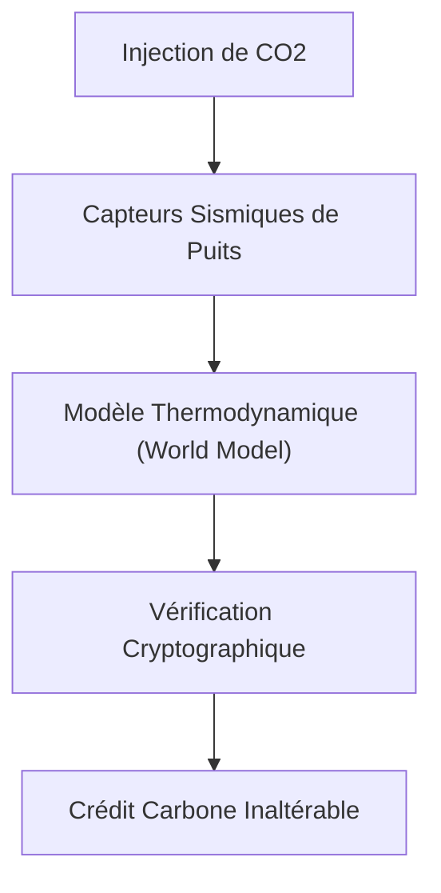
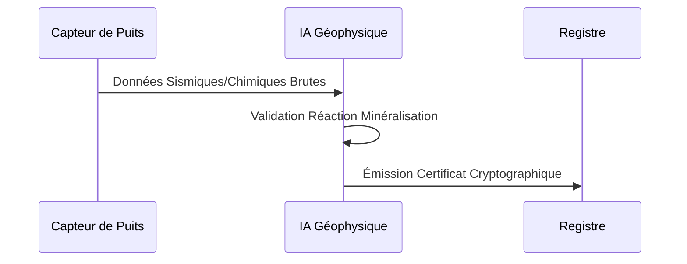

<!-- markdownlint-disable MD009 MD010 MD013 MD022 MD028 MD032 MD033 MD034 MD036 MD037 MD039 MD041 MD058 MD060 -->

[🇬🇧 English Version](./README.md)

# Geo Carbon MRV

> **Résumé exécutif :** Un système IoT et IA géophysique offrant une vérification inaltérable et en temps réel de la minéralisation du CO2 dans les formations géologiques profondes.

---

## 1. Aperçu visuel & Effet Wahou

## 2. La thèse contrariante (Peter Thiel Style)

La croyance populaire : La mesure des compensations carbone (MRV) peut reposer sur des feuilles de calcul, des modèles théoriques et des audits manuels pour garantir la séquestration à long terme.
La vérité cachée : Le MRV actuel basé sur des tableurs est facilement falsifiable (greenwashing). La véritable confiance nécessite de combiner des capteurs géologiques physiques avec une modélisation thermodynamique souterraine en temps réel et un ancrage cryptographique.

## 3. Le problème & La cible

Modèle économique : B2B
Cible précise : Acheteurs de crédits carbone industriels, opérateurs de capture et stockage de carbone (CCS), auditeurs de durabilité.
La douleur urgente : Les marchés du carbone manquent de confiance et de liquidité à cause du greenwashing. Prouver physiquement et de manière inaltérable qu'une tonne spécifique de CO2 a été enfouie et minéralisée dans la roche est extrêmement difficile avec les méthodes actuelles.

## 4. Architecture technique & Plomberie

## 5. Modèle économique & Viabilité financière

| Métrique                    | Valeur                                                |
| --------------------------- | ----------------------------------------------------- |
| Structure de prix           | Frais de vérification par tonne + abonnement matériel |
| Objectif 12 mois            | 5 projets pilotes CCS (20M tonnes vérifiées)          |
| Calcul du CA (Target 100k€) | 5 projets \* 20k€/mois + 0.05€/tonne                  |
| Marge brute estimée         | 70%                                                   |

## 6. Moteur de distribution & Fossé défensif (Moat)

Stratégie d'acquisition : Vente B2B directe aux développeurs CCS, partenariats avec les principaux registres carbone.
Moat (Barrière à l'entrée) : L'intégration profonde de capteurs géologiques propriétaires avec des algorithmes ultra-spécialisés de simulation thermodynamique souterraine crée une barrière insurmontable pour les entreprises logicielles génériques ou les LLMs.

## 7. Grille d'évaluation détaillée

| Critère                           | Score VC (/100) | Score Terrain (/100) |
| --------------------------------- | --------------- | -------------------- |
| Thèse & Monopole / Urgence        | -- / 25         | -- / 25              |
| Moat / Résistance aux LLM natifs  | -- / 25         | -- / 25              |
| Scalabilité / Friction d'adoption | -- / 25         | -- / 25              |
| Unit Economics / ROI direct       | -- / 25         | -- / 25              |
| **TOTAL**                         | **-- / 100**    | **-- / 100**         |

> **Verdict VC :** En attente d'évaluation.
> **Verdict Terrain :** En attente d'évaluation.
