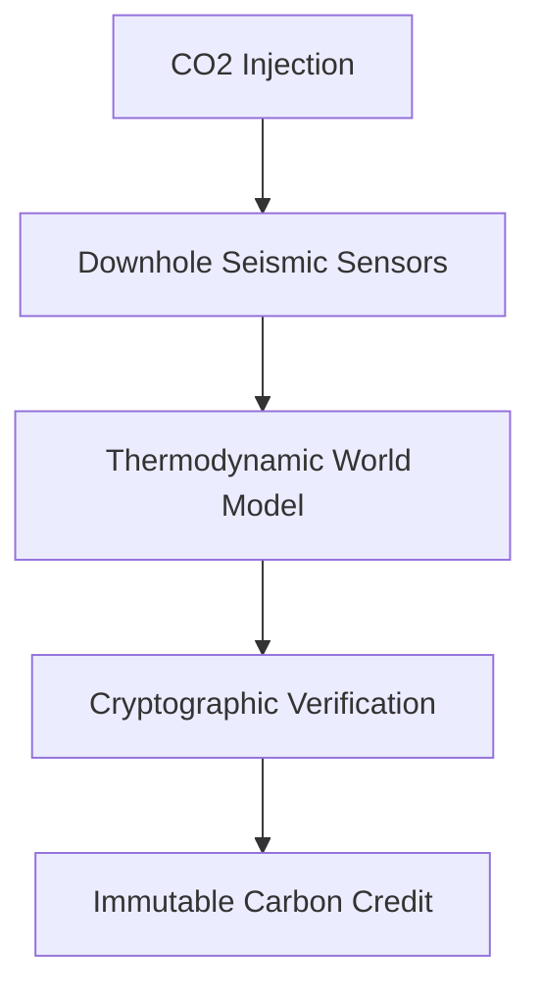
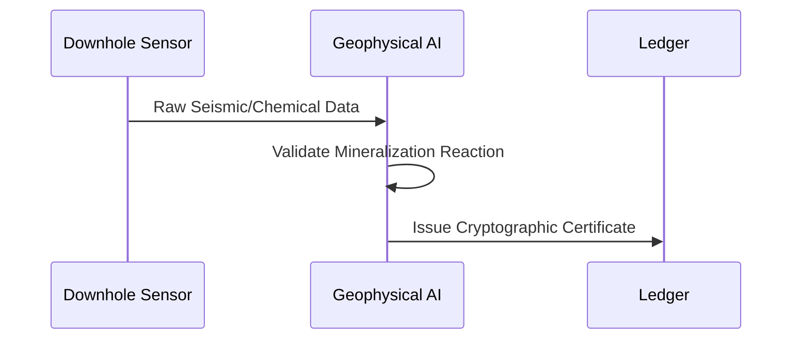

<!-- markdownlint-disable MD009 MD010 MD013 MD022 MD028 MD032 MD033 MD034 MD036 MD037 MD039 MD041 MD058 MD060 -->

[🇫🇷 Version Française](./README.fr.md)

# Geo Carbon MRV

> **Executive Summary:** An IoT and geophysical AI system that provides immutable, real-time verification of CO2 mineralization in deep geological formations.

---

## 1. Visual Overview & Wow Effect

## 2. Contrarian Thesis (Peter Thiel Style)

Popular Belief: Carbon offset measurement (MRV) can rely on spreadsheets, theoretical models, and manual audits to guarantee long-term sequestration.
Hidden Truth: Current spreadsheet-based MRV is easily falsified (greenwashing). Real trust requires combining physical geological sensors with real-time subsurface thermodynamic modeling and cryptographic anchoring.

## 3. Problem & Target Market

Business Model: B2B
Target Audience: Industrial carbon credit buyers, Carbon Capture and Storage (CCS) operators, sustainability auditors.
Urgent Pain Point: Carbon markets lack trust and liquidity due to greenwashing. Proving physically and unalterably that a specific ton of CO2 has been buried and mineralized into rock is extremely difficult and currently impossible with standard methods.

## 4. Technical Architecture & Infrastructure

## 5. Business Model & Financial Viability

| Metric                 | Value                                            |
| ---------------------- | ------------------------------------------------ |
| Pricing Structure      | Per-ton verification fee + hardware subscription |
| 12-Month Target        | 5 CCS pilot projects (20M tons verified)         |
| Revenue Formula        | 5 projects \* $20k/month + $0.05/ton             |
| Estimated Gross Margin | 70%                                              |

## 6. Distribution Engine & Moat

Acquisition Strategy: Direct enterprise sales to CCS developers, partnerships with major carbon registries.
Moat (Defensibility): Deep integration of proprietary geological sensor hardware with highly specialized thermodynamic subsurface simulation algorithms creates an insurmountable barrier for generic software or LLM companies.

## 7. Detailed Evaluation Grid

| Criterion                   | VC Score (/100) | Market Score (/100) |
| --------------------------- | --------------- | ------------------- |
| Thesis & Monopoly / Urgency | 18 / 25         | -- / 25             |
| Moat / LLM Immunity         | 25 / 25         | -- / 25             |
| Scalability / UX Friction   | 21 / 25         | -- / 25             |
| Unit Economics / ROI        | -- / 25         | -- / 25             |
| **TOTAL**                   | **-- / 100**    | **-- / 100**        |

> **VC Verdict:** The monopoly potential is moderate but addresses a clear and urgent pain point (22/25). The moat relies more on switching costs and execution speed than pure technical lock-in (18/25). However, the clear path to profitability and highly scalable distribution (25/25) mitigate the risk of commoditization.
> **Market Verdict:** Pending evaluation.
