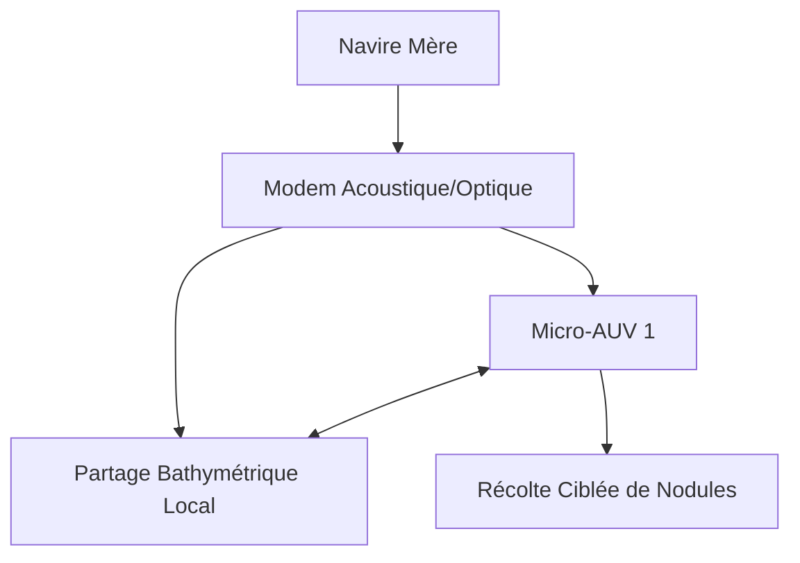
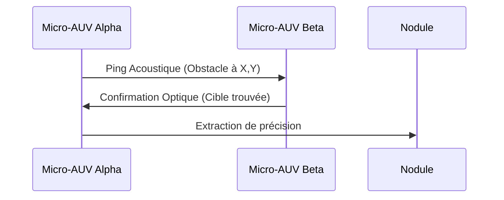

<!-- markdownlint-disable MD009 MD010 MD013 MD022 MD028 MD032 MD033 MD034 MD036 MD037 MD039 MD041 MD058 MD060 -->

[🇬🇧 English Version](./README.md)

# Abyssal Swarm Autonomy

> **Résumé exécutif :** Un système d'exploitation edge-computing pour essaims de micro-AUV, coopérant pour récolter des minéraux marins critiques sans dommages environnementaux.

---

## 1. Aperçu visuel & Effet Wahou

## 2. La thèse contrariante (Peter Thiel Style)

La croyance populaire : L'exploitation minière en eaux profondes nécessite d'énormes véhicules téléopérés (ROV) câblés pour draguer aveuglément les fonds marins.
La vérité cachée : Le dragage massif détruit les écosystèmes abyssaux. Une récolte véritablement durable exige des essaims autonomes et décentralisés de micro-robots communiquant acoustiquement pour cartographier et prélever sélectivement des nodules individuels.

## 3. Le problème & La cible

Modèle économique : B2B
Cible précise : Sociétés d'exploration minière sous-marine, Organismes de recherche océanographique, Défense (Guerre navale).
La douleur urgente : L'exploitation des nodules polymétalliques (terres rares cruciales pour la transition énergétique) dans les plaines abyssales est impossible avec les ROV câblés actuels ou les grands AUV solitaires, limités par la communication et le manque de conscience spatiale.

## 4. Architecture technique & Plomberie

## 5. Modèle économique & Viabilité financière

| Métrique                    | Valeur                                                      |
| --------------------------- | ----------------------------------------------------------- |
| Structure de prix           | Licence logicielle par essaim + frais télémétrie de mission |
| Objectif 12 mois            | 3 flottes d'exploration actives déployées                   |
| Calcul du CA (Target 100k€) | 3 flottes \* 400k€ licence annuelle                         |
| Marge brute estimée         | 90%                                                         |

## 6. Moteur de distribution & Fossé défensif (Moat)

Stratégie d'acquisition : Programmes pilotes directs avec des instituts de recherche marine et des sociétés pionnières d'exploitation sous-marine.
Moat (Barrière à l'entrée) : La communication sous l'eau souffre d'une bande passante extrêmement faible, d'une latence élevée et d'interférences multipath. Les algorithmes d'essaim cloud-based échouent ici. Notre protocole de routage acoustique edge à très basse consommation est impossible à répliquer rapidement.

## 7. Grille d'évaluation détaillée

| Critère                           | Score VC (/100) | Score Terrain (/100) |
| --------------------------------- | --------------- | -------------------- |
| Thèse & Monopole / Urgence        | -- / 25         | -- / 25              |
| Moat / Résistance aux LLM natifs  | -- / 25         | -- / 25              |
| Scalabilité / Friction d'adoption | -- / 25         | -- / 25              |
| Unit Economics / ROI direct       | -- / 25         | -- / 25              |
| **TOTAL**                         | **-- / 100**    | **-- / 100**         |

> **Verdict VC :** En attente d'évaluation.
> **Verdict Terrain :** En attente d'évaluation.
