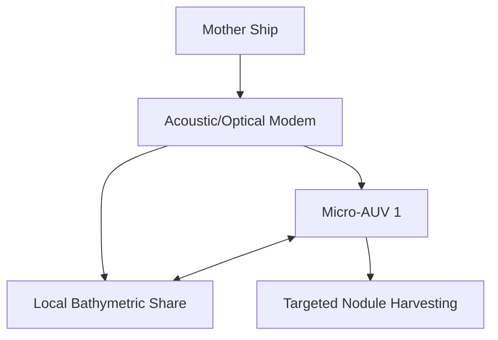
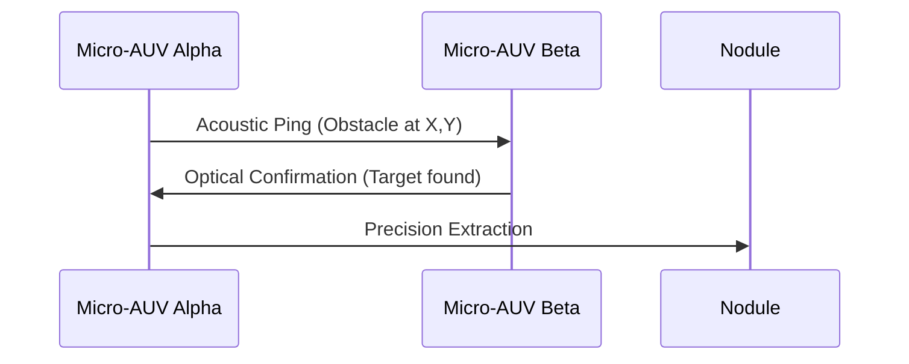

<!-- markdownlint-disable MD009 MD010 MD013 MD022 MD028 MD032 MD033 MD034 MD036 MD037 MD039 MD041 MD058 MD060 -->

[🇫🇷 Version Française](./README.fr.md)

# Abyssal Swarm Autonomy

> **Executive Summary:** An edge-computing operating system for micro-AUV swarms to cooperatively harvest critical deep-sea minerals without environmental damage.

---

## 1. Visual Overview & Wow Effect

## 2. Contrarian Thesis (Peter Thiel Style)

Popular Belief: Deep-sea mining requires massive, tethered remotely operated vehicles (ROVs) to dredge the ocean floor blindly.
Hidden Truth: Massive dredging destroys abyssal ecosystems. True sustainable harvesting requires autonomous, decentralized swarms of micro-robots communicating acoustically to map and pick individual nodules selectively.

## 3. Problem & Target Market

Business Model: B2B
Target Audience: Underwater mining exploration companies, oceanographic research institutes, naval defense.
Urgent Pain Point: Harvesting polymetallic nodules (critical rare earths for the energy transition) in abyssal plains is impossible with current tethered ROVs or large solitary AUVs, which are limited by communication constraints and lack of adaptive spatial awareness.

## 4. Technical Architecture & Infrastructure

## 5. Business Model & Financial Viability

| Metric                 | Value                                                 |
| ---------------------- | ----------------------------------------------------- |
| Pricing Structure      | Software licensing per swarm + mission telemetry fees |
| 12-Month Target        | 3 active exploration fleets deployed                  |
| Revenue Formula        | 3 fleets \* $400k annual license                      |
| Estimated Gross Margin | 90%                                                   |

## 6. Distribution Engine & Moat

Acquisition Strategy: Direct pilot programs with marine research institutes and vanguard subsea mining companies.
Moat (Defensibility): Underwater communication suffers from extreme low bandwidth, high latency, and multipath interference. Cloud-based swarm algorithms or data-heavy AI agents fail entirely here. Our proprietary low-power, edge-native acoustic routing protocol is impossible to replicate quickly.

## 7. Detailed Evaluation Grid

| Criterion                   | VC Score (/100) | Market Score (/100) |
| --------------------------- | --------------- | ------------------- |
| Thesis & Monopoly / Urgency | -- / 25         | 18 / 25             |
| Moat / LLM Immunity         | -- / 25         | 25 / 25             |
| Scalability / UX Friction   | -- / 25         | 12 / 25             |
| Unit Economics / ROI        | -- / 25         | 19 / 25             |
| **TOTAL**                   | **-- / 100**    | **74 / 100**        |

> **VC Verdict:** Pending evaluation.
> **Market Verdict:** Deep-sea harvesting addresses critical mineral shortages, though regulatory urgency varies. It is entirely immune to LLMs due to its hardcore robotics and physical operations. High CapEx and deployment complexity introduce massive friction, but the immense value of rare earth minerals makes monetization straightforward.
