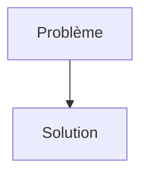
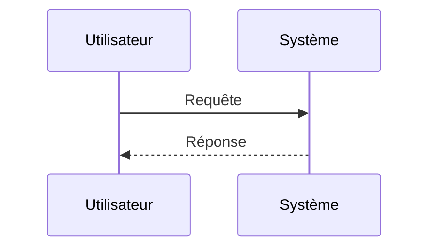

<!-- markdownlint-disable MD009 MD010 MD013 MD022 MD028 MD032 MD033 MD034 MD036 MD037 MD039 MD041 MD058 MD060 -->
<!-- markdownlint-disable MD033 MD041 -->

[🇬🇧 English Version](./README.md)

# YieldTwin

> **Résumé exécutif :** Digital Twin for Semiconductor Yield

---

## 1. Aperçu visuel & Effet Wahou

## 2. La thèse contrariante (Peter Thiel Style)

- **La croyance populaire :** [Ce que la majorité pense sur ce marché]
- **La vérité cachée :** [La réalité non intuitive exploitée par cette startup]

## 3. Le problème & La cible

- **Modèle économique :** B2B
- **Cible précise :** Fonderies de semi-conducteurs (TSMC, Samsung, Intel, GlobalFoundries) et ingénieurs en intégration de processus.
- **La douleur urgente :** Les cycles d'apprentissage des nouveaux nœuds de gravure (ex: 2nm, 1.8nm) durent des mois et coûtent des milliards. Une infime variation d'un paramètre physico-chimique peut détruire le rendement (yield) d'un wafer entier. L'optimisation empirique coûte un temps critique dans une course géopolitique où les marges reposent sur la vitesse de montée en rendement (ramp-up).

## 4. Architecture technique & Plomberie

## 5. Modèle économique & Viabilité financière

| Métrique                        | Valeur                                                          |
| ------------------------------- | --------------------------------------------------------------- |
| **Structure de prix**           | [Prix / Modèle d'abonnement / Commission]                       |
| **Objectif 12 mois**            | [Nombre exact de clients/utilisateurs/transactions nécessaires] |
| **Calcul du CA (Target 100k€)** | [Formule mathématique exacte]                                   |
| **Marge brute estimée**         | [Marge en %]                                                    |

## 6. Moteur de distribution & Fossé défensif (Moat)

- **Stratégie d'acquisition :** [Viralité B2C, réseau C2C, acquisition B2B directe, adhésion dev M2M]
- **Moat (Barrière à l'entrée) :** L'analyse de données classique (SaaS) échoue car les données de production sont extrêmement sporadiques, bruitées et non-linéaires au niveau atomique. Seule une approche couplant physique des plasmas, thermodynamique et IA générative avec des modèles propriétaires peut prédire les défaillances. Un LLM ne connaît pas les équations d'état d'un plasma de gravure.

## 7. Grille d'évaluation détaillée

| Critère                               | Score VC (/100) | Score Terrain (/100) |
| ------------------------------------- | --------------- | -------------------- |
| **Thèse & Monopole / Urgence**        | -- / 25         | -- / 25              |
| **Moat / Résistance aux LLM natifs**  | -- / 25         | -- / 25              |
| **Scalabilité / Friction d'adoption** | -- / 25         | -- / 25              |
| **Unit Economics / ROI direct**       | -- / 25         | -- / 25              |
| **TOTAL**                             | **-- / 100**    | **-- / 100**         |

> **Verdict VC :** En attente d'évaluation.
>
> **Verdict Terrain :** En attente d'évaluation.
