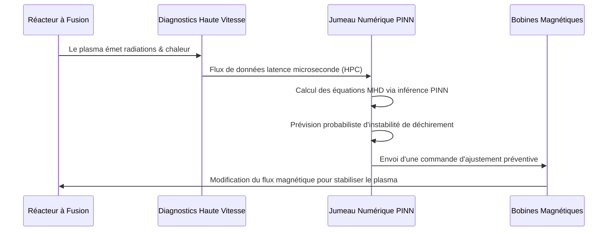

<!-- markdownlint-disable MD009 MD010 MD013 MD022 MD028 MD032 MD033 MD034 MD036 MD037 MD039 MD041 MD058 MD060 -->

[ 🇬🇧 English Version ](./README.md)

# Fusion Plasma Digital Twin

> **Résumé exécutif :** Un Jumeau Numérique (World Model) hybride combinant l'équation magnétohydrodynamique (MHD) classique avec des réseaux de neurones informés par la physique (PINNs). Il prédit et corrige les instabilités du plasma en temps réel, évitant des dommages chiffrés en millions de dollars sur les réacteurs à fusion.


---

## 1. Aperçu visuel & Effet Wahou

```mermaid
graph TD
    A[Réacteur à Fusion (Tokamak)] -->|Données Capteurs (Microseconde)| B[Jumeau Numérique Hybride]
    B -->|Moteur Physique MHD| C{IA Prédictive (PINNs)}
    C -->|Prédit un Plasma Stable| D[Maintenir Champ Magnétique]
    C -->|Prédit une Disruption dans 5ms| E[Calculer Correction Magnétique]
    E --> F[Ajuster Bobines Magnétiques (Temps Réel)]
    F --> A
```

## 2. La thèse contrariante (Peter Thiel Style)

- **La croyance populaire :** La clé pour atteindre la fusion nucléaire commerciale est simplement de construire des aimants et des réacteurs de plus en plus puissants.
- **La vérité cachée :** Nous avons déjà des aimants assez puissants, mais il nous manque les systèmes de contrôle logiciels. Le plasma est fondamentalement chaotique. On ne peut pas résoudre le confinement magnétique uniquement par la force brute de l'ingénierie matérielle ; il faut le résoudre via une intelligence artificielle ultrarapide, informée par la physique, capable de réagir plus vite que le plasma ne se déstabilise.

## 3. Le problème & La cible

- **Modèle économique :** B2B
- **Cible précise :** Startups de fusion nucléaire, laboratoires de recherche nationaux (ITER, CEA).
- **La douleur urgente :** Le confinement magnétique ou inertiel des plasmas de fusion subit des instabilités chaotiques (disruptions) qui détruisent la réaction en quelques millisecondes. Ces anomalies endommagent gravement la structure des réacteurs extrêmement coûteux (Tokamaks, Stellarators), bloquant ainsi l'avancée de la R&D sur la fusion.

## 4. Architecture technique & Plomberie



## 5. Modèle économique & Viabilité financière

| Métrique                        | Valeur                                                          |
| :------------------------------ | :-------------------------------------------------------------- |
| **Structure de prix**           | Licence logicielle annuelle HPC + consulting en intégration R&D |
| **Objectif 12 mois**            | 1 programme pilote avec une startup/labo majeur de fusion       |
| **Calcul du CA (Target 100k€)** | 1 Contrat Pilote R&D = 150 000 €                                |
| **Marge brute estimée**         | 60% (Coûts initiaux HPC/Calcul élevés)                          |

## 6. Moteur de distribution & Fossé défensif (Moat)

- **Stratégie d'acquisition :** Vente scientifique directe (High-touch) ciblant les CTOs de la quarantaine de startups de fusion bien financées à l'échelle mondiale, en commençant par des pilotes localisés sur de petits réacteurs de test.
- **Moat (Barrière à l'entrée) :** L'IA générative standard ne sait pas résoudre des équations différentielles de manière fiable. Ce projet exige une intégration profonde du calcul haute performance (HPC), du matériel à latence microseconde, et une expertise de pointe en physique des plasmas. De plus, les vraies données de fusion à haute température sont rarissimes et silotées.

## 7. Grille d'évaluation détaillée

| Critère                               | Score VC (/100) | Score Terrain (/100) |
| :------------------------------------ | :-------------- | :------------------- |
| **Thèse & Monopole / Urgence**        | -- / 25         | -- / 25              |
| **Moat / Résistance aux LLM natifs**  | -- / 25         | -- / 25              |
| **Scalabilité / Friction d'adoption** | -- / 25         | -- / 25              |
| **Unit Economics / ROI direct**       | -- / 25         | -- / 25              |
| **TOTAL**                             | **-- / 100**    | **-- / 100**         |

> **Verdict VC :** En attente d'évaluation.

> **Verdict Terrain :** En attente d'évaluation.
