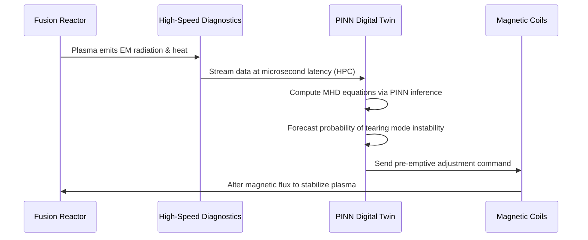

<!-- markdownlint-disable MD009 MD010 MD013 MD022 MD028 MD032 MD033 MD034 MD036 MD037 MD039 MD041 MD058 MD060 -->

[ 🇫🇷 Version Française ](./README.fr.md)

# Fusion Plasma Digital Twin

> **Executive Summary:** A hybrid World Model combining classical magnetohydrodynamic (MHD) equations with Physics-Informed Neural Networks (PINNs) to predict and dynamically mitigate plasma instabilities in real-time, preventing multi-million dollar damage to nuclear fusion reactors.


---

## 1. Visual Overview & Wow Effect

```mermaid
graph TD
    A[Fusion Reactor (Tokamak)] -->|Microsecond Sensor Data| B[Hybrid Digital Twin]
    B -->|MHD Physics Engine| C{Predictive AI (PINNs)}
    C -->|Predicts Stable Plasma| D[Maintain Magnetic Field]
    C -->|Predicts Disruption in 5ms| E[Calculate Magnetic Correction]
    E --> F[Adjust Magnetic Coils (Real-Time)]
    F --> A
```

## 2. Contrarian Thesis (Peter Thiel Style)

- **Popular Belief:** The key to achieving commercial nuclear fusion is simply building larger, more powerful magnets and reactors.
- **Hidden Truth:** We already have powerful enough magnets, but we lack the software control systems. Plasma is fundamentally chaotic. You cannot solve magnetic confinement through brute-force engineering alone; you must solve it through high-speed, physics-aware artificial intelligence capable of reacting faster than the plasma can destabilize.

## 3. Problem & Target Market

- **Business Model:** B2B
- **Target Audience:** Nuclear fusion startups (e.g., Commonwealth Fusion Systems, Tokamak Energy), and national research laboratories (ITER, CEA).
- **Urgent Pain Point:** Magnetic or inertial confinement of fusion plasmas suffers from chaotic instabilities (disruptions). These anomalies can destroy the fusion reaction in milliseconds and inflict severe structural damage on the extremely expensive reactors (Tokamaks, Stellarators), severely bottlenecking fusion R&D.

## 4. Technical Architecture & Infrastructure



## 5. Business Model & Financial Viability

| Metric                     | Value                                                      |
| :------------------------- | :--------------------------------------------------------- |
| **Pricing Structure**      | Annual HPC software licensing + R&D integration consulting |
| **12-Month Target**        | 1 pilot program with a major fusion startup/lab            |
| **Revenue Formula**        | 1 R&D Pilot Contract = €150,000                            |
| **Estimated Gross Margin** | 60% (High initial compute/HPC costs)                       |

## 6. Distribution Engine & Moat

- **Acquisition Strategy:** High-touch, direct scientific sales targeting the CTOs of the ~40 well-funded fusion startups globally, starting with localized pilot experiments on smaller test reactors.
- **Moat (Defensibility):** Generative AI cannot solve differential equations reliably. This requires a profound integration of high-performance computing (HPC), microsecond-latency hardware, and deep domain expertise in plasma physics. Real high-temperature fusion data is extremely rare and siloed, creating an immense barrier to entry for standard software companies.

## 7. Detailed Evaluation Grid

| Criterion                       | VC Score (/100) | Market Score (/100) |
| :------------------------------ | :-------------- | :------------------ |
| **Thesis & Monopoly / Urgency** | -- / 25         | -- / 25             |
| **Moat / LLM Immunity**         | -- / 25         | -- / 25             |
| **Scalability / UX Friction**   | -- / 25         | -- / 25             |
| **Unit Economics / ROI**        | -- / 25         | -- / 25             |
| **TOTAL**                       | **-- / 100**    | **-- / 100**        |

> **VC Verdict:** Pending evaluation.

> **Market Verdict:** Pending evaluation.
