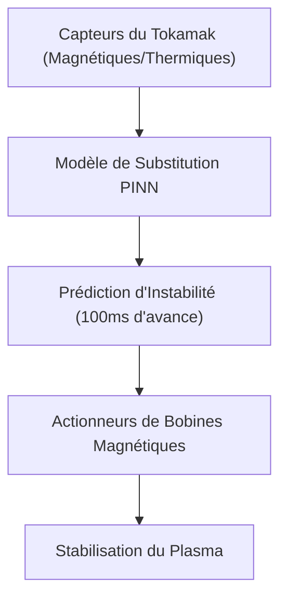
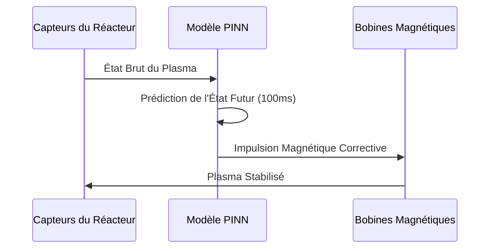

<!-- markdownlint-disable MD009 MD010 MD013 MD022 MD028 MD032 MD033 MD034 MD036 MD037 MD039 MD041 MD058 MD060 -->

[🇬🇧 English Version](./README.md)

# Tokamak Plasma Neural Predictor

> **Résumé exécutif :** Un modèle de substitution d'IA (PINN) en temps réel pour prédire et prévenir les instabilités magnétohydrodynamiques dans les réacteurs à fusion nucléaire.

---

## 1. Aperçu visuel & Effet Wahou

## 2. La thèse contrariante (Peter Thiel Style)

La croyance populaire : Les simulations magnétohydrodynamiques (MHD) de haute fidélité sont le seul moyen de modéliser avec précision le comportement du plasma dans un réacteur à fusion.
La vérité cachée : Les simulations MHD de haute fidélité prennent des jours sur des supercalculateurs. Pour contrôler réellement un réacteur et éviter les dommages structurels, il faut un modèle d'IA de substitution de l'ordre de la milliseconde, contraint par des lois physiques strictes.

## 3. Le problème & La cible

Modèle économique : B2B
Cible précise : Entreprises privées de fusion nucléaire (ex: Commonwealth Fusion Systems), Laboratoires de recherche (ITER).
La douleur urgente : Maintenir la stabilité du plasma (magnétohydrodynamique) dans un réacteur à fusion est un défi d'ingénierie majeur. Les instabilités (disruptions) peuvent détruire les parois du réacteur en quelques millisecondes, et les simulations traditionnelles sont trop lentes.

## 4. Architecture technique & Plomberie

## 5. Modèle économique & Viabilité financière

| Métrique                    | Valeur                                    |
| --------------------------- | ----------------------------------------- |
| Structure de prix           | Licence logicielle par réacteur + support |
| Objectif 12 mois            | 2 déploiements sur réacteurs de recherche |
| Calcul du CA (Target 100k€) | 2 réacteurs \* 500k€/an                   |
| Marge brute estimée         | 85%                                       |

## 6. Moteur de distribution & Fossé défensif (Moat)

Stratégie d'acquisition : Partenariats R&D directs avec les startups de fusion de pointe et les laboratoires nationaux.
Moat (Barrière à l'entrée) : Les LLMs standards ou modèles de deep learning génériques échouent à modéliser des systèmes physiques chaotiques obéissant à des lois de conservation. Une IA contrainte par la physique (PINN) couplée à un contrôle magnétique ultra-rapide est très difficile à répliquer.

## 7. Grille d'évaluation détaillée

| Critère                           | Score VC (/100) | Score Terrain (/100) |
| --------------------------------- | --------------- | -------------------- |
| Thèse & Monopole / Urgence        | -- / 25         | -- / 25              |
| Moat / Résistance aux LLM natifs  | -- / 25         | -- / 25              |
| Scalabilité / Friction d'adoption | -- / 25         | -- / 25              |
| Unit Economics / ROI direct       | -- / 25         | -- / 25              |
| **TOTAL**                         | **-- / 100**    | **-- / 100**         |

> **Verdict VC :** En attente d'évaluation.
> **Verdict Terrain :** En attente d'évaluation.
