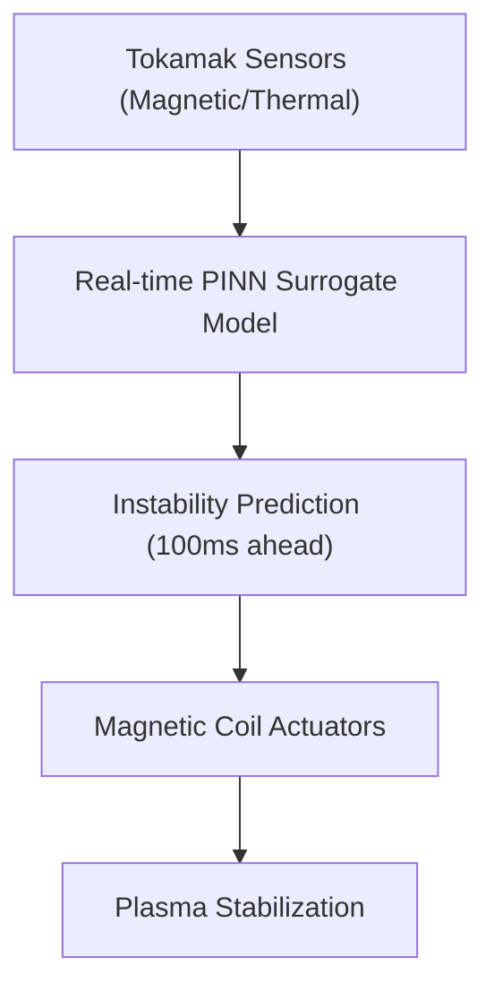
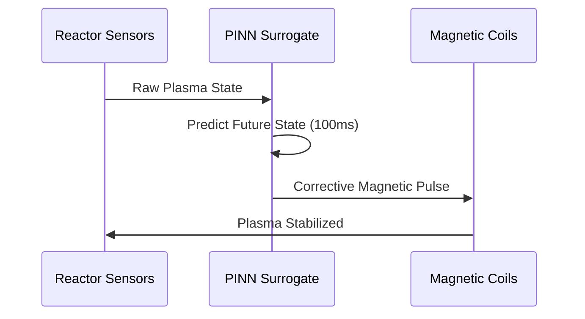

<!-- markdownlint-disable MD009 MD010 MD013 MD022 MD028 MD032 MD033 MD034 MD036 MD037 MD039 MD041 MD058 MD060 -->

[🇫🇷 Version Française](./README.fr.md)

# Tokamak Plasma Neural Predictor

> **Executive Summary:** A real-time Physics-Informed Neural Network (PINN) surrogate model to predict and prevent magnetohydrodynamic instabilities in nuclear fusion reactors.

---

## 1. Visual Overview & Wow Effect

## 2. Contrarian Thesis (Peter Thiel Style)

Popular Belief: High-fidelity magnetohydrodynamic (MHD) simulations are the only way to accurately model plasma behavior in a fusion reactor.
Hidden Truth: High-fidelity MHD simulations take days on supercomputers. To actually control a reactor and prevent structural damage, you need a sub-millisecond AI surrogate model constrained by strict physical laws.

## 3. Problem & Target Market

Business Model: B2B
Target Audience: Private nuclear fusion companies (e.g., Commonwealth Fusion Systems), major research laboratories (ITER).
Urgent Pain Point: Maintaining plasma stability in a Tokamak or Stellarator is incredibly complex. Disruptions can destroy the reactor walls in milliseconds, but traditional simulations are too slow to run in the control loop.

## 4. Technical Architecture & Infrastructure

## 5. Business Model & Financial Viability

| Metric                 | Value                                             |
| ---------------------- | ------------------------------------------------- |
| Pricing Structure      | Enterprise software license per reactor + support |
| 12-Month Target        | 2 active research reactor deployments             |
| Revenue Formula        | 2 reactors \* $500k/year                          |
| Estimated Gross Margin | 85%                                               |

## 6. Distribution Engine & Moat

Acquisition Strategy: Direct R&D partnerships with leading fusion startups and national labs.
Moat (Defensibility): Standard LLMs or generic deep learning models fail to model chaotic physical systems obeying strict conservation laws. A highly specialized Physics-Informed Neural Network tightly coupled to ultra-fast magnetic control hardware is extremely hard to replicate.

## 7. Detailed Evaluation Grid

| Criterion                   | VC Score (/100) | Market Score (/100) |
| --------------------------- | --------------- | ------------------- |
| Thesis & Monopoly / Urgency | -- / 25         | 20 / 25             |
| Moat / LLM Immunity         | -- / 25         | 22 / 25             |
| Scalability / UX Friction   | -- / 25         | 18 / 25             |
| Unit Economics / ROI        | -- / 25         | 16 / 25             |
| **TOTAL**                   | **-- / 100**    | **76 / 100**        |

> **VC Verdict:** Pending evaluation.
> **Market Verdict:** Accelerating fusion research is highly urgent for energy independence. The deep physics-based simulation ensures it won't be replaced by general-purpose LLMs anytime soon. Friction is moderate due to the extreme niche of users, and monetization relies on massive R&D budgets from a few key players.
