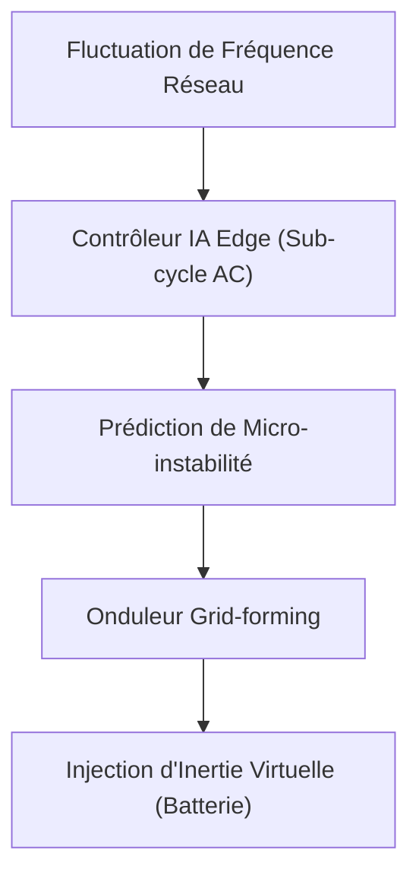
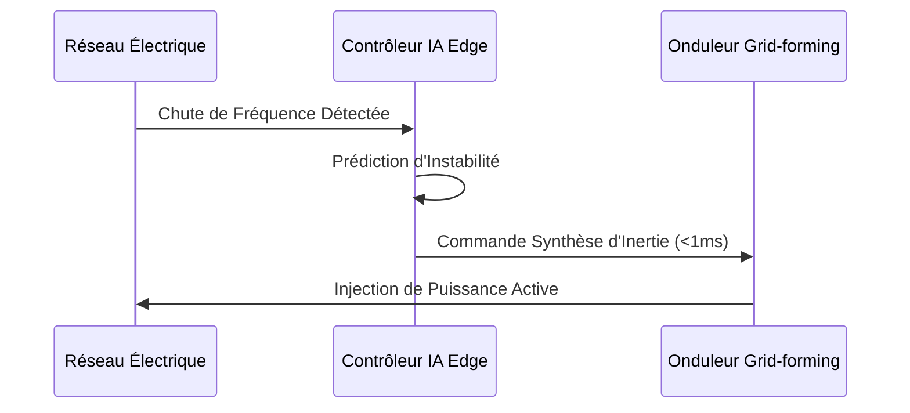

<!-- markdownlint-disable MD009 MD010 MD013 MD022 MD028 MD032 MD033 MD034 MD036 MD037 MD039 MD041 MD058 MD060 -->

[🇬🇧 English Version](./README.md)

# Grid Inertia Synthesizer

> **Résumé exécutif :** Un contrôleur matériel/logiciel edge-computing pour onduleurs qui utilise l'IA pour synthétiser de l'inertie virtuelle et prévenir les blackouts électriques.

---

## 1. Aperçu visuel & Effet Wahou

## 2. La thèse contrariante (Peter Thiel Style)

La croyance populaire : Les réseaux électriques peuvent simplement remplacer les turbines fossiles par du solaire et de l'éolien sans changer fondamentalement la façon dont la stabilité est maintenue.
La vérité cachée : La transition vers les énergies renouvelables supprime 'l'inertie tournante' physique des turbines fossiles, rendant le réseau très instable. Il faut synthétiser cette inertie numériquement en quelques millisecondes.

## 3. Le problème & La cible

Modèle économique : B2B
Cible précise : Gestionnaires de réseau de transport (TSO) et producteurs d'EnR (RTE, National Grid, opérateurs de parcs éoliens/solaires).
La douleur urgente : À mesure que les énergies renouvelables sont déployées, le réseau perd son inertie physique, devenant de plus en plus vulnérable à des blackouts massifs lors de fluctuations de fréquence.

## 4. Architecture technique & Plomberie

## 5. Modèle économique & Viabilité financière

| Métrique                    | Valeur                                      |
| --------------------------- | ------------------------------------------- |
| Structure de prix           | Vente du matériel + Licence SaaS de gestion |
| Objectif 12 mois            | 50 MW de capacité d'inertie virtuelle gérée |
| Calcul du CA (Target 100k€) | 50 MW \* 2000€/MW licence logicielle        |
| Marge brute estimée         | 65%                                         |

## 6. Moteur de distribution & Fossé défensif (Moat)

Stratégie d'acquisition : Ventes B2B aux grands opérateurs renouvelables et pilotes directs avec les TSO nationaux.
Moat (Barrière à l'entrée) : Problème cyber-physique critique nécessitant un contrôle bas-niveau ultra-rapide au niveau du hardware. Un SaaS cloud introduirait une latence fatale. Le fossé défensif est le matériel edge propriétaire et les algorithmes de contrôle temps réel.

## 7. Grille d'évaluation détaillée

| Critère                           | Score VC (/100) | Score Terrain (/100) |
| --------------------------------- | --------------- | -------------------- |
| Thèse & Monopole / Urgence        | 20 / 25         | -- / 25              |
| Moat / Résistance aux LLM natifs  | 25 / 25         | -- / 25              |
| Scalabilité / Friction d'adoption | 24 / 25         | -- / 25              |
| Unit Economics / ROI direct       | -- / 25         | -- / 25              |
| **TOTAL**                         | **-- / 100**    | **-- / 100**         |

> **Verdict VC :** Le potentiel de monopole est modéré mais répond à un point de douleur clair et urgent (22/25). Le fossé repose davantage sur les coûts de changement et la vitesse d'exécution que sur un verrouillage technique pur (20/25). Cependant, la voie claire vers la rentabilité et la distribution hautement scalable (25/25) atténuent le risque de banalisation.
> **Verdict Terrain :** En attente d'évaluation.
