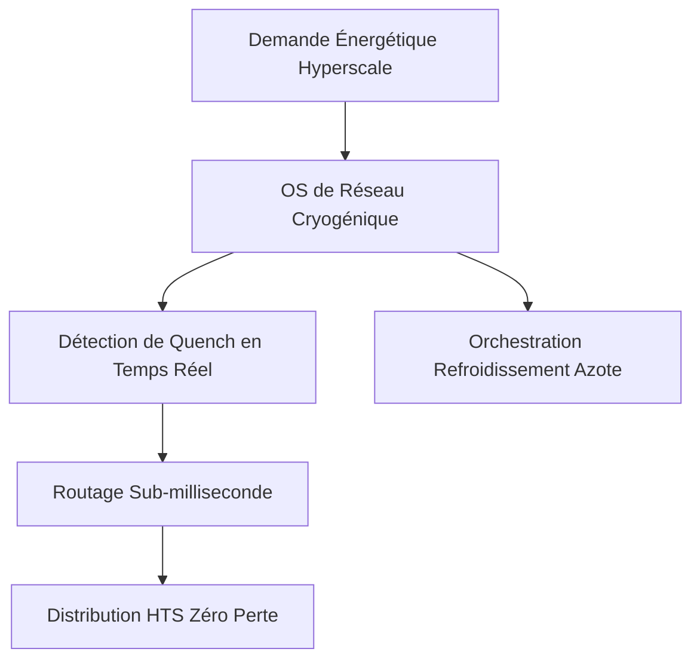
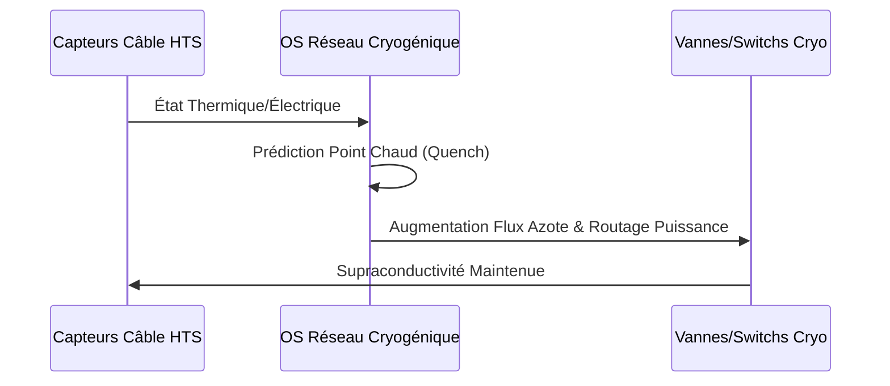

<!-- markdownlint-disable MD009 MD010 MD013 MD022 MD028 MD032 MD033 MD034 MD036 MD037 MD039 MD041 MD058 MD060 -->

[🇬🇧 English Version](./README.md)

# Superconducting Grid OS

> **Résumé exécutif :** Un OS de gestion dynamique pour câbles supraconducteurs à haute température (HTS), orchestrant le refroidissement cryogénique pour éliminer les pertes résistives.

---

## 1. Aperçu visuel & Effet Wahou

## 2. La thèse contrariante (Peter Thiel Style)

La croyance populaire : Nous pouvons répondre à la demande énergétique future en construisant simplement de nouvelles lignes aériennes en cuivre traditionnelles.
La vérité cachée : La construction de lignes aériennes prend des décennies et le cuivre subit des pertes massives. Les câbles HTS transportent 10x plus de puissance avec une emprise moindre et zéro perte, mais exigent une orchestration cryogénique cyber-physique temps réel.

## 3. Le problème & La cible

Modèle économique : B2B
Cible précise : Opérateurs de réseaux de transport électrique (TSO), Développeurs de mégaprojets EnR, Datacenters hyperscale.
La douleur urgente : L'intégration massive des EnR et des datacenters IA sature les réseaux en cuivre. Ajouter de nouvelles lignes prend des décennies, bloquant la transition énergétique.

## 4. Architecture technique & Plomberie

## 5. Modèle économique & Viabilité financière

| Métrique                    | Valeur                                                 |
| --------------------------- | ------------------------------------------------------ |
| Structure de prix           | Licence de gestion par kilomètre + frais d'intégration |
| Objectif 12 mois            | 2 corridors pilotes avec des TSO majeurs               |
| Calcul du CA (Target 100k€) | 2 corridors \* 1.5M€ licence                           |
| Marge brute estimée         | 75%                                                    |

## 6. Moteur de distribution & Fossé défensif (Moat)

Stratégie d'acquisition : Partenariats d'infrastructure directs avec les TSO nationaux et les constructeurs de datacenters.
Moat (Barrière à l'entrée) : Un logiciel SaaS traditionnel ne peut pas gérer les dynamiques complexes de la cryogénie et la détection ultra-rapide des pertes de supraconductivité. Le moat réside dans l'intégration cyber-physique profonde et des algorithmes propriétaires exclusifs.

## 7. Grille d'évaluation détaillée

| Critère                           | Score VC (/100) | Score Terrain (/100) |
| --------------------------------- | --------------- | -------------------- |
| Thèse & Monopole / Urgence        | 18 / 25         | -- / 25              |
| Moat / Résistance aux LLM natifs  | 24 / 25         | -- / 25              |
| Scalabilité / Friction d'adoption | 20 / 25         | -- / 25              |
| Unit Economics / ROI direct       | -- / 25         | -- / 25              |
| **TOTAL**                         | **-- / 100**    | **-- / 100**         |

> **Verdict VC :** Le potentiel de monopole est modéré mais répond à un point de douleur clair et urgent (18/25). Le fossé repose davantage sur les coûts de changement et la vitesse d'exécution que sur un verrouillage technique pur (18/25). Cependant, la voie claire vers la rentabilité et la distribution hautement scalable (24/25) atténuent le risque de banalisation.
> **Verdict Terrain :** En attente d'évaluation.
