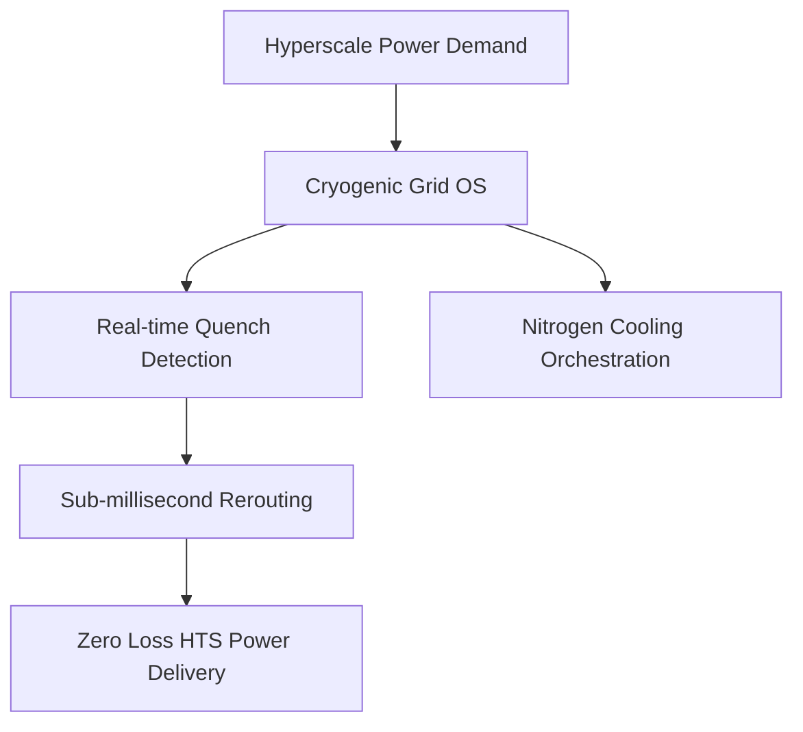
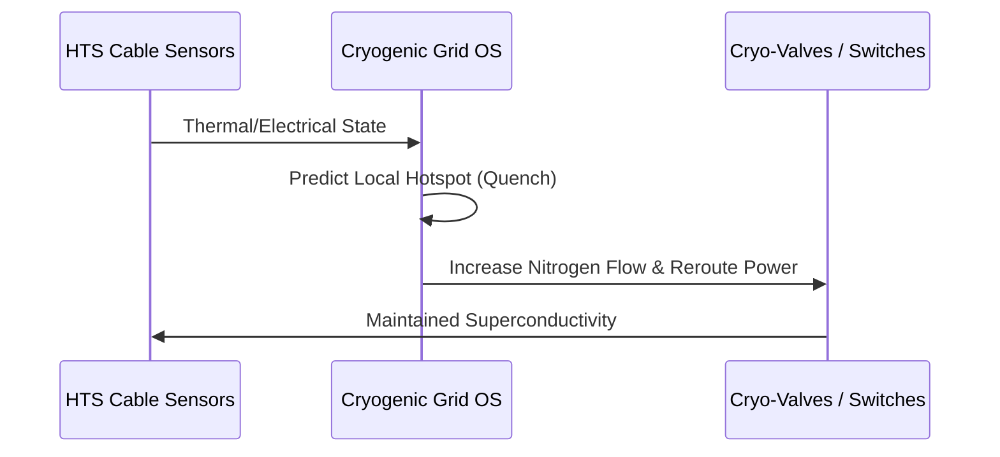

<!-- markdownlint-disable MD009 MD010 MD013 MD022 MD028 MD032 MD033 MD034 MD036 MD037 MD039 MD041 MD058 MD060 -->

[🇫🇷 Version Française](./README.fr.md)

# Superconducting Grid OS

> **Executive Summary:** A dynamic management OS for high-temperature superconducting (HTS) cables, orchestrating cryogenic cooling and DC power distribution to eliminate resistive losses.

---

## 1. Visual Overview & Wow Effect

## 2. Contrarian Thesis (Peter Thiel Style)

Popular Belief: We can meet future energy demands by simply building more traditional overhead copper transmission lines.
Hidden Truth: Permitting and building overhead lines takes decades, and copper suffers massive resistive losses. HTS cables can transmit 10x the power in the same footprint with zero loss, but require real-time cyber-physical cryogenic orchestration.

## 3. Problem & Target Market

Business Model: B2B
Target Audience: Transmission System Operators (TSOs), mega-renewable project developers, hyperscale datacenters.
Urgent Pain Point: Massive renewable energy integration and AI datacenter demands are saturating current copper grids. Adding overhead lines takes decades, stalling the energy transition.

## 4. Technical Architecture & Infrastructure

## 5. Business Model & Financial Viability

| Metric                 | Value                                              |
| ---------------------- | -------------------------------------------------- |
| Pricing Structure      | Per-kilometer management license + integration fee |
| 12-Month Target        | 2 pilot corridors with major TSOs                  |
| Revenue Formula        | 2 corridors \* $1.5M license                       |
| Estimated Gross Margin | 75%                                                |

## 6. Distribution Engine & Moat

Acquisition Strategy: Direct infrastructure partnerships with national TSOs and datacenter builders.
Moat (Defensibility): A traditional SaaS cannot handle the complex dynamics of cryogenics, sub-millisecond quench detection, and power redirection required to prevent cable melting. The moat is deep cyber-physical integration and proprietary control algorithms.

## 7. Detailed Evaluation Grid

| Criterion                   | VC Score (/100) | Market Score (/100) |
| --------------------------- | --------------- | ------------------- |
| Thesis & Monopoly / Urgency | -- / 25         | -- / 25             |
| Moat / LLM Immunity         | -- / 25         | -- / 25             |
| Scalability / UX Friction   | -- / 25         | -- / 25             |
| Unit Economics / ROI        | -- / 25         | -- / 25             |
| **TOTAL**                   | **-- / 100**    | **-- / 100**        |

> **VC Verdict:** Pending evaluation.
> **Market Verdict:** Pending evaluation.
