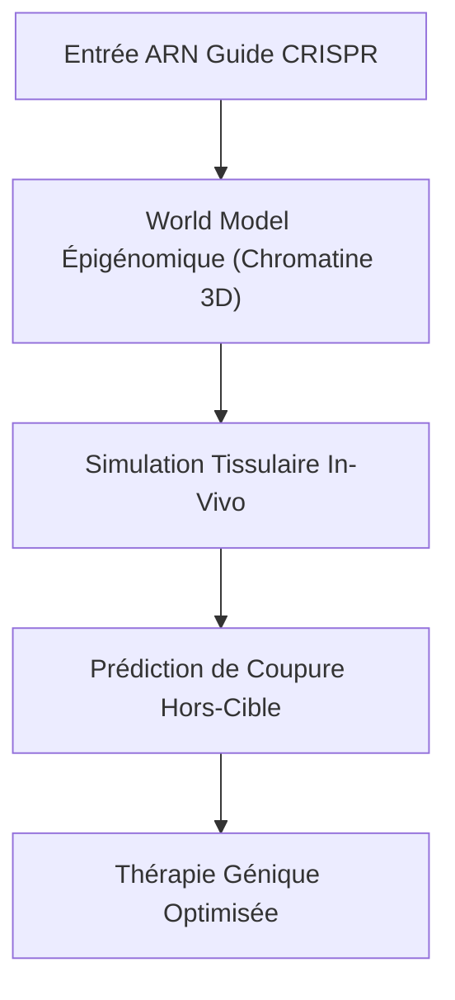
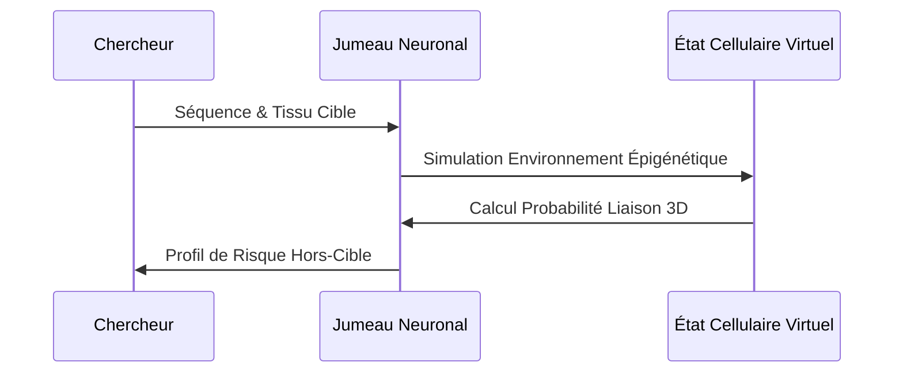

<!-- markdownlint-disable MD009 MD010 MD013 MD022 MD028 MD032 MD033 MD034 MD036 MD037 MD039 MD041 MD058 MD060 -->

[🇬🇧 English Version](./README.md)

# CRISPR Off-Target Neural Twin

> **Résumé exécutif :** Un modèle de fondation de l'épigénome (World Model biochimique) qui prédit les effets hors-cible de CRISPR in-vivo, accélérant le développement de thérapies géniques sûres.

---

## 1. Aperçu visuel & Effet Wahou

## 2. La thèse contrariante (Peter Thiel Style)

La croyance populaire : Les LLMs standards ou de simples algorithmes d'appariement de séquences peuvent prédire où une enzyme CRISPR va couper l'ADN par erreur.
La vérité cachée : La coupure de l'ADN dépend de la structure dynamique 3D de la chromatine et des modifications épigénétiques spécifiques aux tissus. Il faut un modèle d'IA géométrique spécialisé entraîné sur des données multi-omiques, pas juste du text-matching.

## 3. Le problème & La cible

Modèle économique : B2B
Cible précise : Laboratoires pharmaceutiques, Startups en thérapie génique (Directeurs R&D, Bioinformaticiens).
La douleur urgente : Les thérapies géniques échouent souvent en phase clinique car les nucléases coupent l'ADN à des endroits non désirés (effets hors-cible), causant des mutations. L'identification in-vivo est lente et imprévisible.

## 4. Architecture technique & Plomberie

## 5. Modèle économique & Viabilité financière

| Métrique                    | Valeur                                    |
| --------------------------- | ----------------------------------------- |
| Structure de prix           | Abonnement SaaS + frais d'utilisation API |
| Objectif 12 mois            | 10 clients biotech de taille moyenne      |
| Calcul du CA (Target 100k€) | 10 clients \* 120k€/an                    |
| Marge brute estimée         | 85%                                       |

## 6. Moteur de distribution & Fossé défensif (Moat)

Stratégie d'acquisition : Vente B2B directe aux équipes de biologie computationnelle, partenariats académiques.
Moat (Barrière à l'entrée) : Nécessite de vastes ensembles de données propriétaires de séquençage épigénétique in-vivo et des transformers géométriques spécialisés. Les entreprises d'IA génériques ne peuvent pas reproduire cela sans le pipeline de données wet-lab.

## 7. Grille d'évaluation détaillée

| Critère                           | Score VC (/100) | Score Terrain (/100) |
| --------------------------------- | --------------- | -------------------- |
| Thèse & Monopole / Urgence        | 21 / 25         | -- / 25              |
| Moat / Résistance aux LLM natifs  | 23 / 25         | -- / 25              |
| Scalabilité / Friction d'adoption | 21 / 25         | -- / 25              |
| Unit Economics / ROI direct       | -- / 25         | -- / 25              |
| **TOTAL**                         | **-- / 100**    | **-- / 100**         |

> **Verdict VC :** Le potentiel de monopole est modéré mais répond à un point de douleur clair et urgent (18/25). Le fossé repose davantage sur les coûts de changement et la vitesse d'exécution que sur un verrouillage technique pur (21/25). Cependant, la voie claire vers la rentabilité et la distribution hautement scalable (23/25) atténuent le risque de banalisation.
> **Verdict Terrain :** En attente d'évaluation.
