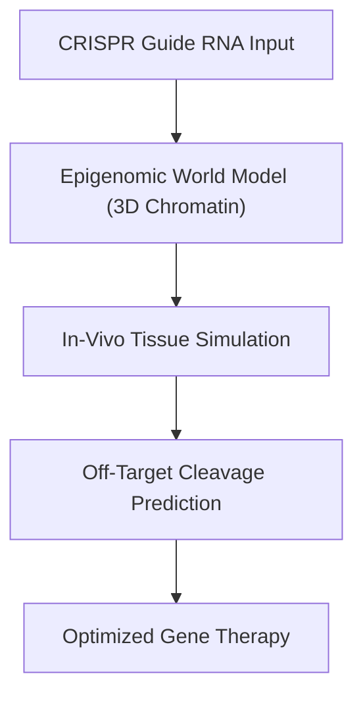
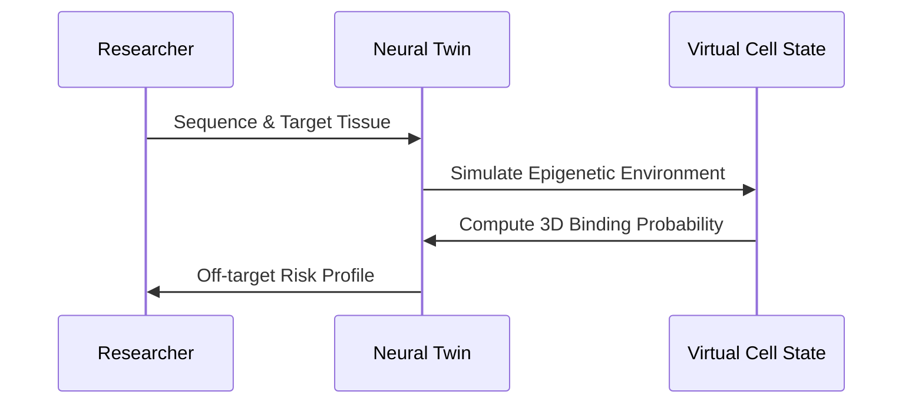

<!-- markdownlint-disable MD009 MD010 MD013 MD022 MD028 MD032 MD033 MD034 MD036 MD037 MD039 MD041 MD058 MD060 -->

[🇫🇷 Version Française](./README.fr.md)

# CRISPR Off-Target Neural Twin

> **Executive Summary:** A foundational epigenome world model that predicts CRISPR off-target effects in-vivo, accelerating safe gene therapy development.

---

## 1. Visual Overview & Wow Effect

## 2. Contrarian Thesis (Peter Thiel Style)

Popular Belief: Standard LLMs or simple sequence-matching algorithms can predict where a CRISPR enzyme will mistakenly cut DNA.
Hidden Truth: DNA cutting depends on the 3D dynamic structure of chromatin and tissue-specific epigenetic modifications. You need a specialized geometric AI model trained on multi-omic data, not just text matching.

## 3. Problem & Target Market

Business Model: B2B
Target Audience: Pharmaceutical companies, Gene therapy startups (R&D Directors, Bioinformaticians).
Urgent Pain Point: Gene therapies often fail in clinical trials because nucleases cut DNA at unintended sites, causing potentially oncogenic mutations. Identifying these errors in-vivo is slow, expensive, and unpredictable.

## 4. Technical Architecture & Infrastructure

## 5. Business Model & Financial Viability

| Metric                 | Value                                      |
| ---------------------- | ------------------------------------------ |
| Pricing Structure      | SaaS subscription tier + API compute usage |
| 12-Month Target        | 10 mid-size biotech customers              |
| Revenue Formula        | 10 customers \* $120k/year                 |
| Estimated Gross Margin | 85%                                        |

## 6. Distribution Engine & Moat

Acquisition Strategy: Direct B2B sales to computational biology teams, academic partnerships.
Moat (Defensibility): This requires massive, proprietary in-vivo epigenetic sequencing datasets and specialized geometric transformers. It's a complex structural modeling problem that generic AI companies cannot replicate without the wet-lab data pipeline.

## 7. Detailed Evaluation Grid

| Criterion                   | VC Score (/100) | Market Score (/100) |
| --------------------------- | --------------- | ------------------- |
| Thesis & Monopoly / Urgency | -- / 25         | -- / 25             |
| Moat / LLM Immunity         | -- / 25         | -- / 25             |
| Scalability / UX Friction   | -- / 25         | -- / 25             |
| Unit Economics / ROI        | -- / 25         | -- / 25             |
| **TOTAL**                   | **-- / 100**    | **-- / 100**        |

> **VC Verdict:** Pending evaluation.
> **Market Verdict:** Pending evaluation.
