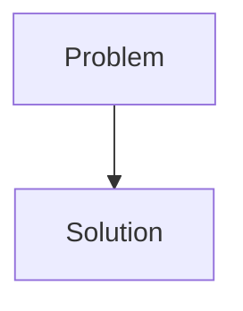
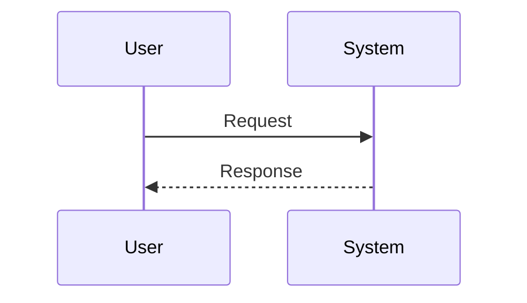

<!-- markdownlint-disable MD009 MD010 MD013 MD022 MD028 MD032 MD033 MD034 MD036 MD037 MD039 MD041 MD058 MD060 -->
<!-- markdownlint-disable MD033 MD041 -->

[🇫🇷 Version Française](./README.fr.md)

# ScadaShield

> **Executive Summary:** Legacy SCADA Modernizer & Protector

---

## 1. Visual Overview & Wow Effect

## 2. Contrarian Thesis (Peter Thiel Style)

- **Popular Belief:** [What the consensus thinks about this market]
- **Hidden Truth:** [The non-intuitive reality leveraged by this startup]

## 3. Problem & Target Market

- **Business Model:** B2B
- **Target Audience:** Vital Infrastructure Operators (VIOs): water treatment, power plants, gas pipelines, petrochemical plants.
- **Urgent Pain Point:** Critical industrial systems (OT/SCADA) work with equipment (PLCs) that are 20 to 30 years old. They use clear communication protocols, without cryptographic authentication (Modbus, DNP3). They cannot be updated or turned off. A compromise (ransomware) of these networks can lead to ecological disasters or paralyze an entire country.

## 4. Technical Architecture & Infrastructure

## 5. Business Model & Financial Viability

| Metric                     | Value                                     |
| -------------------------- | ----------------------------------------- |
| **Pricing Structure**      | [Price / Subscription Model / Commission] |
| **12-Month Target**        | [Exact volume required for 100k ARR]      |
| **Revenue Formula**        | [Mathematical calculation]                |
| **Estimated Gross Margin** | [Margin %]                                |

## 6. Distribution Engine & Moat

- **Acquisition Strategy:** [Virality, network effect, direct sales, developer adoption]
- **Moat (Defensibility):** Classic IT Security (CrowdStrike, Palo Alto) does not include proprietary OT protocols or the physical laws of the industrial process. A false positive (blocking a legitimate command) is as dangerous as an attack. The solution must be "Fail-Safe" and isolated from the Internet (Air-gapped).

## 7. Detailed Evaluation Grid

| Criterion                       | VC Score (/100) | Market Score (/100) |
| ------------------------------- | --------------- | ------------------- |
| **Thesis & Monopoly / Urgency** | -- / 25         | -- / 25             |
| **Moat / LLM Immunity**         | -- / 25         | -- / 25             |
| **Scalability / UX Friction**   | -- / 25         | -- / 25             |
| **Unit Economics / ROI**        | -- / 25         | -- / 25             |
| **TOTAL**                       | **-- / 100**    | **-- / 100**        |

> **VC Verdict:** Pending evaluation.
>
> **Market Verdict:** Pending evaluation.
