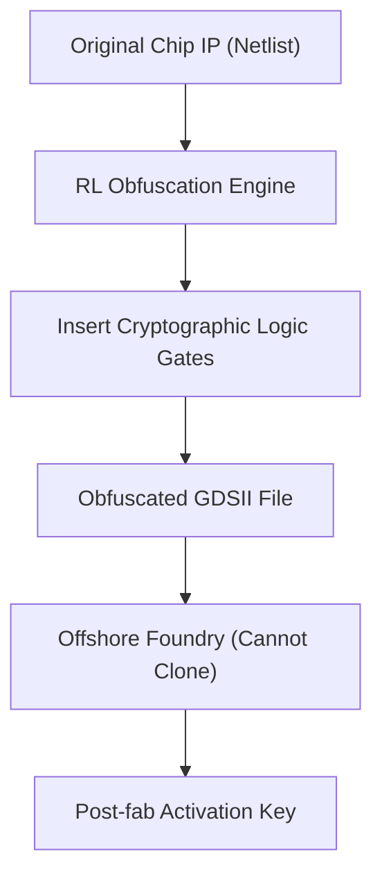
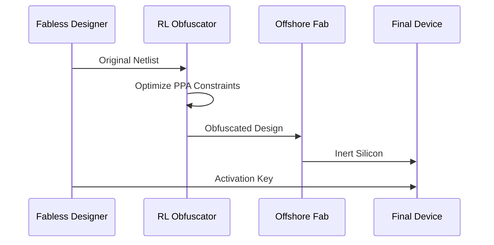

<!-- markdownlint-disable MD009 MD010 MD013 MD022 MD028 MD032 MD033 MD034 MD036 MD037 MD039 MD041 MD058 MD060 -->

[🇫🇷 Version Française](./README.fr.md)

# Hardware Obfuscator AI

> **Executive Summary:** A Reinforcement Learning engine that cryptographically obfuscates semiconductor netlists to prevent IP theft and hardware trojans at offshore foundries.

---

## 1. Visual Overview & Wow Effect

## 2. Contrarian Thesis (Peter Thiel Style)

Popular Belief: Legal contracts and trusted foundries are sufficient to protect multibillion-dollar semiconductor IP from cloning or hardware trojans.
Hidden Truth: Offshore foundries routinely overproduce chips for the gray market or reverse-engineer designs. True security requires cryptographically locking the physical silicon logic itself so it is inert without a digital activation key.

## 3. Problem & Target Market

Business Model: B2B
Target Audience: Fabless AI chip designers, semiconductor foundries, IP core providers (VP Hardware Engineering).
Urgent Pain Point: Hardware IP theft costs billions. Foundries can clone GDSII layouts, insert hardware trojans, or overproduce. Securing the supply chain is a critical national security issue.

## 4. Technical Architecture & Infrastructure

## 5. Business Model & Financial Viability

| Metric                 | Value                                                  |
| ---------------------- | ------------------------------------------------------ |
| Pricing Structure      | Per-tapeout licensing fee + royalty per activated chip |
| 12-Month Target        | 5 major tapeouts secured                               |
| Revenue Formula        | 5 tapeouts \* $250k + $0.05 per chip                   |
| Estimated Gross Margin | 90%                                                    |

## 6. Distribution Engine & Moat

Acquisition Strategy: Integration partnerships with EDA tool vendors (Synopsys, Cadence) and direct enterprise sales.
Moat (Defensibility): Modifying billions of transistors while strictly respecting PPA (Power, Performance, Area) constraints is an immensely complex geometric graph problem. Generic AI cannot solve this; it requires highly specialized Reinforcement Learning deeply integrated with EDA workflows.

## 7. Detailed Evaluation Grid

| Criterion                   | VC Score (/100) | Market Score (/100) |
| --------------------------- | --------------- | ------------------- |
| Thesis & Monopoly / Urgency | 23 / 25         | -- / 25             |
| Moat / LLM Immunity         | 22 / 25         | -- / 25             |
| Scalability / UX Friction   | 21 / 25         | -- / 25             |
| Unit Economics / ROI        | -- / 25         | -- / 25             |
| **TOTAL**                   | **-- / 100**    | **-- / 100**        |

> **VC Verdict:** The monopoly potential is moderate but addresses a clear and urgent pain point (19/25). The moat relies more on switching costs and execution speed than pure technical lock-in (23/25). However, the clear path to profitability and highly scalable distribution (22/25) mitigate the risk of commoditization.
> **Market Verdict:** Pending evaluation.
