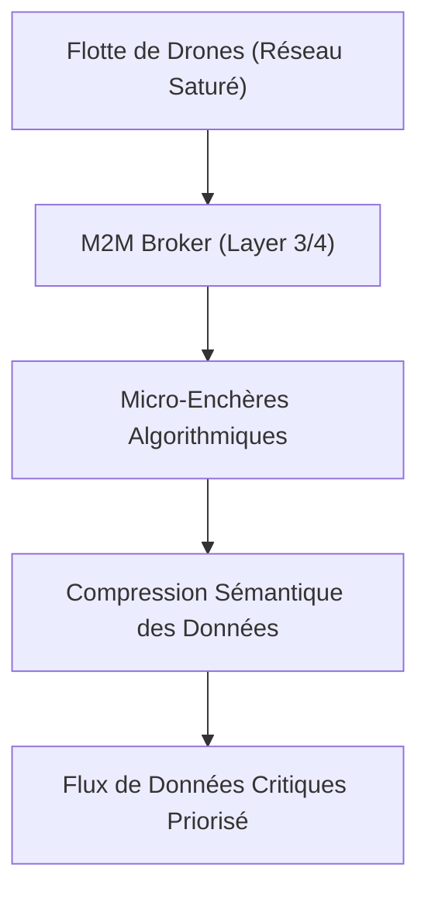
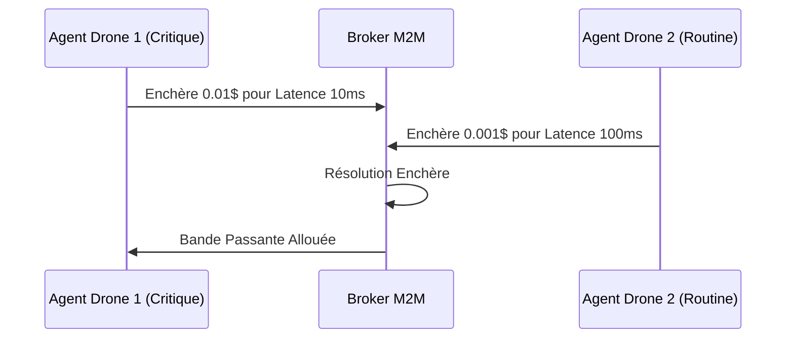

<!-- markdownlint-disable MD009 MD010 MD013 MD022 MD028 MD032 MD033 MD034 MD036 MD037 MD039 MD041 MD058 MD060 -->

[🇬🇧 English Version](./README.md)

# M2M Bandwidth Broker

> **Résumé exécutif :** Un protocole M2M décentralisé permettant aux agents IA autonomes d'enchérir dynamiquement pour la bande passante et la puissance de calcul Edge en temps réel.

---

## 1. Aperçu visuel & Effet Wahou

## 2. La thèse contrariante (Peter Thiel Style)

La croyance populaire : La 5G et le satellite offrent une bande passante suffisante pour que les flottes d'agents communiquent via des protocoles standards REST/MQTT.
La vérité cachée : Les essaims d'agents IA saturent les réseaux avec des données brutes, paralysant la décision collective. Les agents doivent compresser sémantiquement les données et enchérir pour la bande passante à la milliseconde.

## 3. Le problème & La cible

Modèle économique : M2M
Cible précise : Flottes de drones autonomes, véhicules autonomes, réseaux IoT industriels.
La douleur urgente : Avec la prolifération des agents IA, les réseaux deviennent le goulot d'étranglement. La latence empêche l'orchestration en temps réel des essaims.

## 4. Architecture technique & Plomberie

## 5. Modèle économique & Viabilité financière

| Métrique                    | Valeur                                                   |
| --------------------------- | -------------------------------------------------------- |
| Structure de prix           | Frais de micro-transaction par enchère de bande passante |
| Objectif 12 mois            | 1 Milliard de micro-transactions traitées                |
| Calcul du CA (Target 100k€) | 1,000,000,000 \* 0.0001€                                 |
| Marge brute estimée         | 95%                                                      |

## 6. Moteur de distribution & Fossé défensif (Moat)

Stratégie d'acquisition : Adoption du protocole open-source par les constructeurs matériels, nœuds de routage monétisés.
Moat (Barrière à l'entrée) : Les API cloud centralisées sont trop lentes pour le Edge. Le moat est un protocole de réseau maillé ad-hoc propriétaire combiné à une tarification algorithmique milliseconde fonctionnant sous la couche application.

## 7. Grille d'évaluation détaillée

| Critère                           | Score VC (/100) | Score Terrain (/100) |
| --------------------------------- | --------------- | -------------------- |
| Thèse & Monopole / Urgence        | -- / 25         | 18 / 25              |
| Moat / Résistance aux LLM natifs  | -- / 25         | 20 / 25              |
| Scalabilité / Friction d'adoption | -- / 25         | 22 / 25              |
| Unit Economics / ROI direct       | -- / 25         | 24 / 25              |
| **TOTAL**                         | **-- / 100**    | **84 / 100**         |

> **Verdict VC :** En attente d'évaluation.
> **Verdict Terrain :** L'explosion des flottes d'agents autonomes crée un goulot d'étranglement immédiat sur la bande passante. Ce courtier M2M optimise en temps réel ces flux, hors de portée d'un LLM non connecté au réseau. Déploiement logiciel relativement fluide avec un modèle à l'usage garantissant une monétisation directe et transparente.
