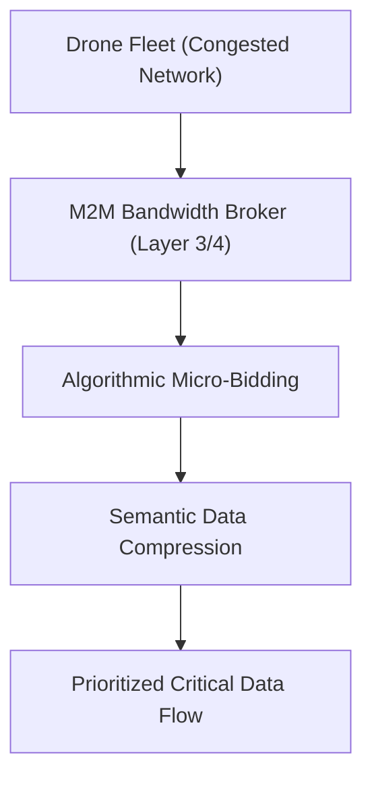
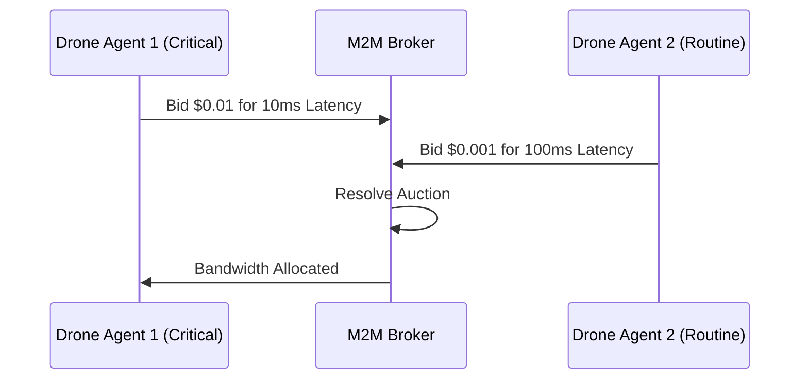

<!-- markdownlint-disable MD009 MD010 MD013 MD022 MD028 MD032 MD033 MD034 MD036 MD037 MD039 MD041 MD058 MD060 -->

[🇫🇷 Version Française](./README.fr.md)

# M2M Bandwidth Broker

> **Executive Summary:** A decentralized M2M protocol enabling autonomous AI agents to dynamically bid for network bandwidth and edge computing power in real-time.

---

## 1. Visual Overview & Wow Effect

## 2. Contrarian Thesis (Peter Thiel Style)

Popular Belief: 5G and satellite networks provide enough bandwidth for fleets of autonomous agents to communicate seamlessly using standard REST/MQTT protocols.
Hidden Truth: Swarms of autonomous AI agents saturate networks with raw data, paralyzing collective decision-making. Agents must semantically compress data and algorithmically bid for bandwidth on a sub-second basis.

## 3. Problem & Target Market

Business Model: M2M
Target Audience: Autonomous drone fleets, self-driving vehicle networks, industrial IoT operators.
Urgent Pain Point: As embedded AI agents proliferate, communication networks become the bottleneck. Latency caused by network saturation prevents real-time swarm orchestration and edge decision-making.

## 4. Technical Architecture & Infrastructure

## 5. Business Model & Financial Viability

| Metric                 | Value                                       |
| ---------------------- | ------------------------------------------- |
| Pricing Structure      | Micro-transaction fee per bandwidth auction |
| 12-Month Target        | 1B micro-transactions processed             |
| Revenue Formula        | 1,000,000,000 \* $0.0001                    |
| Estimated Gross Margin | 95%                                         |

## 6. Distribution Engine & Moat

Acquisition Strategy: Open-source core protocol adoption by hardware manufacturers, monetized routing nodes.
Moat (Defensibility): Cloud-based centralized API brokers are too slow for disconnected edge swarms. Our moat is the proprietary ad-hoc mesh networking protocol combined with millisecond algorithmic pricing, operating below the application layer.

## 7. Detailed Evaluation Grid

| Criterion                   | VC Score (/100) | Market Score (/100) |
| --------------------------- | --------------- | ------------------- |
| Thesis & Monopoly / Urgency | -- / 25         | 18 / 25             |
| Moat / LLM Immunity         | -- / 25         | 20 / 25             |
| Scalability / UX Friction   | -- / 25         | 22 / 25             |
| Unit Economics / ROI        | -- / 25         | 24 / 25             |
| **TOTAL**                   | **-- / 100**    | **84 / 100**        |

> **VC Verdict:** Pending evaluation.
> **Market Verdict:** As AI agents increasingly transact autonomously, bandwidth brokering will become highly desirable. It establishes a protocol layer that LLMs depend on, rather than compete with. The API-first approach ensures low integration friction, and taking a micro-fee per transaction yields crystal-clear, highly scalable unit economics.
