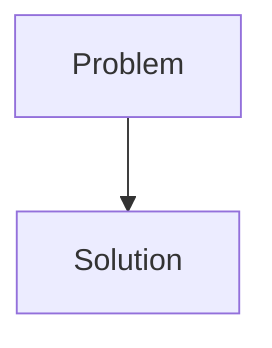
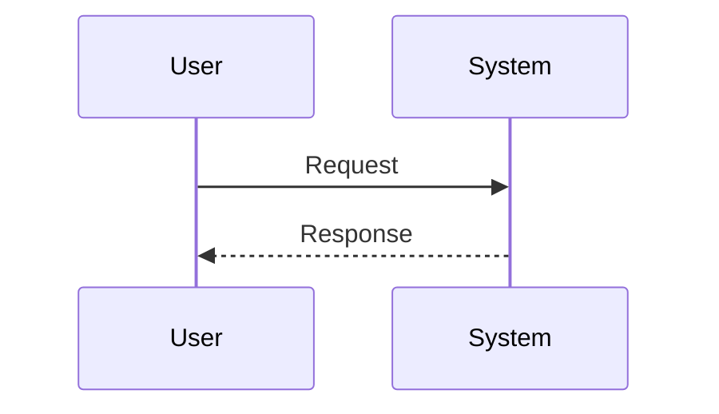

<!-- markdownlint-disable MD009 MD010 MD013 MD022 MD028 MD032 MD033 MD034 MD036 MD037 MD039 MD041 MD058 MD060 -->
<!-- markdownlint-disable MD033 MD041 -->

[🇫🇷 Version Française](./README.fr.md)

# OmicZip

> **Executive Summary:** Multi-Omic Neural Compressor

---

## 1. Visual Overview & Wow Effect

## 2. Contrarian Thesis (Peter Thiel Style)

- **Popular Belief:** [What the consensus thinks about this market]
- **Hidden Truth:** [The non-intuitive reality leveraged by this startup]

## 3. Problem & Target Market

- **Business Model:** B2B
- **Target Audience:** Genomic research institutes, pharmaceutical companies, university hospitals and cloud providers (AWS, GCP).
- **Urgent Pain Point:** Multi-omics analysis (genomics, proteomics, transcriptomics combined) generates petabytes of data per project. The cost of long-term storage, network transfer, and ingestion by AI pipelines becomes prohibitive, creating a fatal bottleneck for personalized medicine and complex biomarker discovery.

## 4. Technical Architecture & Infrastructure

## 5. Business Model & Financial Viability

| Metric                     | Value                                     |
| -------------------------- | ----------------------------------------- |
| **Pricing Structure**      | [Price / Subscription Model / Commission] |
| **12-Month Target**        | [Exact volume required for 100k ARR]      |
| **Revenue Formula**        | [Mathematical calculation]                |
| **Estimated Gross Margin** | [Margin %]                                |

## 6. Distribution Engine & Moat

- **Acquisition Strategy:** [Virality, network effect, direct sales, developer adoption]
- **Moat (Defensibility):** Standard compression algorithms do not include biology. They compress the text blindly. Existing solutions (cram) are static standards exceeded by the volume of new generations of sequencing (Spatial Transcriptomics). It takes expertise combining information theory, generative AI and molecular biology.

## 7. Detailed Evaluation Grid

| Criterion                       | VC Score (/100) | Market Score (/100) |
| ------------------------------- | --------------- | ------------------- |
| **Thesis & Monopoly / Urgency** | -- / 25         | -- / 25             |
| **Moat / LLM Immunity**         | -- / 25         | -- / 25             |
| **Scalability / UX Friction**   | -- / 25         | -- / 25             |
| **Unit Economics / ROI**        | -- / 25         | -- / 25             |
| **TOTAL**                       | **-- / 100**    | **-- / 100**        |

> **VC Verdict:** Pending evaluation.
>
> **Market Verdict:** Pending evaluation.
