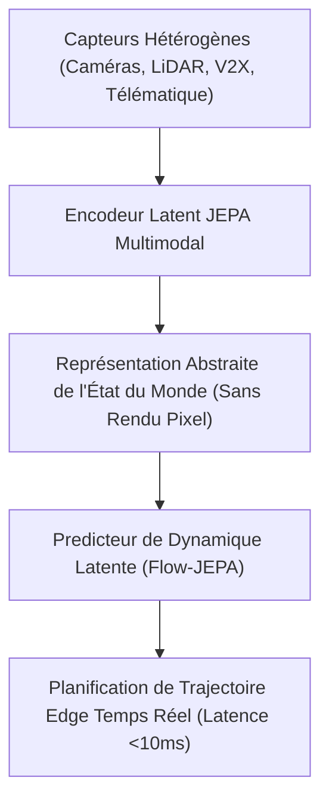
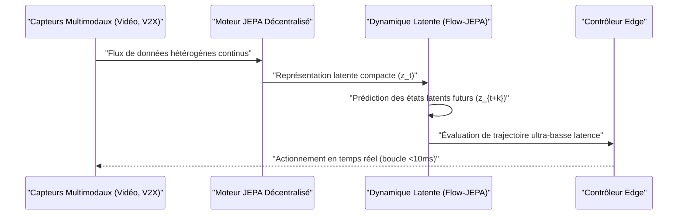

<!-- markdownlint-disable MD009 MD010 MD013 MD022 MD028 MD032 MD033 MD034 MD036 MD037 MD039 MD041 MD058 MD060 -->

[🇬🇧 English Version](./README.md)

# Moteur de Modèle de Monde JEPA Multimodal

> **Aperçu exécutif :** Un moteur d'apprentissage prédictif et de modèle de monde propulsé par une architecture JEPA (Joint Embedding Predictive Architecture) décentralisée et du Flow Matching. Le système fusionne des données capteurs hétérogènes (vidéo, LiDAR, signaux RF, V2X) directement dans un espace latent abstrait pour permettre la prédiction et la prise de décision en temps réel pour véhicules autonomes et AMR, déployé efficacement sur des puces Edge contraintes.

---

## 1. Aperçu visuel & Effet Wahou

## 2. La thèse contrariante (Style Peter Thiel)

Croyance populaire : Les véhicules autonomes et la robotique mobile ont besoin de modèles génératifs denses dans l'espace des pixels (comme la diffusion vidéo ou les modèles de monde LLM) pour simuler et anticiper leur environnement.
Vérité cachée : La génération dans l'espace des pixels est inefficace sur le plan calculatoire et inutile pour les boucles de contrôle. La véritable intelligence réside dans la prédiction auto-supervisée au sein d'un espace latent abstrait (JEPA). En supprimant le décodage en pixels et en prédisant les dynamiques directement dans des plongements joints, les systèmes Edge atteignent une latence 100x plus faible et une meilleure efficacité énergétique.

## 3. Le problème & La cible

Modèle économique : B2B Deep Tech Software Licensing / OEM API
Cible : Constructeurs automobiles (OEM), équipementiers de mobilité connectée, opérateurs de flottes autonomes et fabricants de robots mobiles autonomes (AMR).
Le problème urgent : Les systèmes autonomes échouent à anticiper les environnements denses et dynamiques en temps réel. La fusion de capteurs traditionnelle souffre de la latence et du bruit, tandis que les modèles génératifs ne peuvent pas tourner sur des SoC embarqués sous des contraintes de contrôle de moins de 10ms.

## 4. Architecture technique & Plomberie

## 5. Modèle économique & Viabilité financière

| Métrique            | Valeur                                                  |
| ------------------- | ------------------------------------------------------- |
| Structure de Prix   | Licence SDK Annuelle par Véhicule / Équipement          |
| Cible à 12 Mois     | 100 déploiements entreprise / flottes de test           |
| Formule de Revenu   | 100 équipements \* 1 000 € / équipement = 100 000 € ARR |
| Marge Brute Estimée | 85%                                                     |

## 6. Moteur de distribution & Fossé défensif

Moteur d'acquisition : partenariats d'ingénierie B2B directs avec les équipementiers automobiles de Rang 1 et les équipes d'autonomie OEM, en appuyant sur la crédibilité académique des travaux du laboratoire SAMOVAR (IP Paris / Télécom SudParis).
Fossé défensif (Moat) : formulations propriétaires de pertes auto-supervisées JEPA empêchant l'effondrement de représentation (representation collapse) sur les modalités non visuelles (RF/V2X + Vidéo), combinées à des IPs d'optimisation matérielle (élagage, distillation, NAS) personnalisées pour les SoC automobiles.

## 7. Grille d'évaluation détaillée

| Critère                       | Score VC (/100) | Score Terrain (/100) |
| ----------------------------- | --------------- | -------------------- |
| Thèse & Monopole / Urgence    | -- / 25         | 23 / 25              |
| Fossé Défensif / Immunité LLM | -- / 25         | 19 / 25              |
| Scalabilité / Friction UX     | -- / 25         | 17 / 25              |
| Unit Economics / ROI          | -- / 25         | 21 / 25              |
| **TOTAL**                     | **-- / 100**    | **80 / 100**         |

> **Verdict VC :** En attente d'évaluation.
>
> **Verdict Terrain :** Les modèles du monde physiques prédictifs sont urgents pour la robotique autonome. Bien que les LLMs standards peinent avec le raisonnement physique, les grands laboratoires d'IA ciblent ce domaine, réduisant légèrement l'immunité. Les coûts d'entraînement et d'intégration sont élevés, mais le licensing aux constructeurs est très lucratif.
