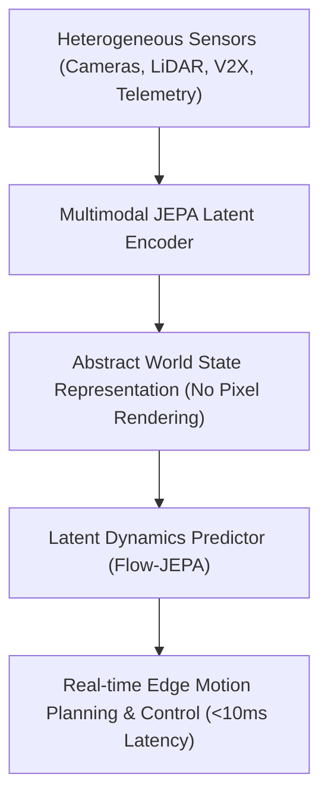
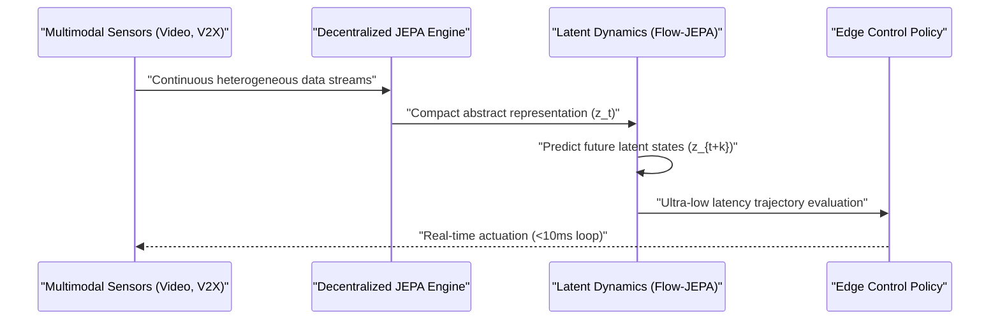

<!-- markdownlint-disable MD009 MD010 MD013 MD022 MD028 MD032 MD033 MD034 MD036 MD037 MD039 MD041 MD058 MD060 -->

[🇫🇷 Version Française](./README.fr.md)

# Multimodal JEPA World Model Engine

> **Executive Summary:** A predictive learning and world-model engine powered by decentralized Joint Embedding Predictive Architectures (JEPA) and Flow Matching. It fuses heterogeneous sensor data (video, LiDAR, RF signals, V2X) directly in abstract latent space to enable real-time prediction and decision-making for autonomous vehicles and AMR, deployed efficiently on resource-constrained Edge hardware.

---

## 1. Visual Overview & Wow Effect

## 2. Contrarian Thesis (Peter Thiel Style)

Popular Belief: Autonomous vehicles and mobile robots need massive generative pixel-space models (like video diffusion or LLM world models) to simulate and anticipate their environment.
Hidden Truth: Pixel-space generation is computationally inefficient and useless for control loops. True intelligence lies in self-supervised prediction within abstract latent space (JEPA). By removing pixel decoding and predicting dynamics directly in joint embeddings, Edge systems achieve 100x lower latency and superior label efficiency.

## 3. Problem & Target Market

Business Model: B2B Deep Tech Software Licensing / OEM API
Target Audience: Automotive OEMs (AV Division Heads), autonomous fleet operators, connected mobility system integrators, and Autonomous Mobile Robot (AMR) manufacturers.
Urgent Pain Point: Autonomous systems fail to accurately anticipate dense dynamic environments in real-time. Traditional sensor fusion suffers from latency and noise, while generative models cannot run on embedded System-on-Chip (SoC) hardware under 10ms control constraints.

## 4. Technical Architecture & Infrastructure

## 5. Business Model & Financial Viability

| Metric                 | Value                                           |
| ---------------------- | ----------------------------------------------- |
| Pricing Structure      | Per-Vehicle / Per-Device Annual SDK License     |
| 12-Month Target        | 100 enterprise deployments / test fleets        |
| Revenue Formula        | 100 devices \* 1,000 € / device = 100,000 € ARR |
| Estimated Gross Margin | 85%                                             |

## 6. Distribution Engine & Moat

Acquisition Strategy: direct B2B engineering partnerships with Tier-1 automotive suppliers and OEM autonomy teams, leveraging academic credibility from IP Paris / Télécom SudParis SAMOVAR lab research.
Moat (Defensibility): proprietary self-supervised JEPA loss formulations preventing representation collapse across non-visual modalities (RF/V2X + Video), combined with model-compression hardware IPs (pruning, distillation, NAS) customized for automotive SoCs.

## 7. Detailed Evaluation Grid

| Criterion                   | VC Score (/100) | Market Score (/100) |
| --------------------------- | --------------- | ------------------- |
| Thesis & Monopoly / Urgency | -- / 25         | 23 / 25             |
| Moat / LLM Immunity         | -- / 25         | 19 / 25             |
| Scalability / UX Friction   | -- / 25         | 17 / 25             |
| Unit Economics / ROI        | -- / 25         | 21 / 25             |
| **TOTAL**                   | **-- / 100**    | **80 / 100**        |

> **VC Verdict:** Pending evaluation.
>
> **Market Verdict:** Predictive physics world models are urgently needed for autonomous robotics. While standard LLMs struggle with physical reasoning, foundational AI labs are aggressively pursuing this, somewhat reducing its immunity. Training costs are high and integration into specific robots requires effort, but licensing to autonomous vehicle/robotics OEMs is lucrative.
