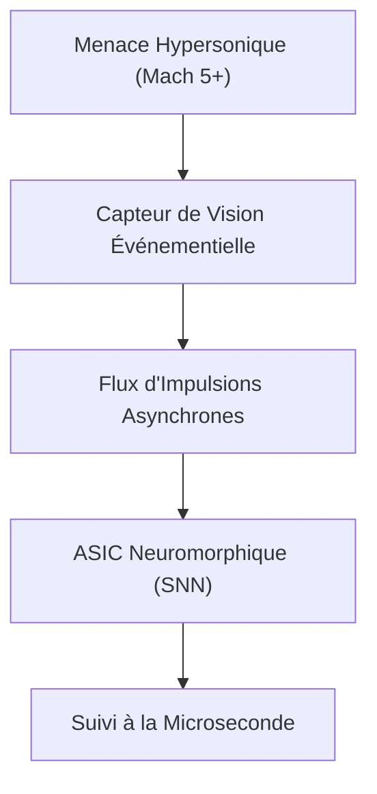
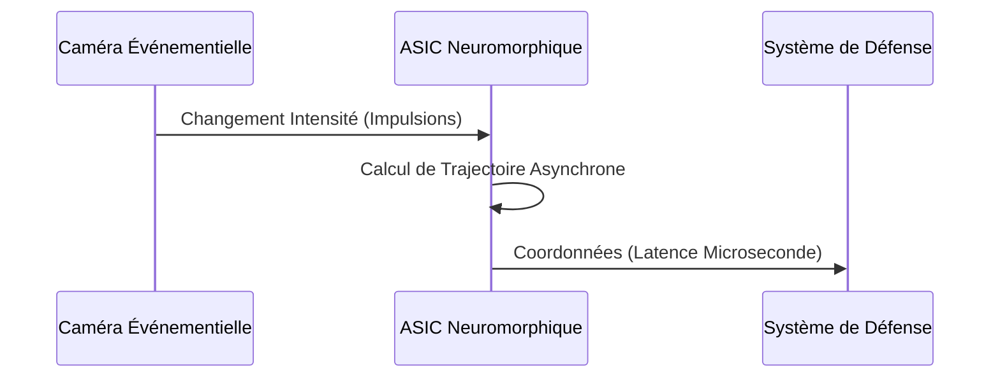

<!-- markdownlint-disable MD009 MD010 MD013 MD022 MD028 MD032 MD033 MD034 MD036 MD037 MD039 MD041 MD058 MD060 -->

[🇬🇧 English Version](./README.md)

# Hypersonic Neuromorphic Tracker

> **Résumé exécutif :** Un système de vision neuromorphique embarqué ultra-rapide utilisant des caméras événementielles et des réseaux de neurones à impulsions pour suivre des objets hypersoniques.

---

## 1. Aperçu visuel & Effet Wahou

## 2. La thèse contrariante (Peter Thiel Style)

La croyance populaire : Pour suivre des objets plus rapides, il suffit d'augmenter la fréquence d'images des caméras et la puissance des GPUs.
La vérité cachée : Les fréquences d'images élevées génèrent trop de données redondantes (goulot de von Neumann). Il faut traiter uniquement les changements de pixels asynchrones avec des SNNs pour atteindre un suivi à la microseconde.

## 3. Le problème & La cible

Modèle économique : B2G / B2B
Cible précise : Défense (Interception anti-missiles), Agences aérospatiales, Systèmes de protection orbitale.
La douleur urgente : Les caméras traditionnelles sont trop lentes pour détecter et suivre de manière fiable des objets se déplaçant à Mach 5+ (missiles, débris spatiaux).

## 4. Architecture technique & Plomberie

## 5. Modèle économique & Viabilité financière

| Métrique                    | Valeur                                            |
| --------------------------- | ------------------------------------------------- |
| Structure de prix           | Matériel (Capteur+ASIC) + Licence compilateur SNN |
| Objectif 12 mois            | 3 déploiements prototypes défense                 |
| Calcul du CA (Target 100k€) | 3 prototypes \* 1M€ contrat R&D                   |
| Marge brute estimée         | 75%                                               |

## 6. Moteur de distribution & Fossé défensif (Moat)

Stratégie d'acquisition : Contrats R&D directs avec les maîtres d'œuvre de la défense et les agences gouvernementales.
Moat (Barrière à l'entrée) : La vision par ordinateur classique (CNN/GPU) est physiquement trop lente. Le moat réside dans le co-design matériel/logiciel : ASIC personnalisé couplé à des algorithmes SNN événementiels exclusifs.

## 7. Grille d'évaluation détaillée

| Critère                           | Score VC (/100) | Score Terrain (/100) |
| --------------------------------- | --------------- | -------------------- |
| Thèse & Monopole / Urgence        | -- / 25         | -- / 25              |
| Moat / Résistance aux LLM natifs  | -- / 25         | -- / 25              |
| Scalabilité / Friction d'adoption | -- / 25         | -- / 25              |
| Unit Economics / ROI direct       | -- / 25         | -- / 25              |
| **TOTAL**                         | **-- / 100**    | **-- / 100**         |

> **Verdict VC :** En attente d'évaluation.
> **Verdict Terrain :** En attente d'évaluation.
