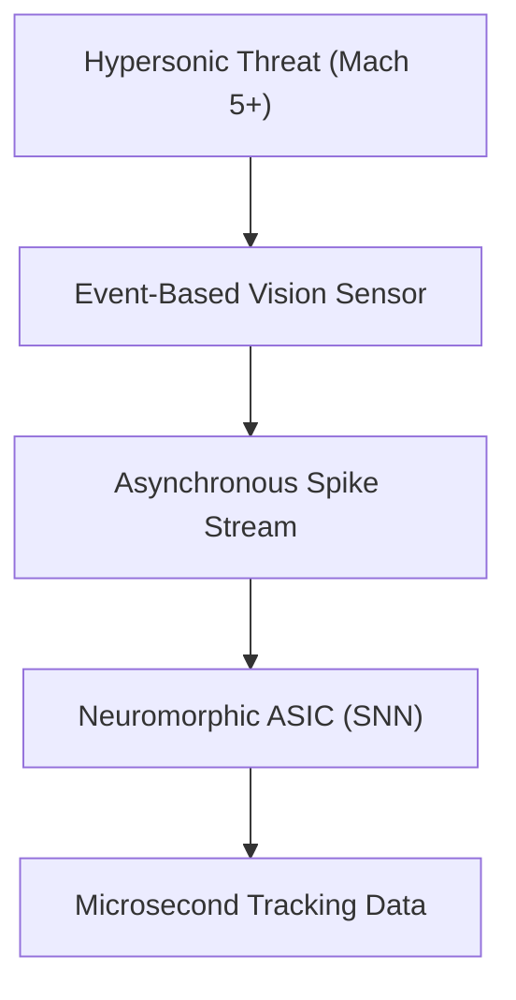
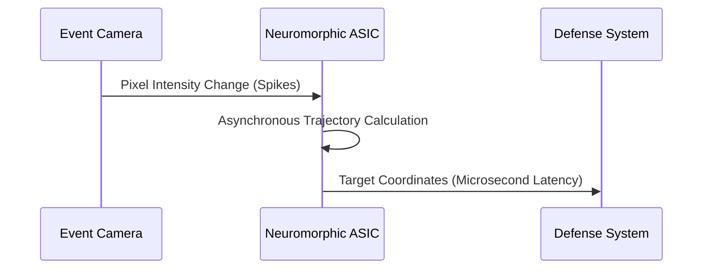

<!-- markdownlint-disable MD009 MD010 MD013 MD022 MD028 MD032 MD033 MD034 MD036 MD037 MD039 MD041 MD058 MD060 -->

[🇫🇷 Version Française](./README.fr.md)

# Hypersonic Neuromorphic Tracker

> **Executive Summary:** An ultra-fast, energy-efficient embedded neuromorphic vision system leveraging event-based cameras and spiking neural networks to track hypersonic objects.

---

## 1. Visual Overview & Wow Effect

## 2. Contrarian Thesis (Peter Thiel Style)

Popular Belief: To track faster objects, you just need cameras with higher frame rates and more powerful GPUs to process the resulting massive data streams.
Hidden Truth: High frame rates generate massive redundant data, causing latency and power bottlenecks (von Neumann bottleneck). You must process only asynchronous pixel changes using spiking neural networks to achieve microsecond tracking.

## 3. Problem & Target Market

Business Model: B2G / B2B
Target Audience: Defense (Anti-missile interception), Aerospace agencies, Orbital protection systems.
Urgent Pain Point: Traditional frame-based cameras are too slow and generate too much data to reliably track objects moving at Mach 5+, making defense interception and space debris avoidance nearly impossible.

## 4. Technical Architecture & Infrastructure

## 5. Business Model & Financial Viability

| Metric                 | Value                                                          |
| ---------------------- | -------------------------------------------------------------- |
| Pricing Structure      | Hardware node (sensor+ASIC) + proprietary SNN compiler license |
| 12-Month Target        | 3 defense prototype deployments                                |
| Revenue Formula        | 3 deployments \* $1M R&D contract                              |
| Estimated Gross Margin | 75%                                                            |

## 6. Distribution Engine & Moat

Acquisition Strategy: Direct R&D contracts with prime defense contractors and government defense agencies.
Moat (Defensibility): Generic Computer Vision models (CNNs on GPUs) physically cannot run fast enough due to memory bottlenecks. The moat is deep hardware-software co-design: custom ASICs paired with specialized event-driven Spiking Neural Network algorithms.

## 7. Detailed Evaluation Grid

| Criterion                   | VC Score (/100) | Market Score (/100) |
| --------------------------- | --------------- | ------------------- |
| Thesis & Monopoly / Urgency | -- / 25         | -- / 25             |
| Moat / LLM Immunity         | -- / 25         | -- / 25             |
| Scalability / UX Friction   | -- / 25         | -- / 25             |
| Unit Economics / ROI        | -- / 25         | -- / 25             |
| **TOTAL**                   | **-- / 100**    | **-- / 100**        |

> **VC Verdict:** Pending evaluation.
> **Market Verdict:** Pending evaluation.
