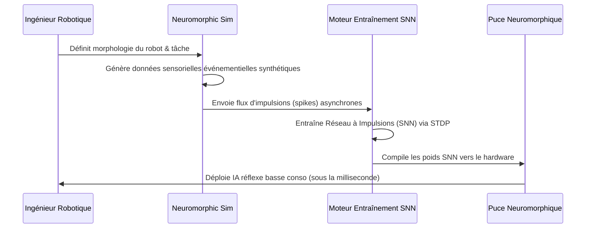

<!-- markdownlint-disable MD009 MD010 MD013 MD022 MD028 MD032 MD033 MD034 MD036 MD037 MD039 MD041 MD058 MD060 -->

[ 🇬🇧 English Version ](./README.md)

# Neuromorphic Robotics Sim

> **Résumé exécutif :** Un moteur de simulation physique générant des données événementielles synthétiques conçues spécifiquement pour entraîner des réseaux de neurones à impulsions (SNN). Il permet de déployer des IA aux réflexes ultra-rapides et à très faible consommation énergétique sur les puces neuromorphiques de nouvelle génération pour la robotique autonome.


---

## 1. Aperçu visuel & Effet Wahou

```mermaid
graph TD
    A[Simulateurs Standards (Unity, Isaac)] -.->|Trames Denses : Lentes, Énergivores| B[Deep Learning Classique (GPU)]
    C[Neuromorphic Robotics Sim] -->|Données Asynchrones (Spikes)| D[Entraîner Réseau de Neurones à Impulsions]
    D -->|Compiler vers Silicium| E[Puce Neuromorphique (ex: Akida/Loihi)]
    E -->|Latence Ultra-basse / Conso Microwatt| F[Drone/Robot Autonome]
```

## 2. La thèse contrariante (Peter Thiel Style)

- **La croyance populaire :** Pour rendre les robots plus intelligents, nous devons faire tourner de grands LLM ou des Vision Transformers sur des GPU embarqués toujours plus puissants et gourmands en énergie.
- **La vérité cachée :** L'architecture classique de Von Neumann et les réseaux de neurones denses sont une impasse pour la robotique rapide sur batterie. Les cerveaux biologiques ne traitent pas des images denses ; ils traitent des événements asynchrones et clairsemés (spikes). L'avenir de la robotique repose sur le silicium neuromorphique, mais il n'existe aucun écosystème logiciel ni simulateur nativement conçu pour les entraîner.

## 3. Le problème & La cible

- **Modèle économique :** B2B
- **Cible précise :** Constructeurs de robots humanoïdes, fabricants de drones autonomes, entreprises de logistique automatisée.
- **La douleur urgente :** L'entraînement de réseaux de neurones pour la robotique nécessitant des réflexes ultra-rapides (ex: rattraper un objet, éviter une collision de drone) est bridé par l'architecture de calcul classique. Celle-ci cause une latence trop élevée pour la physique en temps réel et une consommation énergétique prohibitive qui vide les batteries.

## 4. Architecture technique & Plomberie



## 5. Modèle économique & Viabilité financière

| Métrique                        | Valeur                                                                       |
| :------------------------------ | :--------------------------------------------------------------------------- |
| **Structure de prix**           | Licence SaaS annuelle par siège + facturation API pour génération de données |
| **Objectif 12 mois**            | 3 entreprises de robotique (drone/humanoïde)                                 |
| **Calcul du CA (Target 100k€)** | 3 clients \* 35 000 €/an (Niveau Enterprise) = 105 000 €                     |
| **Marge brute estimée**         | 85%                                                                          |

## 6. Moteur de distribution & Fossé défensif (Moat)

- **Stratégie d'acquisition :** Partenariats directs avec les rares fabricants de matériel construisant des puces neuromorphiques (Intel, BrainChip) pour devenir leur couche logicielle de simulation officielle et recommandée aux développeurs.
- **Moat (Barrière à l'entrée) :** Les simulateurs existants (Unity, Isaac) sont fondamentalement construits pour rendre des trames visuelles denses pour le Deep Learning standard. Construire un simulateur pensé dès la conception pour des données événementielles asynchrones et un traitement déterministe à la microseconde nécessite une réécriture complète du moteur physique. C'est hautement résistant à la disruption par de simples LLMs.

## 7. Grille d'évaluation détaillée

| Critère                               | Score VC (/100) | Score Terrain (/100) |
| :------------------------------------ | :-------------- | :------------------- |
| **Thèse & Monopole / Urgence**        | -- / 25         | -- / 25              |
| **Moat / Résistance aux LLM natifs**  | -- / 25         | -- / 25              |
| **Scalabilité / Friction d'adoption** | -- / 25         | -- / 25              |
| **Unit Economics / ROI direct**       | -- / 25         | -- / 25              |
| **TOTAL**                             | **-- / 100**    | **-- / 100**         |

> **Verdict VC :** En attente d'évaluation.

> **Verdict Terrain :** En attente d'évaluation.
