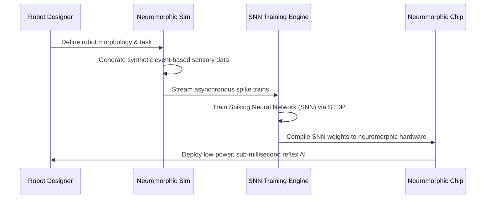

<!-- markdownlint-disable MD009 MD010 MD013 MD022 MD028 MD032 MD033 MD034 MD036 MD037 MD039 MD041 MD058 MD060 -->

[ 🇫🇷 Version Française ](./README.fr.md)

# Neuromorphic Robotics Sim

> **Executive Summary:** A physics simulation engine generating synthetic event-based data specifically designed to train Spiking Neural Networks (SNNs). It enables the deployment of ultra-low latency, highly energy-efficient AI reflexes onto next-generation neuromorphic chips for autonomous robots.


---

## 1. Visual Overview & Wow Effect

```mermaid
graph TD
    A[Standard Simulators (Unity, Isaac)] -.->|Dense Frames: Slow, Power Hungry| B[Standard Deep Learning (GPU)]
    C[Neuromorphic Robotics Sim] -->|Asynchronous Event Data (Spikes)| D[Train Spiking Neural Network]
    D -->|Compile to Silicon| E[Neuromorphic Chip (e.g. Akida/Loihi)]
    E -->|Ultra-low Latency / Microwatt Power| F[Autonomous Drone/Robot]
```

## 2. Contrarian Thesis (Peter Thiel Style)

- **Popular Belief:** To make robots smarter, we need to run larger LLMs or Vision Transformers on increasingly powerful, energy-hungry embedded GPUs.
- **Hidden Truth:** Classical Von Neumann architecture and dense neural networks are a dead end for fast, battery-powered robotics. Biological brains do not process dense frames; they process sparse, asynchronous events (spikes). The future of robotics relies on neuromorphic silicon, but there is no software ecosystem or simulation environment natively built to train them.

## 3. Problem & Target Market

- **Business Model:** B2B
- **Target Audience:** Humanoid robot manufacturers, autonomous drone companies, and automated logistics providers.
- **Urgent Pain Point:** Training neural networks for robotics requiring ultra-fast reflexes (e.g., catching a falling object, avoiding a drone collision) is severely bottlenecked by classical compute architectures. They suffer from latency that is too high for real-time physics and power consumption that quickly drains robotic batteries.

## 4. Technical Architecture & Infrastructure



## 5. Business Model & Financial Viability

| Metric                     | Value                                                                             |
| :------------------------- | :-------------------------------------------------------------------------------- |
| **Pricing Structure**      | Annual SaaS license per simulation seat + API usage for synthetic data generation |
| **12-Month Target**        | 3 robotics companies (drone/humanoid)                                             |
| **Revenue Formula**        | 3 clients \* €35,000/year (Enterprise Tier) = €105,000                            |
| **Estimated Gross Margin** | 85%                                                                               |

## 6. Distribution Engine & Moat

- **Acquisition Strategy:** Direct partnerships with the few hardware vendors building neuromorphic chips (Intel, BrainChip) to become their official, recommended software training simulation layer for developers.
- **Moat (Defensibility):** Existing simulators (Unity, Isaac) are fundamentally built to render dense visual frames for standard Deep Learning. Building a simulator natively designed for asynchronous, event-based data and microsecond deterministic timing requires a complete rewrite of the physics engine and rendering pipeline. It is highly resistant to LLM disruption.

## 7. Detailed Evaluation Grid

| Criterion                       | VC Score (/100) | Market Score (/100) |
| :------------------------------ | :-------------- | :------------------ |
| **Thesis & Monopoly / Urgency** | -- / 25         | -- / 25             |
| **Moat / LLM Immunity**         | -- / 25         | -- / 25             |
| **Scalability / UX Friction**   | -- / 25         | -- / 25             |
| **Unit Economics / ROI**        | -- / 25         | -- / 25             |
| **TOTAL**                       | **-- / 100**    | **-- / 100**        |

> **VC Verdict:** Pending evaluation.

> **Market Verdict:** Pending evaluation.
