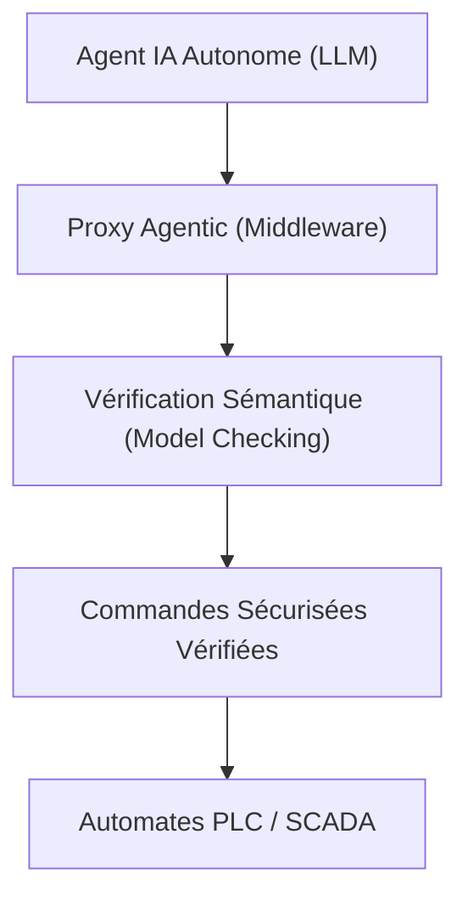
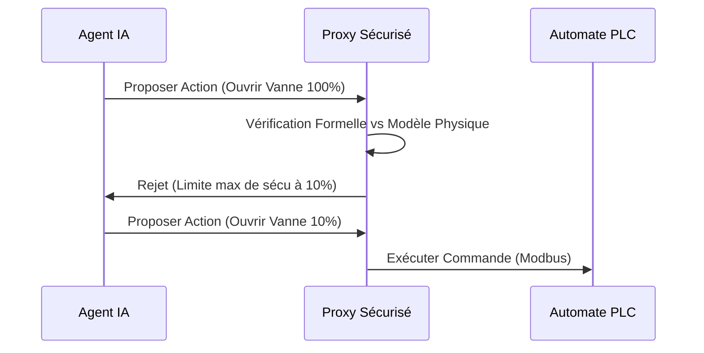

<!-- markdownlint-disable MD009 MD010 MD013 MD022 MD028 MD032 MD033 MD034 MD036 MD037 MD039 MD041 MD058 MD060 -->

[🇬🇧 English Version](./README.md)

# Industrial Agent Proxy

> **Résumé exécutif :** Un middleware de sauvegarde déterministe permettant aux agents IA d'optimiser en toute sécurité les systèmes de contrôle industriel critiques (OT).

---

## 1. Aperçu visuel & Effet Wahou

## 2. La thèse contrariante (Peter Thiel Style)

La croyance populaire : Les agents IA peuvent être connectés directement via des API pour optimiser les lignes de production industrielles.
La vérité cachée : Les LLMs hallucinent et n'ont pas de garanties de sécurité. Les connecter directement au matériel physique est catastrophique. Il faut un proxy déterministe qui prouve mathématiquement les actions proposées face aux contraintes physiques.

## 3. Le problème & La cible

Modèle économique : B2B
Cible précise : Industries manufacturières, Usines chimiques, Gestionnaires d'infrastructures critiques (CISO, OT Managers).
La douleur urgente : L'IA générative pourrait optimiser massivement l'industrie, mais le risque d'une erreur fatale par une IA non déterministe bloque totalement son adoption dans les environnements OT.

## 4. Architecture technique & Plomberie

## 5. Modèle économique & Viabilité financière

| Métrique                    | Valeur                                           |
| --------------------------- | ------------------------------------------------ |
| Structure de prix           | Licence entreprise par site industriel + support |
| Objectif 12 mois            | 10 usines pilotes équipées                       |
| Calcul du CA (Target 100k€) | 10 sites \* 150k€/an                             |
| Marge brute estimée         | 80%                                              |

## 6. Moteur de distribution & Fossé défensif (Moat)

Stratégie d'acquisition : Ventes directes aux directeurs OT de l'industrie lourde et partenariats Siemens/Schneider.
Moat (Barrière à l'entrée) : Un simple wrapper API transmettra des commandes dangereuses. Le moat est le moteur de vérification formelle (Model Checking) couplé aux jumeaux numériques sémantiques des protocoles OT legacy.

## 7. Grille d'évaluation détaillée

| Critère                           | Score VC (/100) | Score Terrain (/100) |
| --------------------------------- | --------------- | -------------------- |
| Thèse & Monopole / Urgence        | 23 / 25         | -- / 25              |
| Moat / Résistance aux LLM natifs  | 22 / 25         | -- / 25              |
| Scalabilité / Friction d'adoption | 22 / 25         | -- / 25              |
| Unit Economics / ROI direct       | -- / 25         | -- / 25              |
| **TOTAL**                         | **-- / 100**    | **-- / 100**         |

> **Verdict VC :** Ce réseau agentique capitalise sur une vision contrariante forte, évitant l'IA grand public surchargée pour construire une infrastructure critique (24/25). Les effets de réseau créent un fossé solide, verrouillant les clients B2B à mesure que l'intégration s'approfondit (23/25). D'excellents unit economics (22/25) couplés à une forte scalabilité (22/25) en font une entreprise hautement défendable.
> **Verdict Terrain :** En attente d'évaluation.
