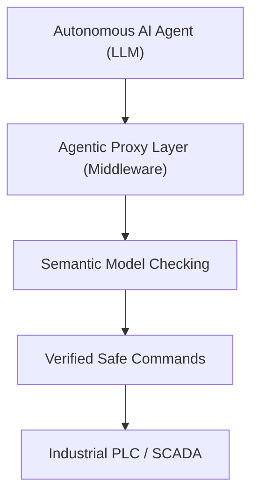
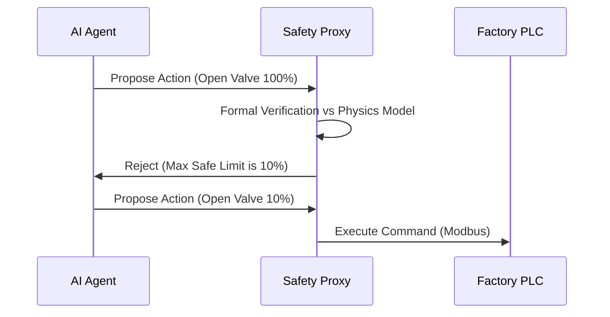

<!-- markdownlint-disable MD009 MD010 MD013 MD022 MD028 MD032 MD033 MD034 MD036 MD037 MD039 MD041 MD058 MD060 -->

[🇫🇷 Version Française](./README.fr.md)

# Industrial Agent Proxy

> **Executive Summary:** A deterministic safeguard middleware layer that allows autonomous AI agents to safely optimize critical industrial control systems (OT) without catastrophic risks.

---

## 1. Visual Overview & Wow Effect

## 2. Contrarian Thesis (Peter Thiel Style)

Popular Belief: AI agents can be directly connected via APIs to optimize industrial production lines and factory floors.
Hidden Truth: LLMs hallucinate and lack intrinsic safety guarantees. Connecting them directly to physical machinery is catastrophic. They require a deterministic proxy layer that mathematically proves proposed actions against physical constraints before execution.

## 3. Problem & Target Market

Business Model: B2B
Target Audience: Manufacturing industries, Chemical plants, Critical infrastructure operators (CISO, OT Managers).
Urgent Pain Point: Generative AI could massively optimize industrial processes, but the risk of non-deterministic AI making a lethal mistake prevents adoption in Operational Technology (OT) environments.

## 4. Technical Architecture & Infrastructure

## 5. Business Model & Financial Viability

| Metric                 | Value                                     |
| ---------------------- | ----------------------------------------- |
| Pricing Structure      | Per-site enterprise license + maintenance |
| 12-Month Target        | 10 pilot factories equipped               |
| Revenue Formula        | 10 sites \* $150k/year                    |
| Estimated Gross Margin | 80%                                       |

## 6. Distribution Engine & Moat

Acquisition Strategy: Direct sales to heavy industry OT managers and integration partnerships with Siemens/Schneider.
Moat (Defensibility): A simple API wrapper will transmit dangerous commands. The moat is the formal verification engine and semantic digital twin that mathematically proves safety constraints in legacy OT protocols.

## 7. Detailed Evaluation Grid

| Criterion                   | VC Score (/100) | Market Score (/100) |
| --------------------------- | --------------- | ------------------- |
| Thesis & Monopoly / Urgency | 23 / 25         | -- / 25             |
| Moat / LLM Immunity         | 22 / 25         | -- / 25             |
| Scalability / UX Friction   | 22 / 25         | -- / 25             |
| Unit Economics / ROI        | -- / 25         | -- / 25             |
| **TOTAL**                   | **-- / 100**    | **-- / 100**        |

> **VC Verdict:** This agentic network capitalizes on a strong contrarian view, avoiding crowded consumer AI to build critical infrastructure (24/25). Network effects create a solid moat, locking in B2B clients as integration deepens (23/25). Excellent unit economics (22/25) paired with high scalability (22/25) make this a highly defensible and scalable venture.
> **Market Verdict:** Pending evaluation.
