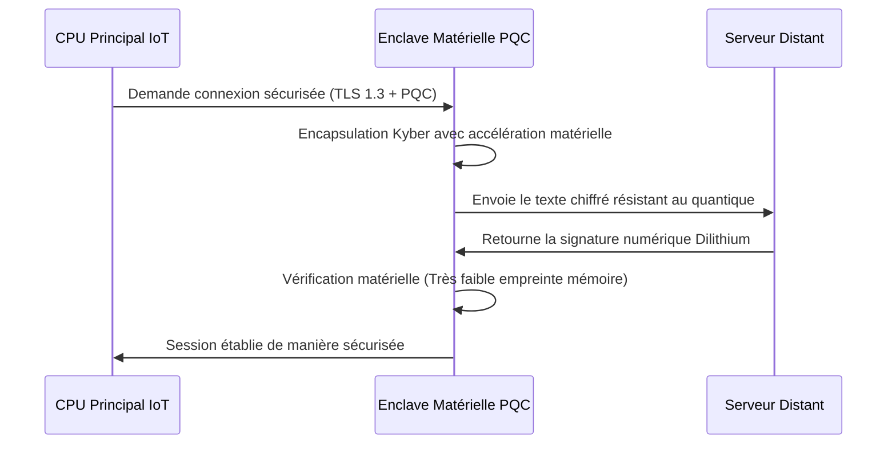

<!-- markdownlint-disable MD009 MD010 MD013 MD022 MD028 MD032 MD033 MD034 MD036 MD037 MD039 MD041 MD058 MD060 -->

[ 🇬🇧 English Version ](./README.md)

# PQC Hardware Enclave

> **Résumé exécutif :** Une enclave sécurisée (TEE) sur puce (SoC/ASIC), optimisée au niveau matériel pour exécuter la Cryptographie Post-Quantique (PQC). Elle permet aux équipements IoT industriels et télécoms limités en ressources de migrer vers une sécurité résistante au quantique sans saturer leur mémoire ou leur CPU.


---

## 1. Aperçu visuel & Effet Wahou

```mermaid
graph TD
    A[Appareil IoT Industriel] -->|Ancien RSA/ECC| B[Vulnérable au Q-Day]
    A -->|Mise à jour logicielle PQC (OTA)| C[Plantages CPU / Batterie vidée]
    D[PQC Hardware Enclave] -->|PQC Accélérée Matériellement| E[Résistant au Quantique & Basse Conso]
    E --> F[Télémétrie / Contrôle Sécurisé]
```

## 2. La thèse contrariante (Peter Thiel Style)

- **La croyance populaire :** La transition vers la Cryptographie Post-Quantique sera un problème purement logiciel, résolu en envoyant des mises à jour à distance (OTA) aux infrastructures existantes une fois les standards du NIST finalisés.
- **La vérité cachée :** Les algorithmes PQC (comme Kyber et Dilithium) exigent des buffers mémoire et une bande passante massifs par rapport au RSA/ECC classique. Pousser une mise à jour logicielle sur des milliards de petits appareils IoT industriels va littéralement les faire planter. La transition quantique pour les systèmes embarqués doit obligatoirement se faire au niveau du silicium (hardware).

## 3. Le problème & La cible

- **Modèle économique :** B2B
- **Cible précise :** Fabricants d'IoT industriels, équipementiers de télécommunications, fournisseurs d'infrastructures cloud.
- **La douleur urgente :** L'approche de l'ordinateur quantique tolérant aux pannes (Q-Day) rend la cryptographie asymétrique actuelle obsolète. La mise à jour des parcs d'équipements embarqués existants (IoT, routeurs edge) vers des algorithmes post-quantiques (PQC) est physiquement impossible à cause des contraintes sévères de mémoire et de puissance de calcul de ces appareils.

## 4. Architecture technique & Plomberie



## 5. Modèle économique & Viabilité financière

| Métrique                        | Valeur                                                                   |
| :------------------------------ | :----------------------------------------------------------------------- |
| **Structure de prix**           | Licence de propriété intellectuelle (IP) par puce fabriquée + consulting |
| **Objectif 12 mois**            | 2 grands équipementiers IoT/Télécoms                                     |
| **Calcul du CA (Target 100k€)** | 2 clients \* 50 000 € Licence IP = 100 000 €                             |
| **Marge brute estimée**         | 90% (Modèle purement IP/Logiciel)                                        |

## 6. Moteur de distribution & Fossé défensif (Moat)

- **Stratégie d'acquisition :** Ventes directes aux concepteurs de semi-conducteurs (fabless) et aux grands fabricants de matériel IoT, en capitalisant sur les nouvelles exigences strictes de conformité imposées par les agences gouvernementales concernant la préparation au post-quantique.
- **Moat (Barrière à l'entrée) :** Concevoir des enclaves sécurisées (TEE) au niveau du silicium exige une expertise pointue en langages de description matérielle (Verilog/VHDL), en cryptographie et en ingénierie électrique. C'est un développement deep tech à cycle long, totalement hors d'atteinte pour les concurrents purement logiciels ou les IA génératives standards.

## 7. Grille d'évaluation détaillée

| Critère                               | Score VC (/100) | Score Terrain (/100) |
| :------------------------------------ | :-------------- | :------------------- |
| **Thèse & Monopole / Urgence**        | -- / 25         | -- / 25              |
| **Moat / Résistance aux LLM natifs**  | -- / 25         | -- / 25              |
| **Scalabilité / Friction d'adoption** | -- / 25         | -- / 25              |
| **Unit Economics / ROI direct**       | -- / 25         | -- / 25              |
| **TOTAL**                             | **-- / 100**    | **-- / 100**         |

> **Verdict VC :** En attente d'évaluation.

> **Verdict Terrain :** En attente d'évaluation.
