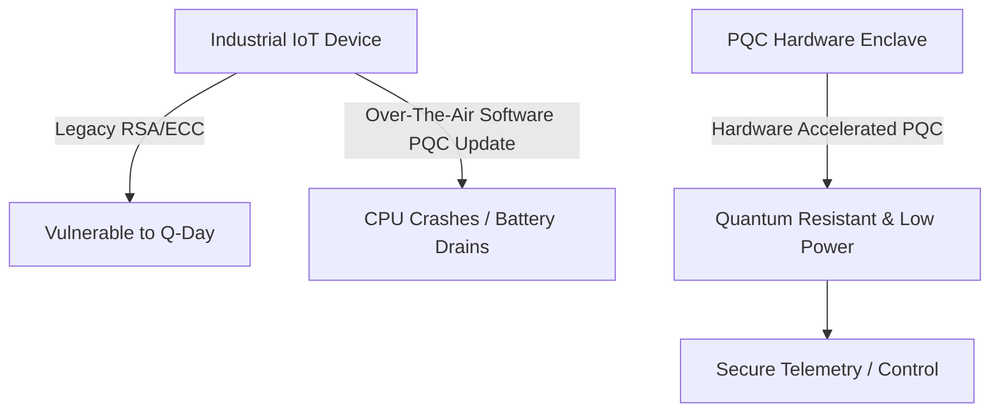
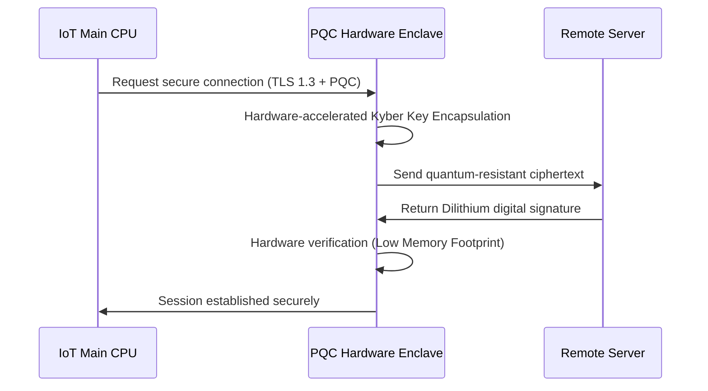

<!-- markdownlint-disable MD009 MD010 MD013 MD022 MD028 MD032 MD033 MD034 MD036 MD037 MD039 MD041 MD058 MD060 -->

[ 🇫🇷 Version Française ](./README.fr.md)

# PQC Hardware Enclave

> **Executive Summary:** A Trusted Execution Environment (TEE) on a chip (SoC/ASIC) hardware-optimized to execute Post-Quantum Cryptography (PQC). It allows resource-constrained industrial IoT devices and telecommunications equipment to migrate to quantum-resistant security without draining their memory or CPU.

---

## 1. Visual Overview & Wow Effect

## 2. Contrarian Thesis (Peter Thiel Style)

- **Popular Belief:** The transition to Post-Quantum Cryptography will be a purely software-based problem, solved by sending Over-The-Air (OTA) updates to existing infrastructure once the NIST standards are finalized.
- **Hidden Truth:** PQC algorithms (like Kyber and Dilithium) require massive memory buffers and bandwidth compared to classical RSA/ECC. Pushing a software update to billions of low-power industrial IoT devices will literally crash them. The quantum transition for embedded systems must happen at the silicon level.

## 3. Problem & Target Market

- **Business Model:** B2B
- **Target Audience:** Industrial IoT manufacturers, telecommunications equipment providers, and defense contractors.
- **Urgent Pain Point:** As fault-tolerant quantum computers approach (Q-Day), current asymmetric cryptography is rendered obsolete. Updating existing embedded fleets (IoT, edge routers) to post-quantum algorithms is physically impossible due to the severe memory and computational constraints of these small devices.

## 4. Technical Architecture & Infrastructure

## 5. Business Model & Financial Viability

| Metric                     | Value                                                                       |
| :------------------------- | :-------------------------------------------------------------------------- |
| **Pricing Structure**      | IP licensing fee per chip manufactured (Royalties) + Integration consulting |
| **12-Month Target**        | 2 major IoT/Telecom equipment manufacturers                                 |
| **Revenue Formula**        | 2 clients \* €50,000 IP License = €100,000                                  |
| **Estimated Gross Margin** | 90% (IP/Software model)                                                     |

## 6. Distribution Engine & Moat

- **Acquisition Strategy:** Direct sales to semiconductor design firms (fabless) and major IoT equipment manufacturers, leveraging the strict new compliance mandates from government defense agencies regarding PQC readiness.
- **Moat (Defensibility):** Designing silicon-level Trusted Execution Environments requires deep expertise in hardware description languages (Verilog/VHDL), cryptography, and electrical engineering. This is a deep-tech, long-cycle development totally immune to standard generative AI or software-only competitors.

## 7. Detailed Evaluation Grid

| Criterion                       | VC Score (/100) | Market Score (/100) |
| :------------------------------ | :-------------- | :------------------ |
| **Thesis & Monopoly / Urgency** | -- / 25         | -- / 25             |
| **Moat / LLM Immunity**         | -- / 25         | -- / 25             |
| **Scalability / UX Friction**   | -- / 25         | -- / 25             |
| **Unit Economics / ROI**        | -- / 25         | -- / 25             |
| **TOTAL**                       | **-- / 100**    | **-- / 100**        |

> **VC Verdict:** Pending evaluation.

> **Market Verdict:** Pending evaluation.
