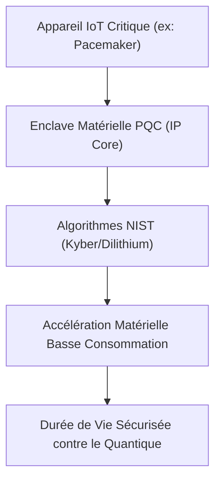
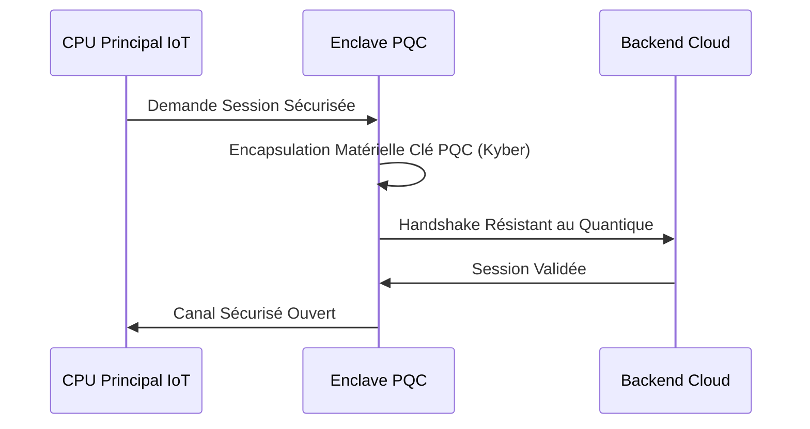

<!-- markdownlint-disable MD009 MD010 MD013 MD022 MD028 MD032 MD033 MD034 MD036 MD037 MD039 MD041 MD058 MD060 -->

[🇬🇧 English Version](./README.md)

# PQC IoT Enclave Microchip

> **Résumé exécutif :** Une IP Core d'enclave sécurisée matérielle offrant une accélération native de cryptographie post-quantique pour les appareils IoT à très faible consommation.

---

## 1. Aperçu visuel & Effet Wahou

## 2. La thèse contrariante (Peter Thiel Style)

La croyance populaire : Nous pourrons protéger les appareils IoT existants contre l'informatique quantique avec de simples mises à jour logicielles OTA.
La vérité cachée : L'implémentation logicielle du PQC sur de petits microcontrôleurs consomme trop de batterie et ralentit l'appareil. Seule une accélération matérielle dédiée (ASIC/IP Core) rend le PQC viable sur le Edge.

## 3. Le problème & La cible

Modèle économique : B2B
Cible précise : Fabricants d'appareils médicaux, Constructeurs automobiles, Industriels IoT (Chief Product Security Officers).
La douleur urgente : Des milliards de dispositifs IoT critiques (déployés pour des décennies) utilisent une cryptographie obsolète face aux ordinateurs quantiques (Harvest Now, Decrypt Later). Ils ne peuvent pas être mis à jour uniquement via logiciel.

## 4. Architecture technique & Plomberie

## 5. Modèle économique & Viabilité financière

| Métrique                    | Valeur                                            |
| --------------------------- | ------------------------------------------------- |
| Structure de prix           | Frais de licence IP + royalties par puce          |
| Objectif 12 mois            | 3 contrats d'intégration avec des fondeurs Tier-1 |
| Calcul du CA (Target 100k€) | 3 licences _ 1M€ + 10M puces _ 0.05€              |
| Marge brute estimée         | 95%                                               |

## 6. Moteur de distribution & Fossé défensif (Moat)

Stratégie d'acquisition : Licensing direct aux concepteurs de puces fabless, vendeurs de microcontrôleurs et intégrateurs.
Moat (Barrière à l'entrée) : La conception silicium pour l'accélération cryptographique basse conso est ultra-spécialisée. Le moat est l'IP physique (GDSII) optimisée qui équilibre les contraintes PPA avec les complexes mathématiques PQC.

## 7. Grille d'évaluation détaillée

| Critère                           | Score VC (/100) | Score Terrain (/100) |
| --------------------------------- | --------------- | -------------------- |
| Thèse & Monopole / Urgence        | -- / 25         | -- / 25              |
| Moat / Résistance aux LLM natifs  | -- / 25         | -- / 25              |
| Scalabilité / Friction d'adoption | -- / 25         | -- / 25              |
| Unit Economics / ROI direct       | -- / 25         | -- / 25              |
| **TOTAL**                         | **-- / 100**    | **-- / 100**         |

> **Verdict VC :** En attente d'évaluation.
> **Verdict Terrain :** En attente d'évaluation.
