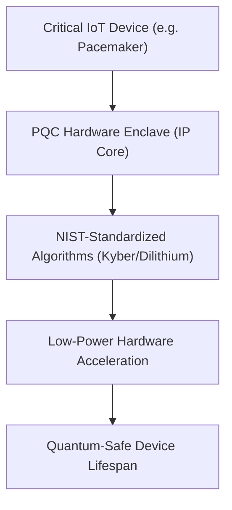
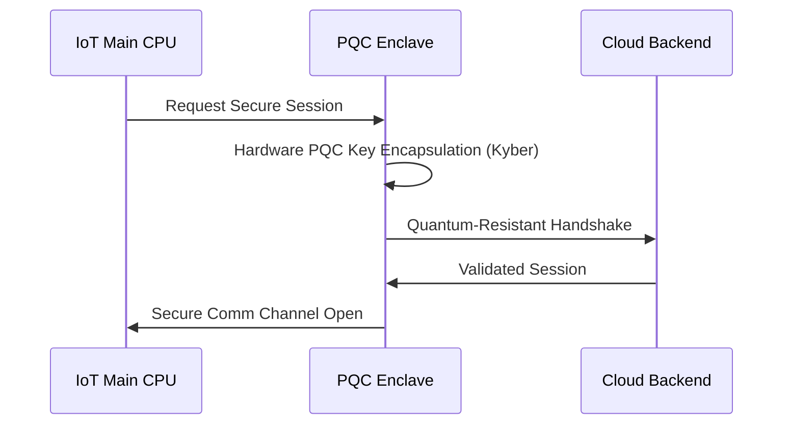

<!-- markdownlint-disable MD009 MD010 MD013 MD022 MD028 MD032 MD033 MD034 MD036 MD037 MD039 MD041 MD058 MD060 -->

[🇫🇷 Version Française](./README.fr.md)

# PQC IoT Enclave Microchip

> **Executive Summary:** A hardware secure enclave IP core providing native Post-Quantum Cryptography acceleration for ultra-low-power IoT devices.

---

## 1. Visual Overview & Wow Effect

## 2. Contrarian Thesis (Peter Thiel Style)

Popular Belief: We can protect current IoT devices from future quantum computer attacks simply by pushing over-the-air (OTA) software updates with new algorithms.
Hidden Truth: Software implementations of Post-Quantum Cryptography on small microcontrollers drain battery life, cause overheating, and introduce severe latency. It requires dedicated hardware acceleration (ASIC/IP Core) to be viable at the edge.

## 3. Problem & Target Market

Business Model: B2B
Target Audience: Medical device manufacturers, Automotive OEMs, Industrial IoT builders (Chief Product Security Officers).
Urgent Pain Point: Billions of critical IoT devices (pacemakers, smart meters, car brakes) are deployed for decades using legacy cryptography (RSA, ECC). They are vulnerable to 'Harvest Now, Decrypt Later' quantum attacks and cannot be upgraded via software alone.

## 4. Technical Architecture & Infrastructure

## 5. Business Model & Financial Viability

| Metric                 | Value                                    |
| ---------------------- | ---------------------------------------- |
| Pricing Structure      | IP licensing fee + per-chip royalty      |
| 12-Month Target        | 3 Tier-1 semiconductor integration deals |
| Revenue Formula        | 3 licenses _ $1M + 10M chips _ $0.05     |
| Estimated Gross Margin | 95%                                      |

## 6. Distribution Engine & Moat

Acquisition Strategy: Direct licensing to fabless chip designers, micro-controller vendors (STMicro, NXP) and system integrators.
Moat (Defensibility): Silicon design for ultra-low-power cryptographic acceleration is incredibly specialized. The moat is the highly optimized physical IP layout (GDSII) that balances PPA constraints with complex NIST-standardized PQC math.

## 7. Detailed Evaluation Grid

| Criterion                   | VC Score (/100) | Market Score (/100) |
| --------------------------- | --------------- | ------------------- |
| Thesis & Monopoly / Urgency | -- / 25         | -- / 25             |
| Moat / LLM Immunity         | -- / 25         | -- / 25             |
| Scalability / UX Friction   | -- / 25         | -- / 25             |
| Unit Economics / ROI        | -- / 25         | -- / 25             |
| **TOTAL**                   | **-- / 100**    | **-- / 100**        |

> **VC Verdict:** Pending evaluation.
> **Market Verdict:** Pending evaluation.
