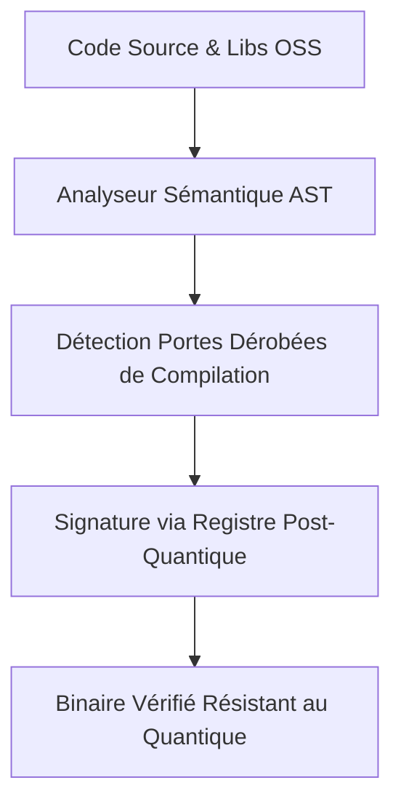
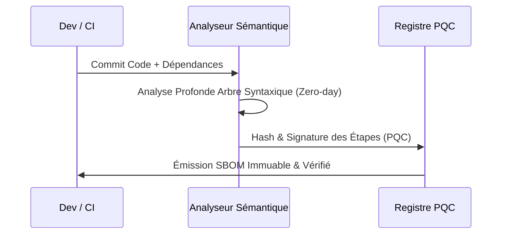

<!-- markdownlint-disable MD009 MD010 MD013 MD022 MD028 MD032 MD033 MD034 MD036 MD037 MD039 MD041 MD058 MD060 -->

[🇬🇧 English Version](./README.md)

# Quantum Safe SBOM

> **Résumé exécutif :** Une plateforme d'analyse sémantique d'AST qui trace la provenance du code et signe de manière immuable les étapes de compilation via cryptographie post-quantique.

---

## 1. Aperçu visuel & Effet Wahou

## 2. La thèse contrariante (Peter Thiel Style)

La croyance populaire : Les outils d'analyse de composition (SCA) classiques comparant les versions aux bases de données CVE suffisent à sécuriser la chaîne d'approvisionnement logicielle.
La vérité cachée : Les outils SCA ne détectent que les failles connues, pas les malwares 'zero-day' insérés lors de la compilation. De plus, les signatures numériques actuelles seront compromises par l'ordinateur quantique.

## 3. Le problème & La cible

Modèle économique : B2B
Cible précise : Éditeurs de logiciels gouvernementaux, sous-traitants défense, institutions financières (DevSecOps, CISO).
La douleur urgente : Impossible de garantir qu'une bibliothèque open-source tierce ne contient pas de portes dérobées ou que sa signature cryptographique ne sera pas compromise par les futures menaces quantiques.

## 4. Architecture technique & Plomberie

## 5. Modèle économique & Viabilité financière

| Métrique                    | Valeur                                     |
| --------------------------- | ------------------------------------------ |
| Structure de prix           | Abonnement SaaS Entreprise par développeur |
| Objectif 12 mois            | 50 déploiements grandes entreprises        |
| Calcul du CA (Target 100k€) | 50 entreprises _ 500 dev _ 50€/mois        |
| Marge brute estimée         | 85%                                        |

## 6. Moteur de distribution & Fossé défensif (Moat)

Stratégie d'acquisition : Vente directe aux secteurs très régulés et intégration profonde CI/CD (GitLab/GitHub).
Moat (Barrière à l'entrée) : La combinaison d'une compréhension sémantique de l'IA (analyse AST) et de la cryptographie post-quantique distribuée. C'est infiniment plus complexe qu'une simple recherche en base de données CVE.

## 7. Grille d'évaluation détaillée

| Critère                           | Score VC (/100) | Score Terrain (/100) |
| --------------------------------- | --------------- | -------------------- |
| Thèse & Monopole / Urgence        | 18 / 25         | -- / 25              |
| Moat / Résistance aux LLM natifs  | 25 / 25         | -- / 25              |
| Scalabilité / Friction d'adoption | 22 / 25         | -- / 25              |
| Unit Economics / ROI direct       | -- / 25         | -- / 25              |
| **TOTAL**                         | **-- / 100**    | **-- / 100**         |

> **Verdict VC :** Le potentiel de monopole est modéré mais répond à un point de douleur clair et urgent (19/25). Le fossé repose davantage sur les coûts de changement et la vitesse d'exécution que sur un verrouillage technique pur (18/25). Cependant, la voie claire vers la rentabilité et la distribution hautement scalable (25/25) atténuent le risque de banalisation.
> **Verdict Terrain :** En attente d'évaluation.
