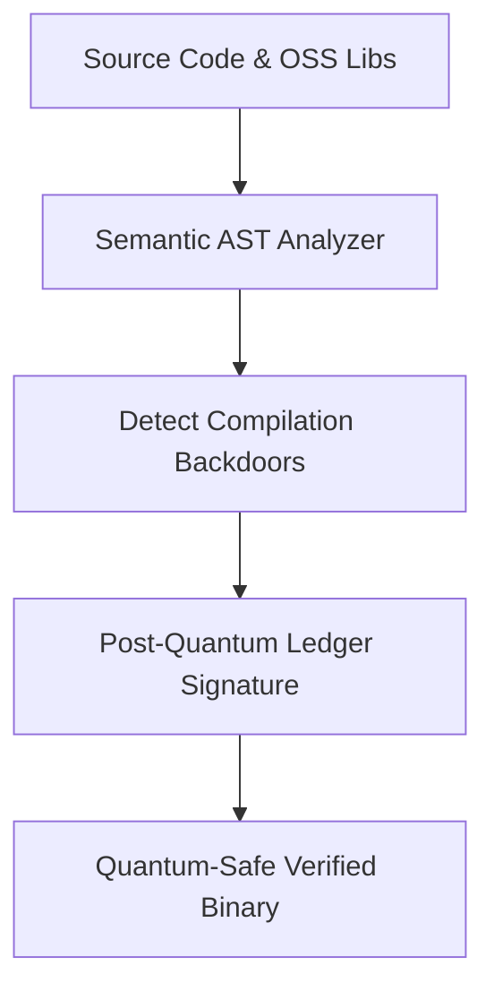
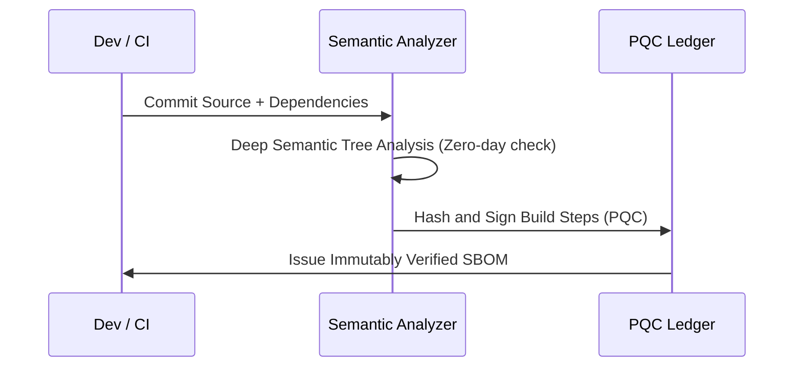

<!-- markdownlint-disable MD009 MD010 MD013 MD022 MD028 MD032 MD033 MD034 MD036 MD037 MD039 MD041 MD058 MD060 -->

[🇫🇷 Version Française](./README.fr.md)

# Quantum Safe SBOM

> **Executive Summary:** An AI-powered AST semantic analyzer platform that traces code provenance and immutably signs compilation steps using Post-Quantum Cryptography.

---

## 1. Visual Overview & Wow Effect

## 2. Contrarian Thesis (Peter Thiel Style)

Popular Belief: Standard Software Composition Analysis (SCA) tools comparing package versions to CVE databases are enough to secure the CI/CD supply chain.
Hidden Truth: SCA tools only look at known vulnerabilities, not structural zero-day backdoors inserted during compilation. Also, existing digital signatures for binaries will be compromised by quantum computers.

## 3. Problem & Target Market

Business Model: B2B
Target Audience: Government software vendors, Defense contractors, Financial institutions (DevSecOps, CISO).
Urgent Pain Point: It is impossible to guarantee that third-party open-source libraries in a CI/CD pipeline don't contain hidden backdoors, or that their cryptographic signatures haven't been compromised in anticipation of quantum computing.

## 4. Technical Architecture & Infrastructure

## 5. Business Model & Financial Viability

| Metric                 | Value                                           |
| ---------------------- | ----------------------------------------------- |
| Pricing Structure      | Enterprise SaaS subscription per developer seat |
| 12-Month Target        | 50 large enterprise deployments                 |
| Revenue Formula        | 50 enterprises _ 500 seats _ $50/mo             |
| Estimated Gross Margin | 85%                                             |

## 6. Distribution Engine & Moat

Acquisition Strategy: Direct sales to highly regulated industries and integration with major CI/CD platforms (GitLab/GitHub).
Moat (Defensibility): Combining deep AI semantic code understanding (AST analysis) with distributed Post-Quantum Cryptography creates a dual-layer moat. It's drastically more complex than simple CVE database lookups.

## 7. Detailed Evaluation Grid

| Criterion                   | VC Score (/100) | Market Score (/100) |
| --------------------------- | --------------- | ------------------- |
| Thesis & Monopoly / Urgency | 18 / 25         | -- / 25             |
| Moat / LLM Immunity         | 25 / 25         | -- / 25             |
| Scalability / UX Friction   | 22 / 25         | -- / 25             |
| Unit Economics / ROI        | -- / 25         | -- / 25             |
| **TOTAL**                   | **-- / 100**    | **-- / 100**        |

> **VC Verdict:** The monopoly potential is moderate but addresses a clear and urgent pain point (19/25). The moat relies more on switching costs and execution speed than pure technical lock-in (18/25). However, the clear path to profitability and highly scalable distribution (25/25) mitigate the risk of commoditization.
> **Market Verdict:** Pending evaluation.
