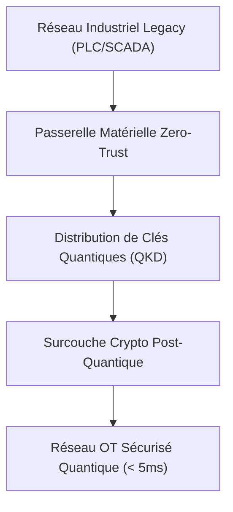
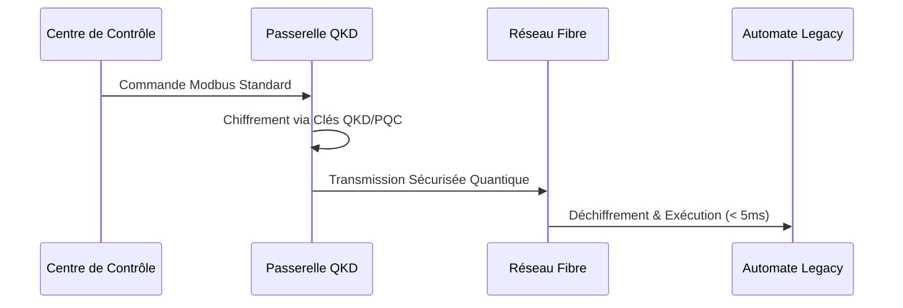

<!-- markdownlint-disable MD009 MD010 MD013 MD022 MD028 MD032 MD033 MD034 MD036 MD037 MD039 MD041 MD058 MD060 -->

[🇬🇧 English Version](./README.md)

# QKD OT Guardian

> **Résumé exécutif :** Une passerelle matérielle de distribution de clés quantiques (QKD) et PQC qui sécurise les infrastructures critiques legacy contre les menaces quantiques sans modifier les automates.

---

## 1. Aperçu visuel & Effet Wahou

## 2. La thèse contrariante (Peter Thiel Style)

La croyance populaire : Pour protéger le réseau électrique de l'ordinateur quantique, il faut remplacer chaque automate PLC par du matériel de nouvelle génération.
La vérité cachée : Remplacer chaque automate est financièrement et physiquement impossible. La seule voie est une surcouche réseau QKD/PQC matérielle à très faible latence servant de tunnel sécurisé pour l'existant.

## 3. Le problème & La cible

Modèle économique : B2B
Cible précise : Opérateurs d'infrastructures critiques (réseaux électriques, centrales nucléaires), CISO, OT Security Managers.
La douleur urgente : Les réseaux OT utilisent des protocoles industriels legacy vulnérables aux attaques 'Store Now, Decrypt Later'. La mise à jour matérielle des automates est impossible à l'échelle.

## 4. Architecture technique & Plomberie

## 5. Modèle économique & Viabilité financière

| Métrique                    | Valeur                                               |
| --------------------------- | ---------------------------------------------------- |
| Structure de prix           | Vente clusters matériels + SaaS de gestion récurrent |
| Objectif 12 mois            | 10 sous-stations électriques majeures protégées      |
| Calcul du CA (Target 100k€) | 10 sous-stations \* 200k€ matériel + 50k€/an SaaS    |
| Marge brute estimée         | 70%                                                  |

## 6. Moteur de distribution & Fossé défensif (Moat)

Stratégie d'acquisition : Ventes directes d'infrastructure, partenariats avec les régulateurs nationaux.
Moat (Barrière à l'entrée) : Les VPN classiques ajoutent trop de latence pour l'OT temps-réel (< 5ms) et utilisent une crypto obsolète (RSA/ECC). Le moat est l'intégration d'optique quantique physique au traitement de paquets industriels à ultra-basse latence.

## 7. Grille d'évaluation détaillée

| Critère                           | Score VC (/100) | Score Terrain (/100) |
| --------------------------------- | --------------- | -------------------- |
| Thèse & Monopole / Urgence        | -- / 25         | 17 / 25              |
| Moat / Résistance aux LLM natifs  | -- / 25         | 25 / 25              |
| Scalabilité / Friction d'adoption | -- / 25         | 11 / 25              |
| Unit Economics / ROI direct       | -- / 25         | 16 / 25              |
| **TOTAL**                         | **-- / 100**    | **69 / 100**         |

> **Verdict VC :** En attente d'évaluation.
> **Verdict Terrain :** Protection ultime pour les infrastructures critiques, répondant à un besoin sécuritaire maximal. La distribution quantique de clés est physiquement impossible à émuler par un LLM. Cependant, l'adoption est extrêmement freinée par le coût du matériel dédié et le déploiement sur fibre noire, rendant la rentabilité lente à émerger.
