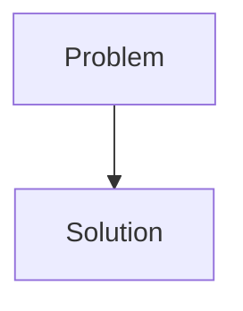
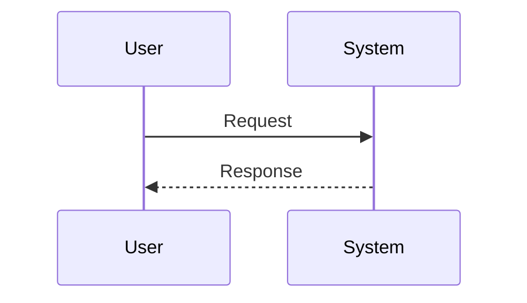

<!-- markdownlint-disable MD009 MD010 MD013 MD022 MD028 MD032 MD033 MD034 MD036 MD037 MD039 MD041 MD058 MD060 -->
<!-- markdownlint-disable MD033 MD041 -->

[🇫🇷 Version Française](./README.fr.md)

# QBattSim

> **Executive Summary:** Quantum Battery & Material Simulator

---

## 1. Visual Overview & Wow Effect

## 2. Contrarian Thesis (Peter Thiel Style)

- **Popular Belief:** [What the consensus thinks about this market]
- **Hidden Truth:** [The non-intuitive reality leveraged by this startup]

## 3. Problem & Target Market

- **Business Model:** B2B
- **Target Audience:** R&D departments of battery manufacturers (CATL, Panasonic, Northvolt), automotive manufacturers (EVs) and materials chemistry companies.
- **Urgent Pain Point:** The discovery of new materials for solid-state batteries or high energy density batteries (Sodium-Ion, Lithium-Sulfur) blocks the barrier of simulation. The exact quantum chemistry of molecular interactions (EQV, DFT) is incalculable on conventional supercomputers, forcing massive approximations that slow down R&D via slow and expensive physical lab trials and errors.

## 4. Technical Architecture & Infrastructure

## 5. Business Model & Financial Viability

| Metric                     | Value                                     |
| -------------------------- | ----------------------------------------- |
| **Pricing Structure**      | [Price / Subscription Model / Commission] |
| **12-Month Target**        | [Exact volume required for 100k ARR]      |
| **Revenue Formula**        | [Mathematical calculation]                |
| **Estimated Gross Margin** | [Margin %]                                |

## 6. Distribution Engine & Moat

- **Acquisition Strategy:** [Virality, network effect, direct sales, developer adoption]
- **Moat (Defensibility):** Conventional molecular material simulation software uses Density Functional Theory (DFT) which approaches its theoretical limits (too many approximations for highly correlated materials). An LLM SaaS is useless here; it is about solving complex N-body Schrödinger equations.

## 7. Detailed Evaluation Grid

| Criterion                       | VC Score (/100) | Market Score (/100) |
| ------------------------------- | --------------- | ------------------- |
| **Thesis & Monopoly / Urgency** | -- / 25         | -- / 25             |
| **Moat / LLM Immunity**         | -- / 25         | -- / 25             |
| **Scalability / UX Friction**   | -- / 25         | -- / 25             |
| **Unit Economics / ROI**        | -- / 25         | -- / 25             |
| **TOTAL**                       | **-- / 100**    | **-- / 100**        |

> **VC Verdict:** Pending evaluation.
>
> **Market Verdict:** Pending evaluation.
