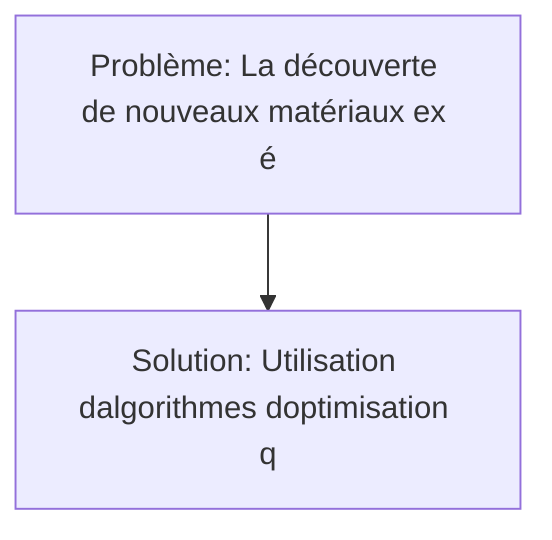
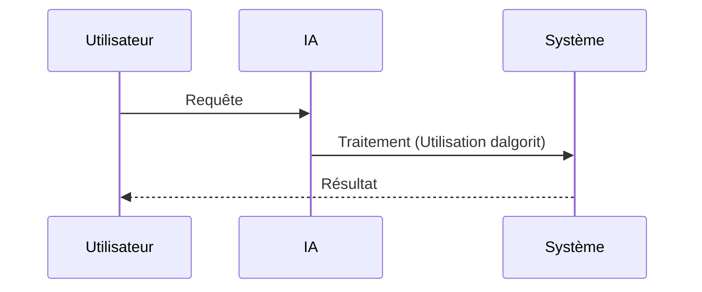

<!-- markdownlint-disable MD013 MD033 MD041 -->

[🇬🇧 English Version](./README.md)

# Quantum-Enhanced Materials Discovery

> **Résumé exécutif :** Une solution B2B ciblant Industries chimiques, constructeurs automobiles (batteries), aérospatial, entreprises d'énergies renouvelables (photovoltaïque) pour résoudre le problème suivant : La découverte de nouveaux matériaux (ex: électrolytes solides pour batteries haute densité, catalyseurs efficaces) repose sur l'essai-erreur en laboratoire ou des simulations sur supercalculateurs classiques, qui sont incapables de modéliser précisément les interactions corrélées des électrons à grande échelle, limitant la vitesse d'innovation climatique et industrielle. L'approche repose sur : Utilisation d'algorithmes d'optimisation quantique (VQE, QAOA) et de simulation hamiltonienne couplés à des réseaux de tenseurs sur des processeurs quantiques NISQ, pour simuler la chimie quantique des molécules complexes et des réseaux cristallins avec une précision inaccessible aux machines classiques.

---

## 1. Aperçu visuel & Effet Wahou

## 2. La thèse contrariante (Peter Thiel Style)

- **La croyance populaire :** Une approche générique SaaS classique est suffisante.
- **La vérité cachée :** La complexité de modélisation de la structure électronique croît de manière exponentielle avec le nombre d'atomes. Un cluster de serveurs AWS classique prendrait des milliards d'années pour calculer précisément l'état fondamental de grosses molécules actives, un problème intrinsèquement conçu pour le calcul quantique.

## 3. Le problème & La cible

- **Modèle économique :** B2B
- **Cible précise :** Industries chimiques, constructeurs automobiles (batteries), aérospatial, entreprises d'énergies renouvelables (photovoltaïque)
- **La douleur urgente :** La découverte de nouveaux matériaux (ex: électrolytes solides pour batteries haute densité, catalyseurs efficaces) repose sur l'essai-erreur en laboratoire ou des simulations sur supercalculateurs classiques, qui sont incapables de modéliser précisément les interactions corrélées des électrons à grande échelle, limitant la vitesse d'innovation climatique et industrielle.

## 4. Architecture technique & Plomberie

Utilisation d'algorithmes d'optimisation quantique (VQE, QAOA) et de simulation hamiltonienne couplés à des réseaux de tenseurs sur des processeurs quantiques NISQ, pour simuler la chimie quantique des molécules complexes et des réseaux cristallins avec une précision inaccessible aux machines classiques.

## 5. Modèle économique & Viabilité financière

| Métrique                    | Valeur                             |
| --------------------------- | ---------------------------------- |
| Structure de prix           | Abonnement / Licence B2B           |
| Objectif 12 mois            | 100 clients (ou volume équivalent) |
| Calcul du CA (Target 100k€) | 100 \* 1000€ = 100k€               |
| Marge brute estimée         | 80%                                |

## 6. Moteur de distribution & Fossé défensif (Moat)

- **Stratégie d'acquisition :** Ventes directes et partenariats dans le domaine : Quantique
- **Moat (Barrière à l'entrée) :** La complexité de modélisation de la structure électronique croît de manière exponentielle avec le nombre d'atomes. Un cluster de serveurs AWS classique prendrait des milliards d'années pour calculer précisément l'état fondamental de grosses molécules actives, un problème intrinsèquement conçu pour le calcul quantique. Les risques incluent : Dépendance critique à la feuille de route matérielle des constructeurs d'ordinateurs quantiques (taux d'erreur, nombre de qubits logiques), le "Quantum Winter" si le matériel stagne, et la difficulté de recruter des talents à la croisée de la chimie théorique et du software quantique.

## 7. Grille d'évaluation détaillée

| Critère                           | Score VC (/100) | Score Terrain (/100) |
| --------------------------------- | --------------- | -------------------- |
| Thèse & Monopole / Urgence        | -- / 25         | 20 / 25              |
| Moat / Résistance aux LLM natifs  | -- / 25         | 25 / 25              |
| Scalabilité / Friction d'adoption | -- / 25         | 12 / 25              |
| Unit Economics / ROI direct       | -- / 25         | 19 / 25              |
| **TOTAL**                         | -- / 100        | 76 / 100             |

> **Verdict VC :** En attente d'évaluation.
> **Verdict Terrain :** Immense désirabilité pour les applications en science des matériaux nécessitant des calculs à grande échelle. Immunité totale face aux LLMs puisque cela requiert des abstractions de calcul quantique et des intégrations matérielles spécifiques. Très forte friction d'adoption car le matériel quantique est rare, mais la monétisation est claire pour les grands départements R&D d'entreprises.
