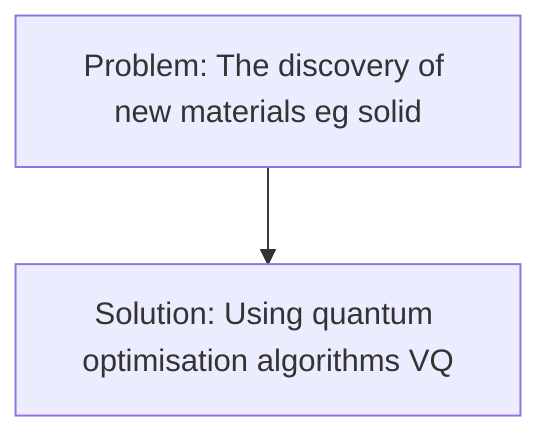
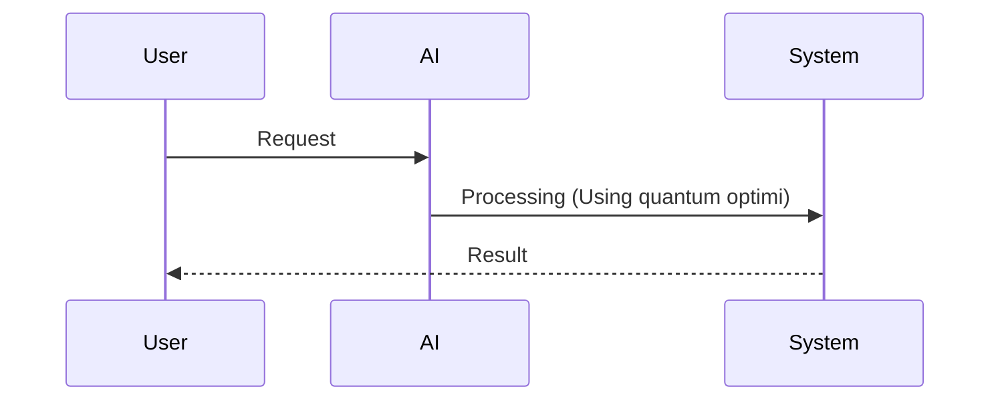

<!-- markdownlint-disable MD013 MD033 MD041 -->

[🇫🇷 Version Française](./README.fr.md)

# Quantum-Enhanced Materials Discovery

> **Executive Summary:** A B2B solution targeting Chemical industries, automotive manufacturers (batteries), aerospace, renewable energy companies (photovoltaic) to solve the following problem: The discovery of new materials (e.g. solid electrolytes for high-density batteries, efficient catalysts) is based on laboratory error testing or conventional supercomputer simulations, which are unable to accurately model the correlated interactions of large-scale electrons, limiting the speed of climate and industrial innovation. The approach relies on: Using quantum optimisation algorithms (VQE, QAOA) and Hamilton simulation coupled with tensor networks on NISQ quantum processors, to simulate the quantum chemistry of complex molecules and crystalline networks with precision inaccessible to conventional machines.

---

## 1. Visual Overview & Wow Effect

## 2. Contrarian Thesis (Peter Thiel Style)

- **Popular Belief:** A generic SaaS approach is sufficient.
- **Hidden Truth:** The complexity of modelling the electronic structure increases exponentially with the number of atoms. A classic AWS server cluster would take billions of years to accurately calculate the ground state of large active molecules, an intrinsically designed problem for quantum computing.

## 3. Problem & Target Market

- **Business Model:** B2B
- **Target Audience:** Chemical industries, automotive manufacturers (batteries), aerospace, renewable energy companies (photovoltaic)
- **Urgent Pain Point:** The discovery of new materials (e.g. solid electrolytes for high-density batteries, efficient catalysts) is based on laboratory error testing or conventional supercomputer simulations, which are unable to accurately model the correlated interactions of large-scale electrons, limiting the speed of climate and industrial innovation.

## 4. Technical Architecture & Infrastructure

Using quantum optimisation algorithms (VQE, QAOA) and Hamilton simulation coupled with tensor networks on NISQ quantum processors, to simulate the quantum chemistry of complex molecules and crystalline networks with precision inaccessible to conventional machines.

## 5. Business Model & Financial Viability

| Metric                 | Value                              |
| ---------------------- | ---------------------------------- |
| Pricing Structure      | B2B Subscription / License         |
| 12-Month Target        | 100 clients (or equivalent volume) |
| Revenue Formula        | 100 \* 1000€ = 100k€               |
| Estimated Gross Margin | 80%                                |

## 6. Distribution Engine & Moat

- **Acquisition Strategy:** Direct sales and partnerships in the domain: Quantum
- **Moat (Defensibility):** The complexity of modelling the electronic structure increases exponentially with the number of atoms. A classic AWS server cluster would take billions of years to accurately calculate the ground state of large active molecules, an intrinsically designed problem for quantum computing. Risks include: Critical dependence on the hardware roadmap of quantum computer manufacturers (error rate, number of logical quotches), the "Quantum Winter" if the hardware stagnates, and the difficulty of recruiting talent at the crossroads of theoretical chemistry and quantum software.

## 7. Detailed Evaluation Grid

| Criterion                   | VC Score (/100) | Market Score (/100) |
| --------------------------- | --------------- | ------------------- |
| Thesis & Monopoly / Urgency | -- / 25         | 20 / 25             |
| Moat / LLM Immunity         | -- / 25         | 25 / 25             |
| Scalability / UX Friction   | -- / 25         | 12 / 25             |
| Unit Economics / ROI        | -- / 25         | 19 / 25             |
| **TOTAL**                   | -- / 100        | 76 / 100            |

> **VC Verdict:** Pending evaluation.
> **Market Verdict:** Huge desirability for materials science applications needing massive scale computation. Total immunity to LLMs as this requires quantum computing abstractions and specific hardware integrations. Very high adoption friction since quantum hardware is scarce, but monetization is clear for large enterprise R&D departments.
